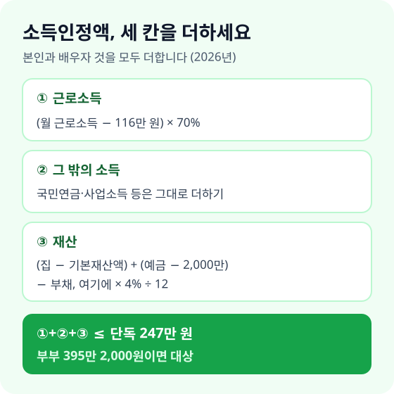
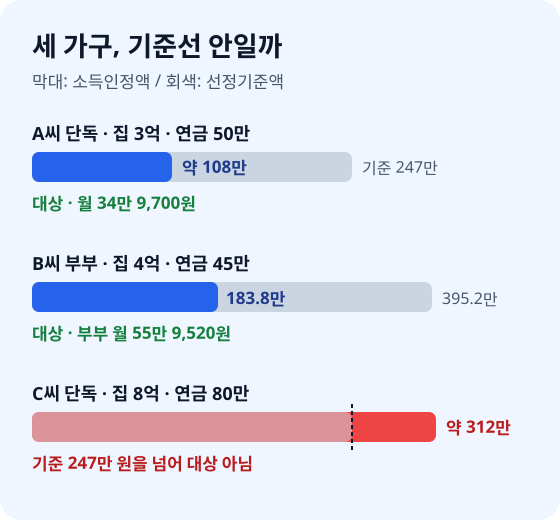

> **바쁜 분을 위한 3줄 요약**
>
> 1. 집 공시가격, 예금, 국민연금 수령액을 적어 **소득인정액부터 계산하세요**.
> 2. 65세 생일이 다가온다면 **생일이 속한 달의 한 달 전에 신청하세요**.
> 3. 작년에 떨어졌다면 선정기준액이 올랐으니 **올해 다시 확인하세요**.

부모님 댁 식탁에 국민연금공단에서 온 안내 우편이 놓여 있습니다. "기초연금 신청 안내"라고 적혀 있지만, 부모님은 "집이 있어서 우리는 안 된대"라며 봉투를 그대로 두셨습니다.

기초연금은 집이 있다고 바로 떨어지는 제도가 아닙니다. 집값과 예금을 "한 달 소득"으로 바꿔 계산한 뒤 기준선과 비교합니다. 2026년 11월 기준 보건복지부 발표와 기초연금법 조문으로 확인한 숫자로, 직접 계산하는 순서를 정리했습니다.

## 2026년 기준선은 단독 247만 원, 부부 395만 2,000원입니다

65세 이상이고 소득인정액이 단독가구 월 247만 원, 부부가구 월 395만 2,000원 이하이면 기초연금을 받습니다. 2025년 228만 원보다 19만 원 올랐습니다.

이 기준선을 선정기준액이라고 부릅니다. 보건복지부는 65세 이상 가운데 수급자가 70% 수준이 되도록 매년 이 금액을 정합니다([기초연금법 제3조](<https://www.law.go.kr/법령/기초연금법/제3조>)). 부부가구 기준은 단독가구의 160%입니다([기초연금법 시행령 제4조](<https://www.law.go.kr/법령/기초연금법시행령/제4조>)).

| 구분 | 2025년 | 2026년 |
|---|---|---|
| 단독가구 선정기준액 | 228만 원 | 247만 원 |
| 부부가구 선정기준액 | 364만 8,000원 | 395만 2,000원 |
| 한 달 최대 금액(단독) | 34만 2,510원 | 34만 9,700원 |
| 부부가 함께 받을 때 합계 | 54만 8,000원 | 55만 9,520원 |

출처: 보건복지부 보도자료 [2026년 노인 단독가구, 소득인정액 월 247만 원 이하면 기초연금 받는다](<https://www.korea.kr/briefing/pressReleaseView.do?newsId=156737807>)(2026년 1월 1일), [국민연금·기초연금 급여 올해 2.1% 인상 확정](<https://www.korea.kr/briefing/pressReleaseView.do?newsId=156739113>)(2026년 1월 9일).

한 달 최대 금액인 기준연금액은 전년도 물가상승률 2.1%를 반영해 올렸습니다. 부부가 둘 다 받으면 각자 금액에서 20%를 줄입니다([기초연금법 제8조](<https://www.law.go.kr/법령/기초연금법/제8조>)). 그래서 부부 합계는 34만 9,700원의 두 배가 아니라 55만 9,520원입니다.

## 소득인정액은 세 칸으로 나눠 계산하세요

소득인정액은 "소득평가액 + 재산의 소득환산액"입니다([기초연금법 제2조](<https://www.law.go.kr/법령/기초연금법/제2조>)). 본인과 배우자의 것을 모두 더합니다.

종이 한 장에 칸 세 개를 그리고 아래 순서로 채우세요.

**첫째 칸, 근로소득입니다.** 한 달 근로소득에서 116만 원을 빼고 70%만 반영합니다. 예를 들어 월 150만 원을 번다면 (150만 − 116만) × 70%로 23만 8,000원입니다.

**둘째 칸, 그 밖의 소득입니다.** 국민연금, 사업소득, 이자·연금소득은 대부분 그대로 더합니다. 국민연금을 월 50만 원 받는다면 50만 원이 그대로 들어갑니다.

**셋째 칸, 재산입니다.** 집·토지·전세보증금 같은 일반재산에서 기본재산액을 빼고, 금융재산에서 2,000만 원을 뺍니다. 여기서 부채를 뺀 금액에 연 4%를 곱하고 12로 나눕니다([기초연금법 시행규칙 제4조](<https://www.law.go.kr/법령/기초연금법시행규칙/제4조>)).

| 사는 곳 | 빼 주는 기본재산액 |
|---|---|
| 대도시 | 1억 3,500만 원 |
| 중소도시 | 8,500만 원 |
| 농어촌 | 7,250만 원 |

집값은 시세가 아니라 시가표준액(주택은 공시가격)으로 계산합니다([기초연금법 시행규칙 제3조](<https://www.law.go.kr/법령/기초연금법시행규칙/제3조>)). 그래서 시세 10억 원 아파트라도 공시가격이 6억 원이면 6억 원으로 셉니다.

## 우리 집 예시로 직접 계산해 보세요

아래 세 가구는 계산 방법을 보여 주려고 만든 가정입니다. 숫자만 내 상황으로 바꿔 같은 순서로 계산하세요.

**예를 들어 A씨(단독, 대도시)** 는 공시가격 3억 원 아파트, 예금 3,000만 원, 국민연금 월 50만 원이 있습니다.

- 재산: (3억 − 1억 3,500만) + (3,000만 − 2,000만) = 1억 7,500만 원
- 재산 환산: 1억 7,500만 × 4% ÷ 12 = 약 58만 3,000원
- 소득인정액: 50만 + 58만 3,000 = 약 108만 3,000원

247만 원보다 낮으니 대상입니다. 국민연금이 기준연금액의 150%인 52만 4,550원 이하라 깎이지 않고 월 34만 9,700원을 받습니다([기초연금법 제6조](<https://www.law.go.kr/법령/기초연금법/제6조>)).

**예를 들어 B씨 부부(중소도시)** 는 공시가격 4억 원 주택, 예금 5,000만 원이 있습니다. 남편은 국민연금 월 45만 원, 아내는 시간제 일로 월 150만 원을 법니다.

- 재산: (4억 − 8,500만) + (5,000만 − 2,000만) = 3억 4,500만 원
- 재산 환산: 3억 4,500만 × 4% ÷ 12 = 115만 원
- 소득: 국민연금 45만 + 근로 23만 8,000 = 68만 8,000원
- 소득인정액: 115만 + 68만 8,000 = 183만 8,000원

부부 기준 395만 2,000원보다 한참 낮습니다. 두 사람 모두 받고, 20%씩 줄어 각자 27만 9,760원, 합계 월 55만 9,520원입니다. 1년이면 671만 4,240원입니다.

**예를 들어 C씨(단독, 대도시)** 는 공시가격 8억 원 아파트, 예금 5,000만 원, 국민연금 월 80만 원이 있습니다.

- 재산: (8억 − 1억 3,500만) + (5,000만 − 2,000만) = 6억 9,500만 원
- 재산 환산: 6억 9,500만 × 4% ÷ 12 = 약 231만 7,000원
- 소득인정액: 80만 + 231만 7,000 = 약 311만 7,000원

247만 원을 넘어 대상이 아닙니다. 같은 조건에서 공시가격이 약 6억 원 아래였다면 기준선 안에 들어옵니다.

## 국민연금이 많으면 얼마나 깎이는지 확인하세요

국민연금을 월 52만 4,550원 이하로 받으면 기초연금은 깎이지 않습니다. 이 금액은 2026년 기준연금액 34만 9,700원의 150%입니다.

국민연금이 이보다 많으면 국민연금 가운데 소득재분배 몫(흔히 A급여)을 기준으로 일부를 줄입니다. 다만 아무리 줄어도 기준연금액의 절반인 부가연금액 17만 4,850원은 남습니다([기초연금법 제5조](<https://www.law.go.kr/법령/기초연금법/제5조>)).

| 국민연금 월 수령액 | 기초연금 |
|---|---|
| 52만 4,550원 이하 | 34만 9,700원 전액 |
| 52만 4,550원 초과 | 일부 감액 |
| 크게 많아도 | 최소 17만 4,850원 |

정확한 감액 금액은 가입 기간과 소득 이력으로 정해져 국민연금공단에서 확인해야 합니다. 그리고 공무원·군인·사학연금 같은 직역연금을 받는 사람과 그 배우자는 원칙적으로 기초연금 대상에서 빠집니다([기초연금법 제3조](<https://www.law.go.kr/법령/기초연금법/제3조>)).

## 신청한 달부터만 주니 미리 신청하세요

기초연금은 신청한 날이 속한 달부터 줍니다([기초연금법 제14조](<https://www.law.go.kr/법령/기초연금법/제14조>)). 65세가 지나 1년 뒤에 신청하면 그 1년 치는 받지 못합니다.

새로 65세가 되는 사람은 생일이 속한 달의 한 달 전부터 신청할 수 있습니다. 2026년에는 1961년생부터 대상이고, 2027년에는 1962년생이 새로 대상이 됩니다.

신청은 주소지와 상관없이 세 곳 중 한 곳에서 합니다.

| 신청 창구 | 이런 분께 맞아요 |
|---|---|
| 읍·면·동 행정복지센터 | 서류를 직접 내고 싶은 분 |
| 국민연금공단 지사 | 국민연금 감액 상담도 함께 |
| 복지로 누리집 | 공동인증서로 집에서 신청 |

거동이 불편하면 국민연금공단 지사에 "찾아뵙는 서비스"를 요청하세요. 직원이 집으로 와서 신청서를 받습니다.

복지로에서 미리 계산해 볼 수도 있습니다. 순서는 아래와 같습니다.

1. 복지로 누리집에 접속합니다.
2. 상단의 **모의계산** 메뉴를 누르고 **기초연금**을 고릅니다.
3. 가구 형태, 사는 지역, 소득, 재산, 부채를 입력합니다.
4. 결과 화면에서 예상 소득인정액과 수급 가능 여부를 봅니다.

모의계산은 내가 입력한 숫자로만 계산합니다. 실제 조사에서 확인한 금융재산이나 부채가 다르면 결과가 달라질 수 있습니다.

## 이런 실수로 떨어지거나 덜 받습니다

**자녀에게 준 돈도 재산으로 셉니다.** 2011년 7월 이후 다른 사람에게 증여하거나 처분한 재산은 쓴 곳을 증명하지 못하면 내 재산으로 봅니다([기초연금법 시행령 제3조](<https://www.law.go.kr/법령/기초연금법시행령/제3조>)). 신청 직전에 자녀 명의로 옮겨도 소용이 없습니다.

**비싼 차 한 대가 모든 계산을 뒤집습니다.** 4,000만 원 이상 고급 자동차와 골프·콘도 회원권은 4%로 나누지 않고 가액 전부를 한 달 소득으로 봅니다. 차 값이 4,000만 원이면 그 한 대만으로 선정기준액을 훌쩍 넘습니다.

**자녀 명의 고가 주택에 살아도 소득이 잡힙니다.** 부모가 자녀 소유의 일정 가격 이상 주택에 살면 시가표준액에 0.78%를 곱해 12로 나눈 금액을 소득으로 봅니다([기초연금법 시행규칙 제2조](<https://www.law.go.kr/법령/기초연금법시행규칙/제2조>)). 예를 들어 시가표준액 10억 원이면 한 달 65만 원이 소득에 더해집니다.

**한 번 떨어졌다고 포기합니다.** 선정기준액은 해마다 바뀌고 2026년에는 19만 원 올랐습니다. 탈락할 때 "수급희망 이력관리"를 신청해 두면 기준이 바뀌어 받을 수 있게 될 때 5년 동안 안내를 받습니다.

## 상황별로 지금 할 일을 고르세요

| 지금 상황 | 할 일 |
|---|---|
| 64세, 생일 두 달 전 | 다음 달에 신청 서류 준비 |
| 65세 넘었는데 미신청 | 이번 달 안에 바로 신청 |
| 작년에 탈락 | 2026년 기준으로 다시 계산 |
| 국민연금 월 52만 원 넘음 | 공단에서 감액액 확인 |
| 부모님 대신 확인 | 공시가격·예금 먼저 정리 |

부모님 대신 알아본다면 집 공시가격, 예금 합계, 대출, 국민연금 수령액 네 가지만 먼저 여쭤보세요. 이 네 숫자면 위 예시와 같은 순서로 대략 판단할 수 있습니다.

2027년 선정기준액은 시행령에 따라 2026년 12월 31일까지 고시됩니다. 소득인정액이 기준선 근처라면 1월 발표를 보고 다시 계산하세요.

## 자주 묻는 질문

**Q. 2026년 기초연금은 한 달에 얼마인가요?**
단독가구는 최대 월 34만 9,700원입니다. 부부가 함께 받으면 각자 20%씩 줄어 합계 월 55만 9,520원입니다.

**Q. 집이 있으면 기초연금을 못 받나요?**
아닙니다. 대도시는 공시가격에서 1억 3,500만 원을 빼고 남은 금액에 4%를 곱해 12로 나눈 만큼만 소득으로 봅니다. 공시가격 3억 원 아파트라면 한 달 55만 원이 더해지는 정도입니다.

**Q. 국민연금을 받으면 기초연금이 깎이나요?**
국민연금이 월 52만 4,550원 이하면 깎이지 않습니다. 그보다 많으면 일부 줄지만 최소 17만 4,850원은 받습니다.

**Q. 늦게 신청하면 지난 달 치도 받을 수 있나요?**
받을 수 없습니다. 기초연금은 신청한 달부터 주니 생일이 속한 달의 한 달 전부터 신청하세요.

## 신청 전 체크리스트

| 순서 | 할 일 |
|---|---|
| 1 | 집 공시가격·전세보증금 확인 |
| 2 | 예금·보험 해지환급금 합계 적기 |
| 3 | 대출 잔액 적기 |
| 4 | 국민연금 월 수령액 확인 |
| 5 | 소득인정액 계산 후 신청 |

집이 있다는 이유만으로 안내 우편을 덮어 두기에는 한 해 400만 원이 넘는 돈입니다. 이번 주에 부모님과 집 공시가격, 예금, 대출, 국민연금 네 숫자를 함께 적어 보세요.

---

> 📅 **함께 보면 좋은 글**  
> 국민연금을 언제부터 받을지는 [국민연금 조기수령 vs 연기수령](/posts/2026-national-pension-claim-strategy.html)에서, 빈 가입 기간을 채우는 법은 [국민연금 추납·임의가입으로 연금 늘리는 법](/posts/2026-national-pension-voluntary-payment-guide.html)에서 보세요. 집을 연금으로 바꾸는 방법은 [주택연금 가입조건과 수령액](/posts/2026-reverse-mortgage-pension-guide.html), 은퇴 뒤 건강보험료는 [건강보험료 줄이는 법](/posts/2026-health-insurance-premium-saving-guide.html)에 정리했습니다.
