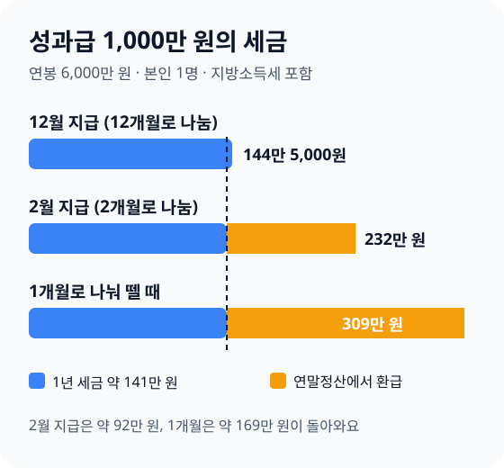
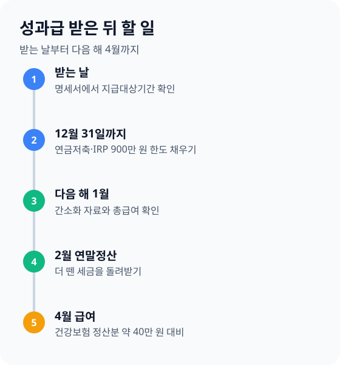

> **바쁜 분을 위한 3줄 요약**
>
> 1. 성과급 명세서에서 소득세가 몇 개월로 나눠 계산됐는지 확인하세요.
> 2. 많이 떼였어도 연말정산에서 돌아오니 1년 세금으로 다시 계산해 보세요.
> 3. 총급여가 5,500만·8,000만 원을 넘는지 보고, 넘으면 연금계좌와 월세 공제 계획을 고치세요.

성과급이 들어온 날, 통장에 찍힌 금액이 공지된 금액보다 한참 적습니다. 1,000만 원이라고 들었는데 700만 원대만 들어왔다면 세금을 너무 많이 뗀 것 같아 급여명세서를 다시 열게 됩니다.

이 글은 2026년 11월 기준 근로소득 간이세액표와 4대보험 요율로 성과급에서 빠지는 돈을 계산했습니다. 숫자는 모두 우리 [연봉 실수령액 계산기](/apps/salary-net-calculator/)와 같은 계산식으로 냈고, 본인 1명·비과세 식대 월 20만 원·원천징수 100%를 가정한 추정치입니다.

## 성과급 1,000만 원이면 약 759만~846만 원이 남습니다

연봉 6,000만 원인 사람이 성과급 1,000만 원을 받으면 12월 지급 때 약 846만 원, 다음 해 2월 지급 때 약 759만 원이 통장에 들어옵니다. 같은 성과급인데 받는 달에 따라 90만 원 가까이 차이가 납니다.

예를 들어 회사원 A씨(가정)의 성과급 1,000만 원에서 빠지는 돈은 아래와 같습니다.

| 빠지는 돈 | 12월 지급 | 2월 지급 |
|---|---|---|
| 소득세 | 131만 3,640원 | 211만 2,040원 |
| 지방소득세 | 13만 1,360원 | 21만 1,200원 |
| 고용보험 0.9% | 9만 원 | 9만 원 |
| 통장에 남는 돈 | 846만 5,000원 | 758만 6,760원 |

차이는 대부분 소득세에서 납니다. 고용보험은 받는 달과 상관없이 성과급의 0.9%를 뗍니다.

## 회사는 성과급을 '지급대상기간'으로 나눠 세금을 뗍니다

회사는 성과급을 지급대상기간의 개월 수로 나눠 월급에 더한 뒤, 그 금액으로 간이세액표 세금을 구하고 다시 개월 수를 곱합니다. 여기서 그동안 월급에서 뗀 세금을 빼면 성과급 세금이 됩니다(소득세법 제136조).

지급대상기간이 정해지지 않은 성과급은 그해 1월 1일부터 받는 달까지를 기간으로 봅니다. 기간의 마지막 달이 아닌 달에 주는 성과급도 기간이 없는 것으로 봅니다([소득세법 시행령 제195조](<https://www.law.go.kr/법령/소득세법시행령/제195조>)).

그래서 12월에 받으면 12개월로 나누고, 2월에 받으면 2개월로만 나눕니다. 나누는 개월 수가 적을수록 한 달 소득이 커 보여 높은 세율 칸이 적용됩니다.

**A씨가 12월에 받는 경우(가정)**

- 월 과세 급여 480만 원 + 성과급 1,000만 원 ÷ 12 = 월 563만 3,333원
- 563만 원대 간이세액 × 12개월 − 그동안 뗀 월 30만 2,760원 × 12개월
- 성과급 소득세 131만 3,640원

**같은 성과급을 2월에 받는 경우(가정)**

- 월 480만 원 + 1,000만 원 ÷ 2 = 월 980만 원으로 계산합니다.
- 성과급 소득세가 211만 2,040원으로 늘어납니다.

회사가 지급대상기간을 반기(6개월)나 1년으로 정해 두었다면 그 기간으로 나눕니다. 급여명세서나 인사팀 안내에서 "지급대상기간"을 확인하세요.

## 명세서에서 몇 개월로 나눴는지 확인하세요

성과급 명세서의 지급액과 소득세 두 줄만 보면 회사가 몇 개월로 나눴는지 짐작할 수 있습니다. 아래 순서대로 5분이면 됩니다.

1. 회사 급여 시스템이나 메일로 받은 성과급 달의 급여명세서를 엽니다.
2. "상여" 또는 "성과급" 줄의 지급액을 적습니다.
3. 그달 소득세에서 평소 월급 소득세를 뺀 금액을 적습니다. 이 금액이 성과급 소득세입니다.
4. 성과급 소득세를 지급액으로 나눕니다. A씨라면 약 13.1%가 12개월, 약 21.1%가 2개월로 나눈 결과입니다.
5. 짐작이 어렵거나 비율이 너무 높으면 인사팀에 지급대상기간을 몇 개월로 잡았는지 물어보세요.

비율이 높게 나왔다고 회사가 잘못 뗀 것은 아닙니다. 법에서 정한 방식대로 뗀 것이고, 더 낸 세금은 연말정산에서 정리됩니다.

## 연봉별로 성과급 세금을 미리 계산해 보세요

연봉 4,000만 원에 성과급 500만 원이면 12월 지급 때 세금 약 72만 원, 연봉 9,000만 원에 2,000만 원이면 약 479만 원을 뗍니다. 연봉이 높을수록 성과급 1원당 세금 비율이 올라갑니다.

| 연봉 · 성과급 | 12월 지급 세금 | 2월 지급 세금 |
|---|---|---|
| 4,000만 · 500만 원 | 72만 2,040원 | 73만 7,190원 |
| 6,000만 · 1,000만 원 | 144만 5,000원 | 232만 3,240원 |
| 9,000만 · 2,000만 원 | 479만 3,440원 | 720만 7,750원 |

세금은 소득세와 지방소득세를 더한 금액이고, 고용보험 0.9%는 따로 빠집니다. 12월에 받으면 통장에 남는 돈은 연봉 4,000만 원이 423만 2,960원, 9,000만 원이 1,502만 6,560원입니다.

연봉 4,000만 원 구간은 2월에 받아도 세금이 크게 늘지 않습니다. 성과급을 더해도 세율 칸이 거의 바뀌지 않기 때문입니다. 연봉 6,000만 원 이상은 지급 달에 따라 약 88만~241만 원씩 달라집니다.

## 많이 떼였어도 연말정산에서 돌려받습니다

성과급에서 뗀 세금은 미리 낸 돈이고, 진짜 세금은 다음 해 2월 연말정산에서 1년 소득으로 다시 계산합니다. A씨라면 성과급 때문에 늘어나는 1년 세금은 약 144만 5,000원입니다.

2월에 성과급을 받아 232만 3,240원을 뗐다면 연말정산에서 약 87만 8,240원을 돌려받습니다. 회사가 1개월로 나눠 309만 4,050원을 뗐다면 약 164만 9,050원이 돌아옵니다.

반대로 돌려받을 돈이 생각보다 적을 수도 있습니다. 성과급 때문에 올해 총급여가 늘면 근로소득세액공제 한도가 줄고, 다른 공제 기준선이 올라가기 때문입니다. [연말정산 환급 계산기](/apps/year-end-tax-calculator/)에 성과급을 더한 총급여를 넣어 다시 계산해 보세요.

## 건강보험료는 다음 해 4월에 정산됩니다

성과급을 받는 달에 바로 빠지는 4대보험은 고용보험뿐인 경우가 많습니다. 건강보험료는 보통 매달 정해진 보수월액으로 내다가 다음 해 4월에 전년도 실제 보수로 정산합니다.

회사가 성과급을 보수월액에 미리 반영하지 않았다면 4월 급여에서 정산분이 빠집니다. 2026년 근로자 부담 요율 3.595%와 장기요양 13.14%로 계산하면 성과급 1,000만 원에 약 40만 6,738원입니다.

4월 급여가 평소보다 적게 들어와도 당황하지 마세요. 성과급을 받은 해에는 4월 급여에서 이만큼 빠질 수 있다고 미리 떼어 두면 됩니다. 국민연금은 전년도 소득으로 정한 금액을 내기 때문에 성과급을 받은 달에 바로 늘지 않습니다.

## 총급여 기준선을 넘는지 확인하세요

성과급은 총급여에 그대로 더해져 연말정산의 여러 기준선을 넘기게 만듭니다. 성과급을 받기 전과 후의 총급여를 적어 아래 세 줄과 비교하세요.

| 기준선 | 넘으면 달라지는 것 |
|---|---|
| 총급여 5,500만 원 | 연금저축·IRP 공제율 16.5% → 13.2% |
| 총급여 8,000만 원 | 월세 세액공제 대상에서 빠짐 |
| 총급여의 25% | 카드 공제가 시작되는 사용액이 올라감 |

예를 들어 연봉 5,000만 원(총급여 4,760만 원)인 사람이 성과급 1,000만 원을 받으면 총급여가 5,760만 원이 됩니다. 연금저축에 600만 원을 넣었다면 세액공제가 99만 원에서 79만 2,000원으로 19만 8,000원 줄어듭니다.

카드 공제는 총급여의 25%를 넘게 쓴 금액부터 시작합니다. 총급여 4,760만 원이면 1,190만 원, 5,760만 원이면 1,440만 원을 넘게 써야 해서 기준이 250만 원 올라갑니다.

연봉 7,500만 원인 사람이 성과급 1,000만 원을 받으면 총급여가 8,000만 원을 넘어 월세 세액공제를 받지 못합니다. 월세를 내고 있다면 [월세 세액공제 받는 법](/posts/2026-rent-tax-credit-guide.html)에서 기준을 다시 확인하세요.

## 성과급 일부를 연금계좌에 넣으면 세금이 돌아옵니다

연금저축과 IRP를 합쳐 연 900만 원까지 넣으면 총급여 5,500만 원 이하는 16.5%, 넘으면 13.2%를 세액공제로 돌려받습니다. 12월 31일까지 넣은 돈이 올해 공제에 들어갑니다.

성과급을 받은 A씨(총급여 6,760만 원)가 아직 연금계좌에 넣지 않았다면 900만 원을 넣어 118만 8,000원을 돌려받습니다. 성과급에서 뗀 1년 세금 약 144만 5,000원의 상당 부분을 되찾는 셈입니다.

다만 연금계좌 돈은 55세 이후 연금으로 받아야 세금이 적습니다. 그 전에 꺼내면 공제받은 돈과 수익에 16.5%를 세금으로 냅니다. 1~2년 안에 쓸 돈이라면 넣지 말고 [파킹통장](/posts/2026-parking-savings-guide.html)에 두세요.

IRP 한도를 채우는 순서는 [IRP 세액공제 300만 원 더 받는 법](/posts/2026-irp-tax-deduction-guide.html)에 정리해 두었습니다.

## 자주 하는 실수를 피하세요

**떼인 세금을 성과급의 실제 세율로 착각합니다.** 2월에 23% 넘게 떼였다고 성과급 세율이 23%인 것은 아닙니다. A씨의 1년 기준 세금은 성과급의 약 14.4%입니다.

**원천징수 비율을 80%로 낮추면 세금이 줄어든다고 생각합니다.** 비율을 낮추면 매달 덜 뗄 뿐 1년 세금은 같습니다. 오히려 연말정산에서 토해 낼 수 있습니다.

**4월 급여를 그대로 지출 계획에 넣습니다.** 건강보험 정산분이 빠지면 4월 급여가 수십만 원 줄어듭니다. 성과급을 받았다면 일부를 4월까지 남겨 두세요.

**성과급 전체를 연금계좌에 넣습니다.** 세액공제는 900만 원까지만 받고, 그보다 많이 넣은 돈은 공제가 없습니다. 급하게 꺼내면 세금까지 내야 합니다.

## 이미 너무 많이 떼였다면

회사 연말정산에서 1년 세금으로 다시 계산되니 따로 신청할 것은 없습니다. 2월 급여명세서나 원천징수영수증에서 "차감징수세액"이 마이너스로 나오면 그만큼 돌려받은 것입니다.

연말정산에서 공제를 빠뜨렸다면 5년 안에 경정청구로 돌려받을 수 있습니다. 홈택스에서 신청하는 순서는 [연말정산 경정청구 방법](/posts/2026-year-end-tax-correction-claim-guide.html)에 있습니다.

## 자주 묻는 질문

**Q. 성과급 세금은 왜 월급보다 많이 떼나요?**
성과급을 지급대상기간 개월 수로 나눠 월급에 더한 뒤 세금을 구하기 때문입니다. 나누는 개월 수가 적으면 한 달 소득이 커 보여 높은 세율 칸이 적용됩니다.

**Q. 성과급에서 많이 뗀 세금은 돌려받을 수 있나요?**
돌려받을 수 있습니다. 다음 해 2월 연말정산에서 1년 소득으로 다시 계산해 더 낸 만큼 돌아옵니다.

**Q. 성과급 1,000만 원이면 세금이 얼마인가요?**
연봉 6,000만 원, 본인 1명 기준으로 12월에 받으면 소득세와 지방소득세를 합쳐 약 144만 5,000원, 2월에 받으면 약 232만 3,240원을 뗍니다. 1년 세금으로는 약 144만 5,000원입니다.

**Q. 성과급을 받으면 건강보험료도 더 내나요?**
더 냅니다. 보수월액에 반영되지 않았다면 다음 해 4월 정산 때 성과급 1,000만 원당 약 40만 6,738원이 빠집니다.

## 성과급 받기 전 체크리스트

| 확인할 것 | 할 일 |
|---|---|
| 지급대상기간 | 명세서·인사팀 안내에서 개월 수 확인 |
| 총급여 | 성과급을 더해 5,500만·8,000만 원 넘는지 확인 |
| 연금계좌 | 12월 31일까지 900만 원 한도 안에서 입금 |
| 연말정산 | 환급 계산기로 1년 세금 다시 계산 |
| 4월 급여 | 건강보험 정산분만큼 남겨 두기 |

성과급은 받는 날 통장 금액보다 1년 세금으로 보는 편이 정확합니다. 오늘은 성과급 명세서를 열어 소득세 옆에 적힌 지급대상기간부터 확인해 보세요.

세법 수치는 2026년 11월 기준 국가법령정보센터 조문과 근로소득 간이세액표로 계산했습니다. 실제 원천징수액은 회사의 지급대상기간, 부양가족 수, 비과세 금액에 따라 달라지니 국세청 홈택스 안내로 최신 기준을 다시 확인하세요. 월급에서 빠지는 돈 전체는 [연봉 실수령액 표 2026](/posts/2026-salary-take-home-pay-guide.html)에서 이어서 보세요.

**직접 계산해 보세요**: [연봉 실수령액 계산기](/apps/salary-net-calculator/)에서 성과급을 더한 연봉을 넣어 보면 1년 실수령액이 얼마나 늘어나는지 바로 확인할 수 있습니다.
