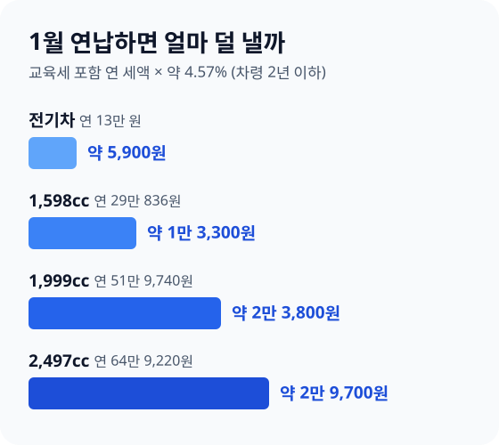
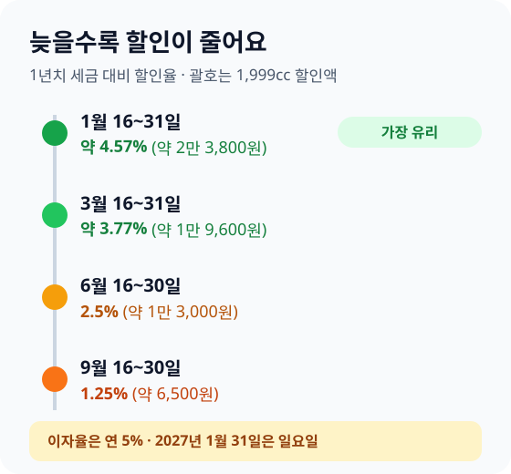

> **바쁜 분을 위한 3줄 요약**
>
> 1. 2027년 1월 16~31일 사이에 자동차세 1년치를 **한 번에 내세요**.
> 2. 배기량과 차령으로 **내 차 연 세액부터 계산하세요**.
> 3. 1월을 놓쳤다면 **3월·6월·9월에 남은 할인이라도 받으세요**.

6월 말, 휴대폰에 자동차세 고지서 문자가 옵니다. 30만 원 가까운 금액을 보고 "벌써 반년이 지났나" 싶습니다. 그리고 12월에 같은 문자가 한 번 더 옵니다.

같은 세금을 1월에 한 번에 내면 2만 원 넘게 덜 내는 차도 많습니다. 신청 기간이 1월 16일부터 31일까지 보름뿐이라 미리 알아 둔 사람만 받습니다. 2026년 11월 지방세법 기준으로 내 차는 얼마를 아끼는지 계산해 보세요.

## 1월 16~31일에 내면 1년치 세금의 약 4.57%를 덜 냅니다

자동차세 연납은 1월 16~31일에 1년치를 한 번에 내고, 남은 기간 이자만큼 세금을 빼 받는 제도입니다. 이자율은 연 5%이고, 1월에 내면 2월 1일부터 12월 31일까지 334일 치 이자를 빼 줍니다.

계산식은 "연세액 × 334일 ÷ 365일 × 5%"입니다. 결과는 1년치 세금의 **약 4.57%입니다**. 연납 기간과 계산식은 [지방세법 제128조](<https://www.law.go.kr/법령/지방세법/제128조>), 이자율 5%는 [지방세법 시행령 제125조](<https://www.law.go.kr/법령/지방세법 시행령/제125조>)에 있습니다.

원래 자동차세는 6월(1기분)과 12월(2기분)에 반씩 나옵니다. 연납은 이 두 번을 1월 한 번으로 당기는 대신 할인을 받는 방식입니다. 할인을 받는 대신 미리 내는 돈이 생기니, 1월에 이 돈을 낼 여유가 있는지 먼저 보세요.

- **이자율 기준**: 시행령 제125조 제6항, 2024년 12월 31일 개정으로 연 5%입니다.
- **신청 방법**: 위택스(서울은 서울시 이택스)나 차량 등록지 시·군·구청 세무 부서에서 신고하고 냅니다.
- **다음 해 납부서**: 한 번 연납하면 시·군·구가 그다음 해 1월에 연납 납부서를 보내 줄 수 있습니다.

## 내 차 자동차세부터 계산해 보세요

개인 승용차(비영업용) 자동차세는 배기량에 시시(cc)당 세액을 곱해 정합니다. 여기에 자동차세의 30%가 지방교육세로 함께 붙습니다. 세율은 [지방세법 제127조](<https://www.law.go.kr/법령/지방세법/제127조>), 지방교육세 30%는 [같은 법 제151조](<https://www.law.go.kr/법령/지방세법/제151조>)에 있습니다.

| 배기량 | cc당 세액 | 예시(교육세 포함 연 세액) |
|---|---|---|
| 1,000cc 이하 | 80원 | 998cc → 10만 3,792원 |
| 1,600cc 이하 | 140원 | 1,598cc → 29만 836원 |
| 1,600cc 초과 | 200원 | 1,999cc → 51만 9,740원 |
| 전기차 등 | 정액 10만 원 | 13만 원 |

예를 들어 1,999cc 차라면 1,999 × 200원 = 39만 9,800원이 자동차세입니다. 여기에 30%인 11만 9,940원을 더해 1년에 51만 9,740원을 냅니다. 전기·수소차처럼 배기량이 없는 차는 "그 밖의 승용자동차"로 1년 10만 원에 교육세 3만 원이 붙습니다.

### 차령 3년부터 세금이 줄어듭니다

배기량으로 세금을 매기는 차는 차령 3년부터 매년 5%씩 세금이 줄고, 12년이 되면 50%까지 줄어듭니다. 계산식은 "연세액 × (1 − 5% × (차령 − 2))"입니다. 차령 12년이 넘어도 12년으로 봅니다.

예를 들어 1,999cc 차가 차령 5년이면 15%가 줄어 자동차세가 33만 9,830원입니다. 교육세를 더하면 44만 1,779원입니다. 정액 10만 원인 전기차는 이 경감이 없습니다.

지자체는 조례로 표준세율보다 높게 정할 수 있습니다. 실제 내 고지액은 지난 6월·12월 고지서나 위택스 조회 화면 숫자를 기준으로 보세요.

## 배기량별로 1월 연납 할인액을 확인하세요

1월 연납 할인액은 "교육세 포함 연 세액 × 약 4.57%"로 바로 구합니다. 지방교육세는 자동차세의 30%라, 자동차세가 줄면 함께 줄어듭니다. 아래는 차령 경감이 없는 차(차령 2년 이하) 기준입니다.

| 내 차(예시) | 연 세액 | 1월 연납 할인 |
|---|---|---|
| 1,598cc | 29만 836원 | 약 1만 3,300원 |
| 1,999cc | 51만 9,740원 | 약 2만 3,800원 |
| 2,497cc | 64만 9,220원 | 약 2만 9,700원 |
| 전기차 | 13만 원 | 약 5,900원 |
| 1,999cc·차령 5년 | 44만 1,779원 | 약 2만 200원 |

1년에 2만 원대가 작아 보일 수 있습니다. 하지만 미리 내는 기간을 따져 보면 일반 예금보다 나은 조건입니다. 할인에는 이자소득세도 붙지 않습니다.

1월에 연납하면 6월분은 5개월, 12월분은 11개월 먼저 내는 셈입니다. 예를 들어 1,999cc 차의 반년 세액 25만 9,870원씩을 그동안 연 3% 예금에 둔다고 가정하면 세전 이자는 약 1만 400원, 15.4%를 떼면 약 8,800원입니다. 연납 할인 약 2만 3,800원이 2배 이상 큽니다.

## 1월을 놓쳤다면 3월·6월·9월에 내세요

1월을 놓쳐도 연납 기회는 세 번 더 있습니다. 다만 남은 기간이 짧아질수록 할인도 줄어듭니다. 아래 할인율은 1년치 세금 대비 비율입니다.

| 연납 기간 | 할인율(1년치 대비) | 1,999cc 할인 |
|---|---|---|
| 1월 16~31일 | 약 4.57% | 약 2만 3,800원 |
| 3월 16~31일 | 약 3.77% | 약 1만 9,600원 |
| 6월 16~30일 | 2.5% | 약 1만 3,000원 |
| 9월 16~30일 | 1.25% | 약 6,500원 |

3월 연납은 4월 1일부터 12월 31일까지 275일 치 이자를 빼 줍니다. 6월 연납은 12월분(2기분) 세금의 5%, 9월 연납은 2기분 세금의 절반 기간 치를 빼 줍니다. 계산식은 모두 지방세법 제128조 제3항 표에 있습니다.

6월에 고지서를 받고 1기분만 내면 할인이 없습니다. 같은 6월 16~30일에 연납으로 신고해 2기분까지 함께 내야 2.5%를 받습니다.

## 내 상황에 맞게 연납 여부를 정하세요

연납은 1년 동안 차를 계속 갖고 있을 사람에게 가장 유리합니다. 그래도 연납 뒤 차를 팔거나 이사해도 손해 보지 않도록 법이 정해 두었습니다. 아래 표로 내 상황을 찾아보세요.

| 내 상황 | 할 일 |
|---|---|
| 1년 내내 같은 차를 탐 | 1월 16~31일에 연납 |
| 1월에 목돈이 빠듯함 | 3월이나 6월 연납으로 미루기 |
| 연 자동차세 10만 원 이하(경차 등) | 1월 연납이 6월 일괄 부과보다 유리 |
| 올해 안에 차를 팔 계획 | 연납해도 되지만 매도 때 정산 확인 |
| 올해 이사 예정 | 연납해도 새 주소지에서 다시 안 냄 |
| 법인·영업용 차 | 고지서와 세율이 달라 위택스로 확인 |

### 연 세액 10만 원 이하라면 1월 연납이 낫습니다

자동차세(교육세 제외) 연세액이 10만 원 이하인 차는 시·군·구가 6월에 1년치를 한꺼번에 부과할 수 있습니다. 이때는 2기분 세금의 5%, 즉 1년치의 2.5%만 빼 줍니다. 998cc 경차라면 자동차세가 7만 9,840원이라 여기에 해당합니다.

같은 차를 1월에 연납하면 약 4.57%를 빼 받습니다. 교육세를 더한 10만 3,792원 기준으로 1월 연납은 약 4,700원, 6월 일괄 부과는 약 2,600원을 덜 냅니다. 금액은 작아도 1월이 2배 가까이 큽니다.

## 연납 신청은 이렇게 하세요

연납 신청은 1월 16일 아침부터 1월 31일까지 하면 됩니다. 2027년 1월 31일은 일요일이니 금요일인 1월 29일까지 끝내 두세요. 마지막 날은 접속이 몰리기 쉽습니다.

1. **차량 등록지 확인**: 자동차등록증의 사용본거지(보통 주소지)가 납세지입니다. 위택스는 전국, 서울에 등록된 차는 서울시 이택스에서 냅니다.
2. **연세액 조회**: 로그인한 뒤 자동차세 연납 신고 화면에서 내 차를 고르면 할인 뒤 금액이 나옵니다. 화면 숫자와 이 글 계산이 크게 다르면 차령과 지자체 세율을 확인하세요.
3. **납부 수단 고르기**: 계좌이체·신용카드·간편결제 가운데 하나를 고릅니다. 카드 실적을 채워야 한다면 카드 납부가 실적에 들어가는지 카드사 조건을 확인하세요.
4. **영수증 보관**: 납부 확인 화면을 캡처해 둡니다. 6월·12월에 고지서가 다시 오면 연납 영수증을 보여 주고 확인하세요.

인터넷이 불편하다면 시·군·구청 세무 부서에 전화하거나 방문해 연납 신고서를 내도 됩니다. 은행 창구와 지방세 ARS로도 낼 수 있는지 고지서 뒷면 안내를 확인하세요.

## 자주 하는 실수를 피하세요

연납에서 가장 많이 놓치는 것은 기간입니다. 1월 1~15일에는 연납 신고가 열리지 않고, 2월 1일이 되면 1월 할인은 끝납니다.

- **고지서를 기다리기**: 처음 연납하는 사람에게는 1월 납부서가 따로 오지 않을 수 있습니다. 1월 16일에 직접 신청하세요.
- **차가 2대인데 1대만 신청**: 연납은 차마다 따로 합니다. 가족 명의 차도 명의자 계정으로 따로 신청하세요.
- **6월 고지서를 1기분만 내기**: 6월에 2기분까지 함께 내야 2.5%를 받습니다.
- **카드 할부 이자 놓치기**: 할부 수수료가 붙으면 2만 원대 할인이 금방 사라집니다. 일시불이나 무이자 조건으로 내세요.
- **새 차 등록 직후 연납**: 연중에 산 차는 등록일부터 날짜로 나눠 계산해 따로 부과됩니다. 첫 고지서를 낸 뒤 남은 연납 기간이나 다음 해 1월을 노리세요.

## 연납한 뒤 차를 팔거나 이사했다면 이렇게 하세요

연납한 뒤 이사해도 자동차세를 두 번 내지 않습니다. 시행령 제125조 제4항은 연세액을 낸 뒤 자동차 소재지가 바뀌어도 새 소재지에서 그해 자동차세를 부과하지 않는다고 정합니다.

차를 팔거나 폐차하면 자동차세는 소유 기간에 따라 날짜로 나눠 계산합니다. 연납했다면 넘긴 날 이후 기간에 해당하는 세금을 돌려받는 방식으로 정리합니다. 양도인이 동의하면 새 주인이 낸 것으로 볼 수도 있습니다([지방세법 제130조](<https://www.law.go.kr/법령/지방세법/제130조>)).

환급은 보통 차량 등록지 시·군·구에서 처리합니다. 매도 뒤 한두 달이 지나도 안내가 없으면 등록지 세무 부서에 환급 계좌를 알려 주세요. 중고차를 팔 계획이라면 [중고차 살 때 금융 체크리스트](/posts/2026-used-car-finance-checklist.html)의 서류 목록도 함께 보세요.

## 자주 묻는 질문

**Q. 자동차세 연납 할인율은 2027년에 얼마인가요?**
이자율은 연 5%입니다. 1월 16~31일에 내면 1년치 세금의 약 4.57%, 3월은 약 3.77%, 6월은 2.5%, 9월은 1.25%를 덜 냅니다.

**Q. 자동차세 연납은 언제 신청하나요?**
1월 16~31일, 3월 16~31일, 6월 16~30일, 9월 16~30일입니다. 할인이 가장 큰 때는 1월이고, 2027년 1월 31일은 일요일이니 미리 내세요.

**Q. 연납하고 차를 팔면 손해인가요?**
손해가 아닙니다. 자동차세는 소유 기간으로 날짜를 나눠 계산하니, 넘긴 날 이후 기간의 세금은 돌려받는 방식으로 정리합니다.

**Q. 전기차도 연납 할인을 받나요?**
받습니다. 전기차 자동차세는 1년 10만 원에 교육세 3만 원이라, 1월 연납 때 약 5,900원을 덜 냅니다.

**Q. 작년에 연납했는데 올해도 신청해야 하나요?**
시·군·구가 1월에 연납 납부서를 보내 줄 수 있지만, 받지 못했다면 1월 16~31일에 직접 신고하고 내세요.

## 1월 연납 체크리스트

| 언제 | 할 일 |
|---|---|
| 12월 | 12월 고지서로 내 차 반년 세액 확인 |
| 1월 첫 주 | 1년치 세액(12월분 × 2) 만큼 돈 남겨 두기 |
| 1월 16일 | 위택스·이택스 접속, 차마다 연납 신고 |
| 1월 29일까지 | 납부 끝내고 영수증 캡처 |
| 6월·12월 | 고지서가 오면 연납 영수증으로 확인 |

자동차세 연납은 1년에 한 번, 10분이면 끝나는 확실한 절약입니다. 오늘 지난 12월 고지서를 찾아 반년 세액에 2를 곱해 보세요.

※ 이 글은 2026년 11월 시행 중인 지방세법(제127조·제128조·제130조·제151조)과 시행령 제125조를 기준으로 계산했습니다. 지자체 조례 세율, 차령, 끝전 처리에 따라 실제 고지액과 할인액은 몇십 원에서 몇천 원 다를 수 있으니 위택스 화면 금액을 기준으로 하세요.

---

> 🚗 **함께 읽으면 좋은 글: [자동차보험료 아끼는 법, 갱신 전 특약·운전자 범위·자기부담금부터 확인하세요](/posts/2026-car-insurance-saving-guide.html)**  
> 자동차세를 줄였다면 보험료도 점검해 보세요. 연말에 챙길 절세는 [연말 절세 막판 체크리스트](/posts/2026-year-end-tax-saving-checklist.html), 차를 바꿀 계획이라면 [중고차 살 때 금융 체크리스트](/posts/2026-used-car-finance-checklist.html)에 정리했어요.
