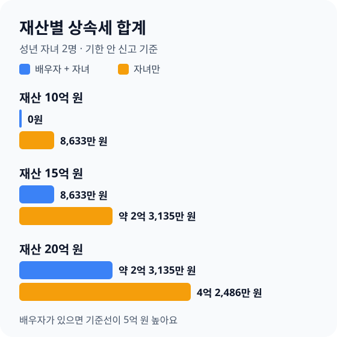

> **바쁜 분을 위한 3줄 요약**
>
> 1. 집·예금·주식을 시가로 더하고 빚을 빼서 **부모님 재산 합계부터 적어 보세요**.
> 2. 배우자와 자녀가 함께 받으면 10억 원, 자녀만 받으면 5억 원과 **기준선을 비교하세요**.
> 3. 기준선을 넘으면 돌아가신 달 말일부터 6개월 안에 **신고해 3%를 덜 내세요**.

명절에 모인 가족 사이에서 "아파트값이 올라서 나중에 상속세가 꽤 나온다더라"라는 말이 오갑니다. 부모님은 걱정하시고, 자녀들은 얼마인지 몰라 말을 잇지 못합니다.

상속세는 생각보다 많은 가정에서 0원입니다. 공제가 크기 때문입니다. 2026년 11월 11일 국가법령정보센터에서 확인한 현행 상속세및증여세법 조문으로, 우리 집이 기준선 안인지 직접 계산하는 순서를 정리했습니다.

## 배우자와 자녀가 있으면 10억 원까지 상속세가 없습니다

배우자와 자녀가 함께 상속받으면 빚과 장례비를 뺀 재산이 10억 원 이하일 때 상속세가 없습니다. 일괄공제 5억 원과 배우자공제 최소 5억 원을 합친 금액입니다.

자녀만 상속받으면 배우자공제가 없어 기준선이 5억 원으로 내려갑니다. 같은 재산이라도 누가 상속받는지에 따라 세금이 크게 달라집니다.

| 가족 형태 | 기본 공제 | 0원 기준선(장례비 500만 원 포함) |
|---|---|---|
| 배우자 + 자녀 | 일괄 5억 + 배우자 5억 | 10억 500만 원 |
| 자녀만 | 일괄 5억 | 5억 500만 원 |
| 배우자만(자녀·부모님 없음) | 기초 2억 + 배우자 공제 | 사례별 계산 |

일괄공제는 기초공제 2억 원과 자녀공제(1명당 5,000만 원) 등을 더한 금액과 5억 원 중 큰 쪽을 고르는 제도입니다([상속세및증여세법 제21조](<https://www.law.go.kr/법령/상속세및증여세법/제21조>), [제18조](<https://www.law.go.kr/법령/상속세및증여세법/제18조>), [제20조](<https://www.law.go.kr/법령/상속세및증여세법/제20조>)). 미성년 자녀가 없고 자녀가 5명 이하라면 5억 원이 더 큽니다.

배우자가 혼자 상속받으면 일괄공제를 쓸 수 없고 기초공제 2억 원과 인적공제만 받습니다(제21조 ②). 이 경우는 배우자공제 해석이 사례마다 달라 세무서나 세무사에게 확인하세요.

## 공제 다섯 가지를 차례로 빼 보세요

상속세는 재산에서 빚·장례비를 빼고, 공제를 뺀 나머지에만 매깁니다. 순서대로 빼면 어느 단계에서 0원이 되는지 바로 보입니다.

| 순서 | 빼는 항목 | 금액 |
|---|---|---|
| 1 | 빚·밀린 세금 | 실제 금액 |
| 2 | 장례비 | 500만~1,000만 원 |
| 3 | 일괄공제 | 5억 원(또는 기초+인적 중 큰 쪽) |
| 4 | 배우자공제 | 최소 5억, 최대 30억 원 |
| 5 | 금융재산공제 | 최대 2억 원 |

**배우자공제**는 배우자가 실제 받은 금액만큼 빼 주되, 법정상속분으로 계산한 한도와 30억 원 중 작은 금액까지입니다. 배우자가 5억 원보다 적게 받거나 아예 받지 않아도 5억 원은 빼 줍니다([제19조](<https://www.law.go.kr/법령/상속세및증여세법/제19조>) ①④).

**금융재산공제**는 예금·주식·펀드에서 금융 빚을 뺀 순금융재산에 적용합니다. 2,000만 원 이하는 전액, 넘으면 20%와 2,000만 원 중 큰 금액을 빼고 최대 2억 원까지입니다([제22조](<https://www.law.go.kr/법령/상속세및증여세법/제22조>)).

**장례비**는 영수증이 500만 원보다 적어도 500만 원을 빼고, 1,000만 원을 넘으면 1,000만 원까지만 뺍니다. 봉안시설 비용은 따로 최대 500만 원을 더 뺄 수 있습니다.

공제를 다 빼고 남은 금액이 과세표준입니다. 여기에 아래 세율을 곱합니다([제26조](<https://www.law.go.kr/법령/상속세및증여세법/제26조>)).

| 과세표준 | 세율 | 누진공제 |
|---|---|---|
| 1억 원 이하 | 10% | 0원 |
| 5억 원 이하 | 20% | 1,000만 원 |
| 10억 원 이하 | 30% | 6,000만 원 |
| 30억 원 이하 | 40% | 1억 6,000만 원 |
| 30억 원 초과 | 50% | 4억 6,000만 원 |

## 재산 15억 원이면 8,633만 원을 냅니다

예를 들어 아버지가 시가 15억 원 재산을 남기고, 어머니와 성년 자녀 2명이 상속받는다고 가정합니다. 빚은 없고 장례비는 500만 원으로 계산하면 기한 안에 신고할 때 8,633만 원을 냅니다.

| 단계 | 계산 | 금액 |
|---|---|---|
| 과세가액 | 15억 − 장례비 500만 | 14억 9,500만 원 |
| 공제 | 일괄 5억 + 배우자 5억 | 10억 원 |
| 과세표준 | 14억 9,500만 − 10억 | 4억 9,500만 원 |
| 산출세액 | 4억 9,500만 × 20% − 1,000만 | 8,900만 원 |
| 낼 세금 | 신고세액공제 3% 267만 원 빼기 | 8,633만 원 |

기한 안에 신고하면 산출세액의 3%를 빼 줍니다([제69조](<https://www.law.go.kr/법령/상속세및증여세법/제69조>)). 위 예시에서는 267만 원입니다.

이 금액은 상속인 한 명이 아니라 **상속인 모두가 함께 낼 합계**입니다. 각자 받은 몫의 비율대로 나눠 냅니다.

### 재산 규모별로 비교해 보세요

우리 [증여세·상속세 계산기](/apps/inheritance-gift-tax-calculator/#inheritance)와 같은 계산 방식으로 성년 자녀 2명 기준, 빚 없음, 장례비 500만 원을 넣어 계산했습니다. 배우자공제는 최소 5억 원으로 넣었습니다.

| 재산(시가) | 배우자 + 자녀 2명 | 자녀 2명만 |
|---|---|---|
| 10억 원 | 0원 | 8,633만 원 |
| 15억 원 | 8,633만 원 | 약 2억 3,135만 원 |
| 20억 원 | 약 2억 3,135만 원 | 4억 2,486만 원 |

배우자가 있으면 기준선이 5억 원 높아서, 배우자가 있는 15억 원 가정과 자녀만 있는 10억 원 가정의 세금이 같습니다. 부모님 두 분 중 한 분이 먼저 돌아가실 때와 두 번째로 돌아가실 때 세금이 다른 이유도 여기에 있습니다.

## 배우자 몫과 예금으로 세금을 줄이세요

배우자가 법정상속분만큼 실제로 받으면 배우자공제가 5억 원보다 커져 세금이 줄어듭니다. 15억 원 예시에서 어머니가 법정상속분(배우자 1.5 : 자녀 1 : 자녀 1)인 7분의 3을 받으면 배우자공제가 약 6억 4,286만 원이 됩니다.

이때 세금은 약 5,862만 원으로, 5억 원만 공제할 때보다 약 2,771만 원 줄어듭니다. 다만 배우자가 받은 재산은 배우자가 나중에 돌아가실 때 다시 상속재산이 되니, 두 번의 상속을 함께 보고 나누세요.

배우자공제를 5억 원보다 많이 받으려면 신고 기한 다음 날부터 9개월 안에 재산을 나누고 등기까지 마쳐야 합니다(제19조 ②). 2026년 11월 11일에 돌아가셨다면 신고 기한은 2027년 5월 31일, 분할 기한은 2028년 2월 29일입니다.

예금·주식이 있으면 금융재산공제도 확인하세요. 예를 들어 재산 12억 원 중 2억 원이 예금이라면 금융재산공제 4,000만 원이 더해져 세금이 2,813만 원에서 2,037만 원으로 줄어듭니다.

어린 자녀가 있으면 일괄공제 대신 기초공제와 인적공제 합계가 더 클 수 있습니다. 예를 들어 배우자 없이 만 3세·5세 자녀 둘이 7억 500만 원을 상속받으면 인적공제가 4억 원이라 공제가 6억 원이 되고, 세금은 970만 원입니다. 일괄공제 5억 원으로 계산하면 1,940만 원입니다.

## 이런 실수로 세금이 늘어납니다

계산은 맞게 했는데 아래 실수로 세금이 늘어나는 경우가 많습니다. 신고 전에 하나씩 확인하세요.

- **아파트를 공시가격으로 넣는다**: 상속재산은 돌아가신 날의 시가로 평가하는 것이 원칙입니다([제60조](<https://www.law.go.kr/법령/상속세및증여세법/제60조>)). 같은 단지 최근 거래가가 있으면 그 값에 가깝게 계산됩니다.
- **10년 전 증여를 잊는다**: 돌아가시기 전 10년 안에 상속인에게, 5년 안에 상속인이 아닌 사람에게 준 재산은 상속재산에 다시 더합니다([제13조](<https://www.law.go.kr/법령/상속세및증여세법/제13조>)).
- **신고를 하지 않는다**: 신고하지 않으면 3% 공제를 못 받고, 일괄공제도 5억 원으로만 계산합니다(제21조 ①). 어린 자녀가 있어 인적공제가 큰 가정은 손해가 더 큽니다.
- **배우자 분할 기한을 넘긴다**: 9개월 분할 기한이 지나면 배우자공제는 5억 원만 받습니다.
- **현금을 미리 빼서 쓴다**: 돌아가시기 직전 인출한 돈은 쓴 곳을 설명하지 못하면 상속재산으로 볼 수 있습니다. 병원비·장례비 영수증을 모아 두세요.

세금이 크면 나눠 내는 방법도 있습니다. 낼 세금이 1,000만 원을 넘으면 일부를 2개월 안에 나눠 내고, 2,000만 원을 넘으면 담보를 맡기고 최대 10년 동안 나눠 내는 연부연납을 신청할 수 있습니다([제70조](<https://www.law.go.kr/법령/상속세및증여세법/제70조>), [제71조](<https://www.law.go.kr/법령/상속세및증여세법/제71조>)).

## 우리 집 상황에 맞는 할 일을 고르세요

재산 규모와 가족 형태만 알면 지금 할 일이 정해집니다. 아래 표에서 우리 집에 맞는 줄을 찾으세요.

| 우리 집 상황 | 지금 할 일 |
|---|---|
| 배우자+자녀, 재산 10억 원 이하 | 세금은 없지만 기한 안에 신고해 재산 가액을 남기세요 |
| 배우자+자녀, 10억 원 초과 | 배우자 몫과 분할 기한을 가족과 미리 정하세요 |
| 자녀만, 5억 원 초과 | 사전증여 10년 합산과 금융재산공제를 확인하세요 |
| 미성년 자녀가 있음 | 기초+인적공제가 5억 원보다 큰지 계산하세요 |
| 세금 2,000만 원 초과 예상 | 연부연납 담보와 현금 마련 방법을 준비하세요 |

생전에 자녀에게 미리 주는 방법을 생각한다면 10년 합산 규칙을 먼저 보세요. 돌아가시기 10년 전보다 앞서 준 돈은 상속재산에 더하지 않습니다. 자세한 공제 한도는 [증여세 없이 자녀에게 주는 돈](/posts/2026-gift-tax-exemption-guide.html)에 정리했습니다.

상속세 개편안이 여러 차례 발표됐지만, 2026년 11월 11일 기준 현행 조문에는 일괄공제 5억 원, 배우자공제 최소 5억 원, 최고세율 50%가 그대로 있습니다. 법이 바뀌면 이 글과 계산기를 함께 고치겠습니다.

## 자주 묻는 질문

**Q. 상속세는 재산이 얼마부터 내나요?**
배우자와 자녀가 함께 상속받으면 빚과 장례비를 뺀 재산이 10억 원을 넘을 때부터 냅니다. 자녀만 상속받으면 5억 원을 넘을 때부터 냅니다.

**Q. 상속세 신고 기한은 언제까지인가요?**
돌아가신 날이 속한 달의 말일부터 6개월 안입니다. 기한 안에 신고하면 산출세액의 3%를 덜 냅니다.

**Q. 세금이 0원이어도 상속세 신고를 해야 하나요?**
낼 세금이 없으면 신고 의무로 인한 가산세는 없지만, 신고해 두면 나중에 집을 팔 때 취득가액을 증명하기 쉽습니다. 시가 근거 자료를 함께 남겨 두세요.

**Q. 배우자가 많이 받으면 상속세가 줄어드나요?**
줄어듭니다. 배우자가 법정상속분까지 실제로 받으면 30억 원 한도 안에서 그만큼 공제됩니다. 15억 원 예시에서는 약 2,771만 원 줄어듭니다.

## 신고 전 체크리스트

| 순서 | 할 일 |
|---|---|
| 1 | 집·예금·주식 시가 합계와 빚 적기 |
| 2 | 10년 안에 받은 증여 찾기 |
| 3 | 기준선(10억 원 또는 5억 원)과 비교 |
| 4 | 배우자 몫과 분할 기한 정하기 |
| 5 | 6개월 안에 신고하고 납부 방법 정하기 |

상속세는 대부분 가정에서 0원이지만, 0원인지 확인하는 일은 미리 해 두어야 합니다. 이번 주에 부모님과 집 시가, 예금, 빚 세 숫자를 적어 기준선과 비교해 보세요.

---

> 🎁 **직접 계산해 보세요: [증여세·상속세 계산기 →](/apps/inheritance-gift-tax-calculator/#inheritance)**  
> 남긴 재산과 가족 수만 넣으면 상속세가 0원인 기준선, 낼 세금, 신고 기한, 배우자 몫에 따라 달라지는 금액을 알려 드려요.

> 🏠 **함께 읽으면 좋은 글**  
> 생전에 나눠 주는 방법은 [증여세 없이 자녀에게 주는 돈](/posts/2026-gift-tax-exemption-guide.html)에서, 집을 연금으로 바꾸는 방법은 [주택연금 가입조건과 수령액](/posts/2026-reverse-mortgage-pension-guide.html)에서 보세요. 상속받은 집을 팔 계획이라면 [1세대 1주택 양도세 비과세](/posts/2026-one-house-capital-gains-tax-exemption-guide.html)도 함께 확인하세요.
