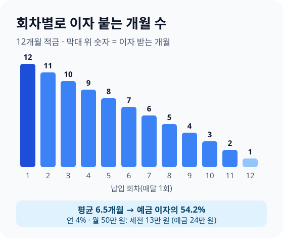
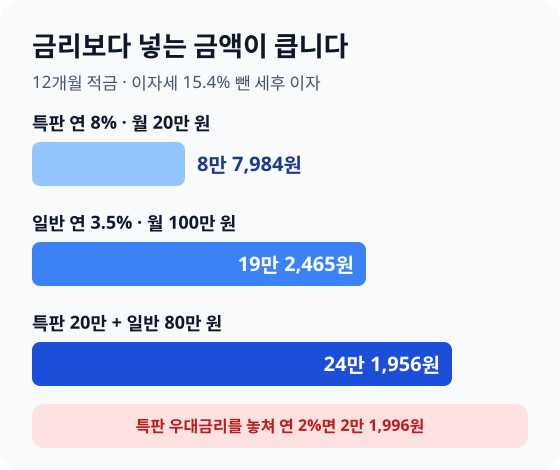

> **바쁜 분을 위한 3줄 요약**
>
> 1. 적금 금리는 절반쯤으로 줄여서 예금 금리와 비교하세요.
> 2. 특판 적금은 월 한도와 우대 조건을 먼저 읽고, 남는 돈은 일반 적금에 나눠 넣으세요.
> 3. 이미 목돈이 있다면 적금보다 예금에 한 번에 넣으세요.

은행 앱에 "연 4% 적금" 배너가 뜹니다. 월 50만 원씩 1년이면 600만 원, 이자는 24만 원쯤 되겠다고 계산하고 가입 버튼을 누릅니다.

만기 날 찍히는 세후 이자는 10만 9,980원입니다. 금리가 틀린 게 아니라 적금 이자를 계산하는 방식이 예금과 다르기 때문입니다. 가입 전에 이 방식만 알면 적금과 예금 가운데 어디에 넣을지 바로 정할 수 있습니다.

## 적금 이자는 예금 이자의 절반쯤이라고 생각하세요

연 4% 적금에 월 50만 원씩 12개월을 넣으면 세전 이자는 **13만 원입니다**. 같은 600만 원을 처음부터 연 4% 예금에 넣으면 세전 이자는 24만 원이라, 적금 이자는 예금의 54.2%입니다.

세금 15.4%를 떼고 나면 차이는 더 또렷합니다. 우리 [적금·예금 이자 계산기](/apps/savings-calculator/)와 같은 방식(세전 이자를 원 단위로 반올림한 뒤 세금 계산)으로 계산했습니다.

| 같은 600만 원, 연 4% | 세전 이자 | 세후 이자 |
|---|---|---|
| 적금(월 50만 원 × 12개월) | 13만 원 | 10만 9,980원 |
| 예금(600만 원 한 번에) | 24만 원 | 20만 3,040원 |

적금 연 4%를 예금 금리로 바꾸면 **연 2.17% 정도입니다**. 그래서 "적금 4%"와 "예금 3%"를 나란히 놓고 적금이 낫다고 판단하면 안 됩니다. 비교할 때는 적금 금리를 절반쯤으로 줄여 놓고 보세요.

## 회차마다 이자가 붙는 기간을 세어 보세요

적금 이자는 매달 넣은 돈이 만기까지 남은 개월 수만큼만 붙습니다. 첫 달에 넣은 50만 원은 12개월 동안 이자를 받지만, 마지막 달에 넣은 50만 원은 1개월만 받습니다.

12개월을 모두 더하면 12+11+…+1 = 78개월치입니다. 원금 600만 원 전체로 보면 평균 6.5개월만 이자를 받는 셈이고, 6.5개월은 12개월의 54.2%입니다.

단리 적금의 세전 이자는 이렇게 계산합니다. 월 납입액 × 연 금리 ÷ 12 × (개월 수 × (개월 수 + 1) ÷ 2)입니다. 월 50만 원, 연 4%, 12개월이면 50만 원 × 0.04 ÷ 12 × 78 = 13만 원입니다.

기간이 길어지면 비율은 50%에 더 가까워집니다. 월 50만 원, 연 4%로 계산한 결과입니다.

| 기간 | 예금 대비 이자 비율 | 세후 이자 |
|---|---|---|
| 12개월 | 54.2% | 10만 9,980원 |
| 24개월 | 52.1% | 42만 3,000원 |
| 36개월 | 51.4% | 93만 9,060원 |

월복리 적금이라도 차이는 작습니다. 같은 조건(월 50만 원, 연 4%, 12개월)을 월복리로 계산하면 세전 이자는 13만 1,602원으로, 단리보다 1,602원 많습니다. 복리라는 말보다 금리와 넣는 금액을 먼저 보세요.

## 월 납입액별 세후 이자를 확인하세요

12개월 적금의 세후 이자는 월 납입액과 금리에 거의 그대로 비례합니다. 내 월 납입액을 아래 표에서 찾아보세요.

| 월 납입액(12개월) | 연 3% 세후 이자 | 연 4% 세후 이자 |
|---|---|---|
| 30만 원 | 4만 9,491원 | 6만 5,988원 |
| 50만 원 | 8만 2,485원 | 10만 9,980원 |
| 100만 원 | 16만 4,970원 | 21만 9,960원 |

금리 1%포인트 차이는 월 50만 원 기준으로 1년에 2만 7,495원입니다. 큰돈은 아니지만, 우대 조건 하나를 맞추는 데 드는 수고와 비교해 보는 기준이 됩니다.

계산기로 내 숫자를 넣어 보려면 이 순서로 하세요.

1. [적금·예금 이자 계산기](/apps/savings-calculator/)를 열고 맨 위에서 "적금"을 고르세요.
2. 월 납입액, 기간(개월), 연 이자율을 넣으세요. 우대금리를 받을 자신이 없으면 기본금리만 넣으세요.
3. 이자 방식은 상품 설명서에 적힌 대로 단리나 월복리를 고르세요.
4. 세금은 보통 "일반 15.4%"를 고르고, 비과세 계좌라면 "비과세"를 고르세요.

## 특판 적금은 월 한도와 우대 조건부터 보세요

연 8% 같은 특판 적금은 월 한도가 작아 이자 금액은 생각보다 적습니다. 예를 들어 월 20만 원까지만 넣을 수 있는 연 8% 적금의 1년 세후 이자는 8만 7,984원입니다.

같은 기간 연 3.5% 일반 적금에 월 100만 원을 넣으면 세후 이자는 19만 2,465원입니다. 금리는 절반도 안 되지만 넣는 금액이 커서 이자는 두 배가 넘습니다.

가장 많이 받는 방법은 나눠 넣기입니다. 특판에 한도인 20만 원을 채우고, 남는 80만 원을 연 3.5% 일반 적금에 넣으면 세후 이자는 모두 24만 1,956원입니다.

특판 금리는 대부분 기본금리에 우대금리를 더한 숫자입니다. 예를 들어 기본 연 2%에 우대 6%를 더한 상품에서 우대 조건을 놓치면, 월 20만 원 1년 세후 이자는 2만 1,996원으로 줄어듭니다.

가입 전에 상품 설명서에서 아래 세 가지를 확인하세요.

- **우대 조건**: 급여이체, 카드 사용 실적, 자동이체 횟수처럼 1년 내내 지켜야 하는 조건인지 확인하세요.
- **월 한도와 기간**: 월 한도가 작거나 기간이 6개월이면 이자 금액은 더 작아집니다.
- **선착순·추첨**: 일부 특판은 추첨으로 높은 금리를 주기도 합니다. 내가 받을 금리가 확정인지 보세요.

## 목돈이 있다면 적금보다 예금에 넣으세요

이미 600만 원이 통장에 있다면 적금으로 나눠 넣는 것보다 예금에 한 번에 넣는 편이 이자가 많습니다. 연 4% 기준으로 세후 이자 차이는 9만 3,060원입니다.

적금은 "매달 들어오는 월급에서 떼어 모으는 도구"입니다. 목돈을 굴리는 용도로 쓰면 이자 계산 방식 때문에 손해를 봅니다.

| 내 상황 | 이렇게 넣으세요 | 이유 |
|---|---|---|
| 월급에서 매달 모은다 | 적금 | 강제로 모으는 효과 |
| 목돈이 이미 있다 | 예금 | 원금 전체에 이자 |
| 언제 쓸지 모른다 | 파킹통장 | 언제든 꺼냄 |
| 청년 상품 가입 조건에 맞는다 | 정부 청년 상품 먼저 | 정부 기여금 |
| 기초연금 수급 65세 이상 | 비과세종합저축 | 이자세 0원 |

목돈을 어디에 둘지 기간별로 고르는 방법은 [파킹통장 vs CMA vs 정기예금](/posts/2026-parking-savings-guide.html) 글에 정리했습니다. 청년 상품은 [청년도약계좌·청년미래적금 정리](/posts/2026-youth-leap-account-guide.html)를 먼저 보세요.

## 세금 15.4%를 줄일 수 있는지 확인하세요

일반 적금 이자에는 소득세 14%와 지방소득세 1.4%를 더해 15.4%가 떼입니다. 소득세 14%는 [소득세법 제129조](https://www.law.go.kr/법령/소득세법/제129조)에 적힌 이자소득 원천징수세율입니다.

세금을 줄이는 길은 세 가지입니다. 2026년 11월 2일 법 조문 기준입니다.

- **비과세종합저축**: [조세특례제한법 제88조의2](https://www.law.go.kr/법령/조세특례제한법/제88조의2)에 따라 2028년 12월 31일까지 가입하면 1명당 원금 5,000만 원까지 이자에 소득세를 매기지 않습니다. 대상은 65세 이상 기초연금 수급자, 등록 장애인, 국민기초생활보장 수급자 등입니다.
- **조합 예탁금**: 농협·수협·신협 같은 조합의 예탁금은 1명당 3,000만 원까지 세금을 줄여 줍니다. 직전 해 총급여 7,000만 원 이하(또는 종합소득금액 6,000만 원 이하)이거나 농어민 조합원이라면 2028년 말까지 가입분 이자에 **세금이 없습니다**. 그 밖의 사람은 2026년 가입분 5%, 2027년 가입분부터 9%입니다([조세특례제한법 제89조의3](https://www.law.go.kr/법령/조세특례제한법/제89조의3), [제88조의5](https://www.law.go.kr/법령/조세특례제한법/제88조의5)).
- **ISA 안에서 굴리기**: ISA 계좌 안의 예금·적금 이자는 일정 금액까지 비과세입니다. 자세한 한도는 [ISA 계좌 가이드](/posts/2026-isa-account-guide.html)를 보세요.

비과세가 되면 월 50만 원, 연 4%, 12개월 적금의 이자는 13만 원을 그대로 받습니다. 일반 과세보다 2만 20원을 더 받는 셈입니다.

비과세종합저축은 조건이 바뀐 부분이 있어, 이미 가입한 분과 새로 가입하는 분의 적용이 다를 수 있습니다. 조합 예탁금도 가입 기관에서 실제로 떼는 세금을 한 번 더 확인하세요.

## 자주 하는 실수를 피하세요

적금에서 손해를 보는 경우는 대부분 가입 전 확인을 건너뛴 때입니다. 아래 다섯 가지만 피해도 충분합니다.

- **적금 금리를 예금 금리와 그대로 비교하기**: 적금 4%는 예금 2.17% 정도입니다.
- **목돈을 적금에 나눠 넣기**: 600만 원이 있다면 예금이 9만 3,060원 더 받습니다.
- **우대 조건을 끝까지 안 읽기**: 조건 하나를 놓치면 특판 이자가 4분의 1로 줄 수 있습니다.
- **적금을 여러 개 한꺼번에 들기**: 하나만 깨져도 나머지까지 흔들립니다. 비상금을 먼저 채우세요.
- **납입일을 자주 미루기**: 늦게 넣으면 그 회차의 이자 기간이 줄고, 상품에 따라 만기일이 미뤄지기도 합니다. 월급날 다음 날로 자동이체를 걸어 두세요.

비상금을 먼저 모으는 순서는 [사회초년생 월급 관리법](/posts/2026-first-salary-money-management-guide.html)에 단계별로 적었습니다.

## 이미 적금을 깨야 한다면 해지 전에 대출을 비교하세요

만기 전에 해지하면 약정 금리 대신 훨씬 낮은 중도해지 금리를 받습니다. 예를 들어 월 50만 원, 연 4% 적금을 6회 넣고 중도해지 금리 연 1%로 깨면 세전 이자는 8,750원입니다. 약정 금리라면 3만 5,000원이었을 이자입니다.

급하게 돈이 필요하다면 해지 대신 적금담보대출이 되는지 은행 앱이나 창구에서 물어보세요. 만기가 몇 달 남지 않았다면 대출 이자를 내더라도 해지보다 손해가 적을 수 있습니다.

둘 중 무엇이 나은지는 세 숫자로 정하세요. 중도해지로 잃는 이자, 대출 기간 동안 낼 이자, 만기까지 남은 개월 수입니다.

한 은행에 적금과 예금을 많이 모았다면 예금자보호 한도도 확인하세요. [예금자보호법 시행령 제18조](<https://www.law.go.kr/법령/예금자보호법 시행령/제18조>)에 따라 한 금융회사에서 1명당 원금과 이자를 합쳐 1억 원까지 보호됩니다.

## 자주 묻는 질문

**Q. 적금 이자는 왜 표시된 금리보다 적게 나오나요?**
매달 넣은 돈이 만기까지 남은 기간만큼만 이자를 받기 때문입니다. 12개월 적금은 원금 전체로 보면 평균 6.5개월만 이자가 붙어, 같은 금리 예금 이자의 54.2%입니다.

**Q. 연 4% 적금에 월 50만 원씩 1년 넣으면 이자가 얼마인가요?**
세전 13만 원, 세금 15.4%를 떼면 10만 9,980원입니다. 만기에는 원금 600만 원과 함께 610만 9,980원을 받습니다.

**Q. 적금과 예금 중 어느 쪽이 이자가 많나요?**
같은 금액이 이미 있다면 예금이 많습니다. 월급에서 매달 떼어 모으는 돈이라면 적금으로 모으고, 만기가 되면 그 목돈을 예금에 넣으세요.

**Q. 적금 이자에도 세금이 붙나요?**
일반 적금 이자에는 15.4%가 붙습니다. 비과세종합저축 대상자이거나 ISA 안에서 굴리면 세금을 줄일 수 있습니다.

## 적금 가입 전 체크리스트

| 순서 | 할 일 |
|---|---|
| 1 | 비상금(생활비 3개월치)이 따로 있는지 보기 |
| 2 | 매달 넣을 금액을 월급 기준으로 정하기 |
| 3 | 적금 금리를 절반쯤으로 줄여 예금 금리와 비교하기 |
| 4 | 우대 조건, 월 한도, 기간을 상품 설명서에서 읽기 |
| 5 | 비과세종합저축·ISA·청년 상품 대상인지 확인하기 |
| 6 | 월급날 다음 날로 자동이체 걸기 |
| 7 | 만기 날짜를 달력에 넣고, 만기 뒤 예금으로 옮길 곳 정하기 |

적금은 이자를 크게 불리는 상품이 아니라 월급에서 돈을 떼어 내 목돈을 만드는 도구입니다. 오늘 내 적금 금리를 절반으로 줄여 보고, 지금 예금 금리와 나란히 놓아 보세요.

지금 가입한 적금이 있다면 은행 앱에서 만기일을 확인하고, 그날 옮길 예금 하나를 미리 골라 두세요.

수치는 2026년 11월 2일 기준입니다. 이자 계산 예시는 우리 적금·예금 이자 계산기와 같은 계산식으로 냈고, 상품 금리는 모두 가정입니다. 세율과 한도는 국가법령정보센터의 소득세법·조세특례제한법·예금자보호법 시행령 조문을 기준으로 했습니다.

---

> 📊 **직접 계산해 보세요**  
> [적금·예금 이자 계산기](/apps/savings-calculator/)로 내 적금의 세후 이자와 같은 금액을 예금에 넣었을 때를 비교할 수 있어요. 이자·배당이 많다면 [금융소득종합과세 피하는 법](/posts/2026-financial-income-comprehensive-tax-guide.html)도 함께 보세요.
