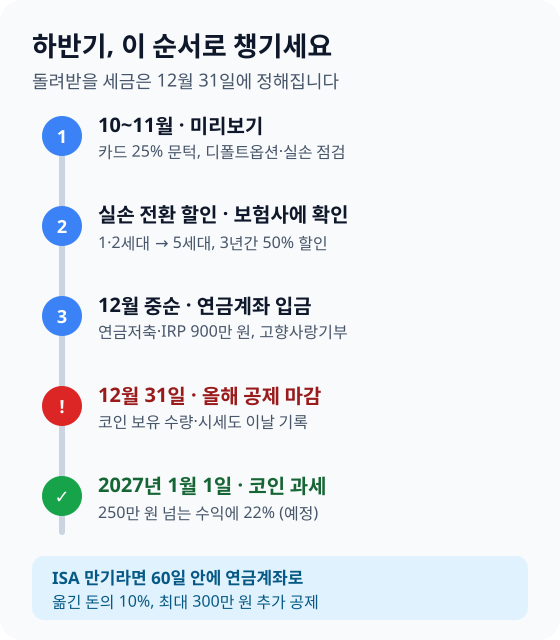
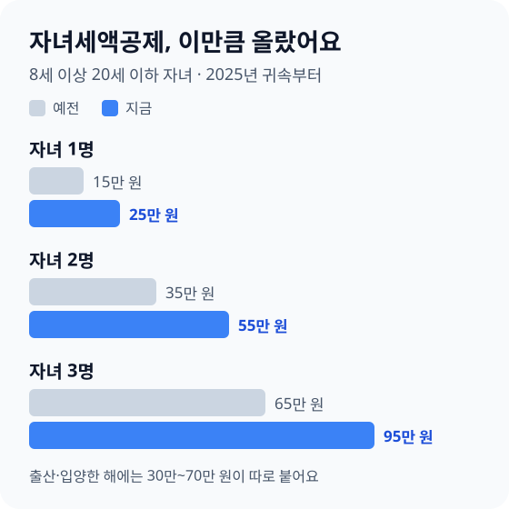

> **바쁜 분을 위한 3줄 요약**
>
> 1. 연말정산 공제는 **연말 절세 체크리스트**를 보며 12월 중순 전에 채우세요.
> 2. 퇴직연금 디폴트옵션과 **실손 세대**를 이번 달에 확인하세요.
> 3. 해외주식 손실 정리와 코인 보유 기록처럼 **12월 31일이 마감인 일**을 이 글의 표로 하나씩 지우세요.

10월 달력을 넘기면 남은 장은 석 장뿐입니다. 회사 메신저에는 벌써 "연말정산 일정 안내" 공지가 올라오기 시작합니다.

"1월에 회사가 알아서 해 주겠지" 하고 넘기기 쉽습니다. 하지만 돌려받을 세금은 **12월 31일까지 한 일로** 정해집니다. 이 글은 세금 공제 밖에서 연말이 마감인 일을 모았고, 연말정산 공제는 마감일만 짚은 뒤 따로 정리한 글로 연결했습니다.

## 세금 공제는 마감일만 확인하고 체크리스트로 챙기세요

연말정산 공제는 **12월 중순까지 연금계좌 입금, 12월 31일까지 기부**로 마감됩니다. 항목별 순서와 연봉별 환급액은 [연말 절세 막판 체크리스트](/posts/2026-year-end-tax-saving-checklist.html)에 정리했으니, 여기서는 마감일과 핵심 숫자만 확인하세요.

| 할 일 | 마감 | 핵심 |
|---|---|---|
| 연말정산 미리보기 | 지금 | 카드 사용액이 총급여 25%를 넘었는지 |
| 연금저축·IRP 입금 | 12월 중순 | 연금저축 600만, 합쳐 900만 원까지 |
| 고향사랑기부 | 12월 31일 | 10만 원까지 전액 세액공제 |

연금계좌 공제율은 총급여 5,500만 원 이하면 16.5%, 넘으면 13.2%입니다([소득세법 제59조의3](<https://www.law.go.kr/법령/소득세법/제59조의3>)). 미리보기 화면의 **예상 결정세액이 0원에 가깝다면** 공제를 더 받아도 돌려받을 세금이 없으니, 이 숫자부터 보고 넣을 금액을 정하세요.

## ISA는 만기일과 개편안을 함께 확인하세요

ISA는 계좌 안 이자·배당·매매손익을 합쳐 순이익 200만 원(서민형·농어민 400만 원)까지 비과세하고, 넘는 부분은 9.9%만 떼는 계좌입니다. 연 2,000만 원까지 넣고 못 넣은 한도는 다음 해로 넘어가며, 의무가입 기간은 3년입니다.

**만기가 다가온다면** 60일 안에 연금저축이나 IRP로 옮길지부터 정하세요. 옮긴 금액의 10%, 최대 300만 원을 연금 세액공제 한도에 더해 줍니다.

**아직 계좌가 없다면** 적은 돈으로라도 지금 만드세요. 의무가입 3년은 가입한 날부터 세기 때문입니다.

정부가 추진하는 **국내투자형 ISA**(국내 주식 투자 시 비과세·납입 한도 확대)는 시행이 확정됐는지 아직 확인되지 않았습니다. 가입이나 전환 전에 증권사·금융위원회 공지를 먼저 보세요. 확정 전까지는 기존 중개형 ISA로 국내·해외 ETF를 함께 담는 방식이 그대로 유효합니다.

자세한 내용은 [ISA 계좌 하나로 절세 끝내기](/posts/2026-isa-account-guide.html)와 [ISA 만기 자금 연금계좌 이전](/posts/2026-isa-maturity-pension-transfer-guide.html)에 있습니다.

## 퇴직연금 디폴트옵션을 다시 고르세요

DC형 퇴직연금이나 IRP에 있는 돈은 내가 굴려야 합니다. 퇴직연금 앱을 열어 지금 상품 구성과 **디폴트옵션 위험등급**을 확인하세요.

많은 사람이 디폴트옵션을 초저위험(원리금보장형)으로 골라 두었습니다. 이러면 자동 운용이 되어도 예금과 비슷한 수익률에 머뭅니다. 은퇴까지 10년 넘게 남았다면 위험자산 70% 한도 안에서 TDF나 주식형 ETF로 일부를 옮기는 것을 검토하세요.

- **직접 고르기 어렵다면**: 은퇴 시점에 맞는 적격 TDF 하나로 채우세요. 적격 TDF는 70% 한도에 묶이지 않고 100%까지 담을 수 있습니다.
- **얼마까지 옮길 수 있나요?** 적립금이 5,000만 원이라면 주식형 펀드·ETF 같은 위험자산은 3,500만 원까지 담을 수 있습니다. 한 번에 옮기기 불안하면 3~6개월에 나눠 옮기세요.
- **원리금보장형 만기 알림이 왔다면**: 그냥 두면 다시 예금으로 굴러가는 경우가 많습니다. 그때 상품을 다시 고르세요.

매년 400만 원씩 20년을 넣는다면 연 2%와 연 6%로 굴렸을 때 차이가 **약 5,000만 원입니다**. 한 번 바꿔 두는 것만으로 노후 자금이 이만큼 달라질 수 있습니다.

자세한 배분 예시는 [퇴직연금 DC형 운용 방법](/posts/2026-dc-retirement-pension-guide.html)에 정리했습니다.

## 1·2세대 실손이라면 전환 할인 대상인지 물어보세요

2026년 5월 6일부터 **5세대 실손보험**이 판매되고 있습니다. 보험료는 낮아진 대신, 암·뇌혈관·심장질환 같은 중증이 아닌 비급여 진료는 **자기부담이 50%로** 커졌습니다.

금융당국은 2013년 3월 이전에 가입해 재가입 조건이 없는 1·2세대 가입자가 5세대로 옮기면 **5세대 보험료를 3년간 50% 할인**하는 제도를 발표했습니다. 시행 시기와 대상은 바뀔 수 있으니, 가입한 보험사에 내가 대상인지와 시작 날짜를 직접 확인하세요. 부모님 실손도 함께 물어보면 좋습니다.

전환은 보험료만 보고 정하지 마세요. 최근 3년 비급여 진료비를 조회해, 늘어나는 자기부담이 아끼는 보험료보다 큰지 계산해야 합니다. 전환 후 보험금을 받은 적이 없으면 6개월(받았다면 3개월) 안에 한 번 되돌릴 수 있습니다.

**4세대 가입자라면** 전환보다 할증 관리가 먼저일 수 있습니다. 작년에 받은 비급여 보험금이 100만 원 이상이면 올해 비급여 보험료가 할증(최대 300%)됩니다. 갱신 안내문에서 내 구간을 확인하세요.

**회사 단체실손이 있다면** 개인실손을 해지하지 말고 '개인실손 중지' 제도를 쓰세요. 퇴사 후 다시 살릴 수 있습니다.

계산법은 [내 실손보험 몇 세대? 1~5세대 비교](/posts/2026-health-insurance-generation-guide.html)에 있습니다. 자동차보험 갱신이 다가온다면 [자동차보험료 아끼는 법](/posts/2026-car-insurance-saving-guide.html)으로 특약부터 챙기세요.

## 주식·코인 세금은 지금 기준으로 정리하세요

**금융투자소득세(금투세)는** 2024년 12월 소득세법 개정으로 시행되지 않고 폐지됐습니다. 그래서 주식 세금은 예전 방식 그대로입니다.

- **국내 상장주식 매매차익**: 대주주가 아니면 세금이 없습니다.
- **해외주식 양도차익**: 1년 이익에서 250만 원을 뺀 뒤 22%(지방소득세 포함)를 다음 해 5월에 직접 신고합니다. 같은 해 이익과 손실은 합산하니, 연말 전에 손실 종목을 점검하세요.
- **배당·이자**: 15.4%를 원천징수하고, 1년에 2,000만 원을 넘으면 금융소득종합과세 대상입니다.

**예시**: 올해 해외주식 A에서 1,000만 원 이익을 실현했고, B는 400만 원 손실 중이라고 해 보겠습니다. A만 팔면 (1,000만 − 250만) × 22% = **165만 원**을 냅니다. 연내에 B도 팔아 손실을 확정하면 (600만 − 250만) × 22% = **77만 원으로** 88만 원이 줄어듭니다.

해외주식은 결제일 기준으로 연도가 갈리니, 12월 마지막 주보다 일찍 정리하세요. 계속 갖고 싶은 종목이라면 판 뒤 다시 사는 방법도 있지만, 그사이 가격이 움직일 수 있다는 점을 감안하세요.

**가상자산(코인)은** 현행 법대로라면 **2027년 1월 1일부터** 과세됩니다. 1년 수익에서 250만 원을 뺀 뒤 22%를 내고, 첫 신고는 2028년 5월입니다. 국회에 유예·폐지 법안도 있어 바뀔 수 있으니 시행 전 발표를 확인하세요.

코인을 갖고 있다면 **2026년 12월 31일** 보유 수량과 시세를 꼭 기록하세요. 그날 시가와 실제로 산 가격 가운데 큰 금액이 취득가액이 되기 때문입니다. 자세한 내용은 [가상자산 과세 2027년 시행](/posts/2026-crypto-asset-tax-guide.html)에 정리했습니다.

## 오른 자녀세액공제와 출산 공제를 확인하세요

**자녀세액공제**는 2025년 귀속 연말정산부터 자녀 1명당 10만 원씩 올랐습니다. 기본공제 대상인 20세 이하 자녀 가운데 2025년 귀속은 8세 이상, 2026년 귀속은 9세 이상이 대상입니다. 아동수당 지급 나이가 늘어나면서 2030년 귀속에는 13세 이상까지 해마다 한 살씩 올라갑니다.

| 자녀 수 | 2024년 귀속까지 | 2025년 귀속부터 |
|---|---|---|
| 1명 | 15만 원 | 25만 원 |
| 2명 | 35만 원 | 55만 원 |
| 3명 | 65만 원 | 95만 원 |

회사에 낸 부양가족 신고서에 자녀가 빠짐없이 올라 있는지 보세요. 맞벌이라면 한 자녀는 부부 중 한 사람만 공제받습니다. 둘 다 올리면 나중에 가산세와 함께 추징됩니다.

올해 아이를 낳거나 입양했다면 **출산·입양 세액공제**가 따로 붙습니다. 첫째 30만 원, 둘째 50만 원, 셋째 이상 70만 원입니다.

이 밖에 놓치기 쉬운 항목도 있습니다. 월세를 산다면 [월세 세액공제](/posts/2026-rent-tax-credit-guide.html)로 낸 월세의 15~17%를, 보장성 보험료는 연 100만 원 한도로 12%(지방소득세 포함 13.2%)를 돌려받습니다.

## 연말 목돈은 쓸 날짜에 맞춰 넣으세요

성과급이나 연말 보너스가 들어오면 먼저 **언제 쓸 돈인지** 나누세요. 한 달 안에 쓸 돈과 비상금은 파킹통장, 3개월 넘게 안 쓸 돈은 정기예금이 맞습니다.

2025년 9월 1일부터 예금자보호 한도가 1인당 금융회사별 **1억 원으로** 올랐습니다. 원금과 이자를 합쳐 1억 원이 넘는다면 금융회사를 나눠 넣으세요. 자세한 비교는 [파킹통장 vs CMA vs 정기예금](/posts/2026-parking-savings-guide.html)에 있습니다.

연말에는 카드값도 커집니다. 카드값·대출 이자는 월급날 다음 날로 자동이체를 걸어 연체를 막으세요.

10만 원 이상을 5영업일 이상 밀리면 신용평가사에 공유돼 점수가 떨어집니다. 점수 관리는 [신용점수 올리는 법](/posts/2026-credit-score-guide.html)을 참고하세요.

## 자주 하는 실수를 피하세요

- **연금저축에만 900만 원 넣기**: 연금저축은 600만 원까지만 공제됩니다. 300만 원은 IRP로 넣으세요.
- **12월 31일에 입금하기**: 이체가 밀리거나 휴일이면 다음 해 납입이 됩니다. 12월 중순까지 끝내세요.
- **결정세액을 안 보고 공제부터 채우기**: 결정세액이 0원이면 세액공제를 더 받아도 돌려받을 돈이 없습니다. 미리보기로 먼저 확인하세요.
- **맞벌이 부부가 같은 자녀를 둘 다 올리기**: 한 자녀는 한 사람만 공제받습니다.
- **전화 한 통에 실손 전환하기**: 진료 기록을 보고 계산한 뒤 정해도 늦지 않습니다.
- **개편안을 확정된 것처럼 믿기**: 국내투자형 ISA, 가상자산 과세 일정처럼 바뀔 수 있는 제도는 공식 발표로 확인하세요.

## 이미 놓쳤다면

- **지난해 연말정산에서 빠뜨린 공제가 있다면**: 법정 신고기한부터 5년 안에 홈택스에서 경정청구로 돌려받을 수 있습니다. 월세·의료비·부양가족 공제를 많이 놓칩니다.
- **올해 연금계좌 입금을 놓쳤다면**: 연금 세액공제 한도는 다음 해로 넘어가지 않습니다. 내년에는 1월부터 매달 나눠 넣도록 자동이체를 걸어 두세요.
- **ISA 만기 60일이 지났다면**: 추가 공제는 받을 수 없습니다. 대신 새 ISA를 열어 다시 3년을 시작하고, 다음 만기일을 달력에 적어 두세요.

## 자주 묻는 질문

**Q. 연말 전에 꼭 챙길 금융 일정은 무엇인가요?**
연금저축·IRP 납입, ISA 만기 자금 이전, 퇴직연금 디폴트옵션 점검, 실손 세대 확인입니다. 연금계좌 납입은 12월 중순까지 끝내세요.

**Q. 금융투자소득세(금투세)는 시행되나요?**
시행되지 않습니다. 2024년 12월 소득세법 개정으로 폐지돼 주식 세금은 예전 방식 그대로입니다.

**Q. 성과급 같은 연말 목돈은 어디에 두나요?**
쓸 날짜로 나누세요. 한 달 안에 쓸 돈과 비상금은 파킹통장, 3개월 넘게 안 쓸 돈은 정기예금에 둡니다.

## 하반기 금융 체크리스트

| 언제까지 | 할 일 |
|---|---|
| 10~11월 | 연말정산 미리보기, 25% 넘었으면 체크카드로 |
| 11월 | 퇴직연금 디폴트옵션, 실손 세대·전환 할인 확인 |
| 12월 중순 | 연금저축·IRP 900만 원 채우기, 고향사랑기부 |
| 12월 31일 | 올해 공제 마감, 코인 보유 수량·시세 기록 |
| 1월 | 간소화 자료로 자녀·월세·보험 공제 확인 |
| ISA 만기 후 60일 | 연금계좌 이전 여부 결정 |

금융은 아는 만큼 지킵니다. 하지만 아는 것보다 **달력에 적는 것**이 더 중요합니다. 오늘 홈택스 미리보기를 열고, 위 표의 마감일을 휴대폰 일정에 옮겨 두세요.

※ 국내투자형 ISA, 5세대 실손 전환 할인, 가상자산 과세 일정은 바뀔 수 있습니다. 실제 결정 전에 금융위원회·국세청·보험사 공식 안내를 확인하세요.

---

> 🐷 **직접 계산해 보세요: [연금저축·IRP 세액공제 계산기 →](/apps/pension-tax-calculator/)**  
> 소득과 납입액만 넣으면 올해 예상 환급액을 바로 계산해 드려요. 월세를 산다면 [월세 세액공제 계산기](/apps/rent-tax-credit-calculator/)도 함께 써 보세요. 연말에 할 일을 더 자세히 보고 싶다면 [연말 절세 막판 체크리스트](/posts/2026-year-end-tax-saving-checklist.html)를 읽어 보세요.
