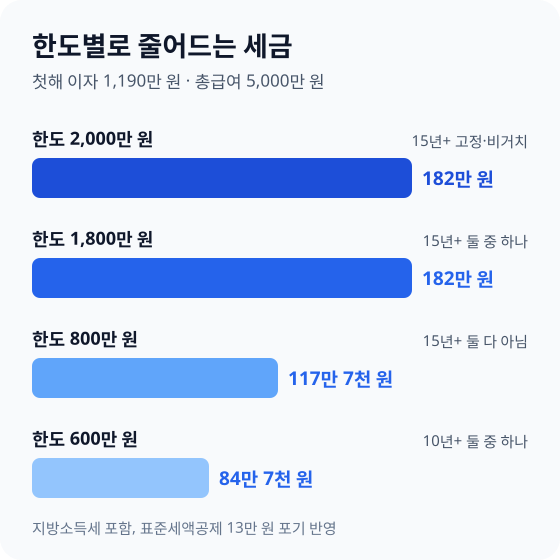
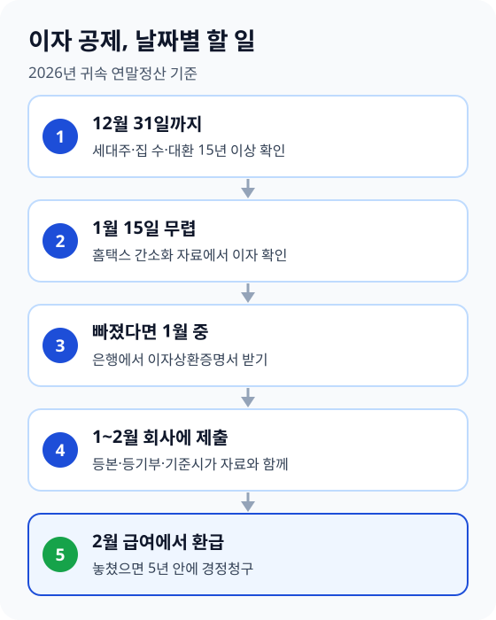

> **바쁜 분을 위한 3줄 요약**
>
> 1. 대출 약정서에서 상환기간·고정금리 비율·거치기간 세 가지를 찾아 내 공제 한도를 확인하세요.
> 2. 12월 31일 기준으로 세대주인지, 집이 1채인지 주민등록등본과 등기부로 확인하세요.
> 3. 1월 간소화 자료에 이자가 안 보이면 은행에서 이자상환증명서를 받아 회사에 내세요.

매달 빠져나가는 주택담보대출 원리금, 그 가운데 이자가 1년에 얼마인지 알고 계신가요? 은행 앱의 상환 내역을 1년 치 더해 보면 생각보다 큰 숫자가 나옵니다.

이 이자는 조건만 맞으면 연말정산에서 소득공제를 받습니다. 3억 원을 30년, 연 4%로 빌렸다면 첫해 이자만 약 1,190만 원이고, 총급여 5,000만 원 직장인이면 세금이 182만 원 넘게 줄어듭니다. 이 글은 2026년 11월 기준 소득세법 조문으로 조건을 확인하고, 우리 연말정산 계산기 방식으로 금액을 계산했습니다.

## 내 대출이 공제 대상인지 다섯 가지로 확인하세요

다섯 가지를 모두 채워야 공제를 받습니다. 하나라도 빠지면 이자를 아무리 많이 냈어도 공제는 0원입니다([소득세법 제52조](<https://www.law.go.kr/법령/소득세법/제52조>), [소득세법 시행령 제112조](<https://www.law.go.kr/법령/소득세법시행령/제112조>)).

| 확인할 것 | 조건 | 어디서 보나 |
|---|---|---|
| 사람 | 근로소득이 있는 세대주 | 주민등록등본 |
| 집 수 | 무주택 또는 1주택 세대 | 등기부, 가족 보유 집 |
| 집값 | 취득 당시 기준시가 6억 원 이하 | 공시가격 조회 |
| 빌린 때 | 소유권 이전등기 후 3개월 안 | 대출 약정서 날짜 |
| 명의 | 대출 채무자 = 집 소유자 | 등기부와 약정서 |

세대주 여부와 집 수는 **12월 31일 현재**로 판단합니다. 세대 구성원이 가진 집까지 합쳐 그날 2주택 이상이면 그해는 공제를 받지 못합니다.

세대주가 아닌 세대원도 받을 수 있는 경우가 있습니다. 세대주가 주택자금 공제를 받지 않고, 그 세대원이 그 집에 실제로 살고 있어야 합니다. 세대주는 실제 거주 여부와 관계없이 적용됩니다.

기준시가는 지금 가격이 아니라 **취득 당시** 가격을 봅니다. 산 뒤 공시가격이 6억 원을 넘게 올랐어도 산 때 6억 원 이하였다면 대상입니다. 새 아파트처럼 공시가격이 나오기 전에 빌렸다면 그 뒤 처음 공시된 가격으로 판단합니다.

## 한도는 상환기간과 금리 방식으로 정해집니다

공제 한도는 **연 600만 원에서 2,000만 원**까지 네 단계입니다. 대출 약정서에서 상환기간, 고정금리인지, 거치기간이 있는지만 찾으면 내 단계가 나옵니다.

| 상환기간 | 고정금리·비거치 | 공제 한도 |
|---|---|---|
| 15년 이상 | 둘 다 해당 | 2,000만 원 |
| 15년 이상 | 하나만 해당 | 1,800만 원 |
| 15년 이상 | 둘 다 아님 | 800만 원 |
| 10년 이상 | 하나 이상 해당 | 600만 원 |

여기서 "고정금리"는 대출금의 **70% 이상**에 고정금리를 적용하는 경우입니다. 5년 이상 단위로 금리를 바꾸는 방식도 고정금리로 봅니다. 그래서 흔한 "5년 고정 후 변동" 혼합형도 고정금리로 인정될 수 있습니다.

"비거치식"은 이자만 내는 기간이 **1년 이내**이고, 그 뒤 매년 정해진 금액 이상 원금을 갚는 방식입니다. 처음부터 원리금을 같이 갚는 원리금균등·원금균등 상환이면 대부분 해당합니다.

한 가지 더 기억하세요. 이 한도는 청약통장 소득공제와 전세대출 원리금 공제를 **합친 금액**입니다. 청약통장으로 이미 공제를 받는다면 그만큼 이자 공제 한도가 줄어듭니다.

## 총급여별로 돌려받는 금액을 계산해 보세요

이자 1,190만 원을 다 공제받으면 총급여 5,000만~7,000만 원은 약 182만 원, 1억 원은 약 300만 원을 덜 냅니다. 소득공제는 과세표준을 줄이므로, 내 세율이 높을수록 같은 이자로 더 많이 줄어듭니다.

예를 들어 3억 원을 30년 원리금균등, 연 4%로 빌렸다고 가정해 보겠습니다. 매달 143만 2천 원쯤 갚고, 첫해에 낸 이자는 약 1,190만 원입니다. 한도 1,800만 원 이상 대출이면 이 이자를 전부 공제받습니다.

| 총급여 | 원래 낼 세금 | 이자 1,190만 원 공제 시 덜 내는 세금 |
|---|---|---|
| 4,000만 원 | 157만 3,490원 | 123만 3,040원 |
| 5,000만 원 | 292만 4,550원 | 182만 500원 |
| 7,000만 원 | 573만 8,880원 | 182만 500원 |
| 1억 원 | 1,279만 4,490원 | 299만 8,600원 |

계산 조건은 본인 1명, 4대보험 공제만 있고 카드 공제는 없는 경우입니다. 세금은 지방소득세를 포함했고, 공제를 받으면서 잃는 표준세액공제 13만 원도 뺐습니다. 부양가족이나 카드 공제가 있으면 금액이 달라집니다.

총급여 4,000만 원은 공제 뒤 과세표준이 15% 구간에서 6% 구간으로 내려가서 덜 내는 금액이 작아집니다. 원래 낼 세금보다 많이 돌려받을 수는 없다는 점도 기억하세요.

같은 이자라도 한도에 따라 차이가 큽니다. 총급여 5,000만 원이라면 한도 800만 원 대출은 117만 7천 원, 600만 원 대출은 84만 7천 원만 줄어듭니다.

## 이자가 적으면 표준세액공제와 비교하세요

이자를 공제받으면 **표준세액공제 13만 원**을 받을 수 없습니다. 법이 주택자금 소득공제를 신청하지 않은 근로자에게만 13만 원을 주기 때문입니다([소득세법 제59조의4](<https://www.law.go.kr/법령/소득세법/제59조의4>)).

그래서 이자가 아주 적으면 오히려 손해일 수 있습니다. 총급여 5,000만 원, 다른 특별공제가 없는 1인 가구로 계산하면 이자 50만 원을 공제받을 때 세금이 6만 500원 늘어납니다.

| 1년 이자 | 덜 내는 세금 | 판단 |
|---|---|---|
| 50만 원 | -6만 500원 | 신청하지 않기 |
| 80만 원 | -1만 1천 원 | 신청하지 않기 |
| 90만 원 | 5,500원 | 신청하기 |
| 100만 원 | 2만 2천 원 | 신청하기 |

15% 세율 구간이면 1년 이자 약 90만 원이 갈림길입니다. 대출 막바지라 이자가 적거나 연말에 대출을 받아 이자를 몇 달만 냈다면 한 번 비교해 보세요. 보험료·의료비 세액공제를 이미 받는다면 표준세액공제는 어차피 없으니 신청하는 쪽이 낫습니다.

## 12월 31일 전에 할 일을 챙기세요

연말정산 결과는 12월 31일 상황으로 정해집니다. 아래 세 가지는 해가 바뀌기 전에 확인해야 바꿀 수 있습니다.

첫째, **세대주를 확인하세요.** 부부가 함께 사는데 대출 명의자가 세대주가 아니라면 세대주가 주택자금 공제를 받지 않고 대출자가 그 집에 살 때만 공제됩니다. 둘 다 조건이 애매하면 주민센터에서 세대주 변경을 할지 미리 따져 보세요.

둘째, **집 수를 확인하세요.** 이사하면서 새집을 사고 옛집을 아직 못 팔았다면 12월 31일에 2주택이 됩니다. 그해는 공제를 받지 못하니 잔금일과 매도 일정을 함께 보세요.

셋째, **대출을 갈아탈 계획이면 조건을 지키세요.** 다른 은행으로 옮겨도 새 대출이 기존 대출 잔액을 바로 갚고 상환기간이 15년 이상이면 공제가 이어집니다. 기존 잔액을 넘는 추가 대출분 이자는 공제되지 않습니다.

## 간소화 자료에 없으면 서류를 직접 내세요

대부분은 1월 중순 홈택스 연말정산 간소화 자료에 이자상환액이 나옵니다. 하지만 공제 요건을 은행이 다 알 수는 없어 빠지거나, 나와 있어도 회사에 증빙을 따로 내야 하는 경우가 있습니다.

1. 홈택스에서 **연말정산 간소화** 메뉴로 들어가 소득·세액공제 자료를 조회합니다.
2. 주택자금 항목에서 장기주택저당차입금 이자상환액이 나왔는지 봅니다.
3. 없으면 대출 은행 앱이나 창구에서 **장기주택저당차입금 이자상환증명서**를 받습니다.
4. 주민등록등본, 등기부등본, 취득 당시 기준시가를 확인할 자료와 함께 회사에 냅니다.

회사마다 받는 서류가 조금씩 다르니 담당 부서 안내를 먼저 확인하세요. 대출을 갈아탔다면 새 은행뿐 아니라 옛 은행 이자상환증명서도 함께 내야 1년 치 이자가 다 들어갑니다.

## 자주 하는 실수를 피하세요

**부부 공동명의 집을 한 사람 이름으로 빌린 대출**이라도 채무자가 소유자 중 한 명이면 조건을 채울 수 있습니다. 반대로 집은 배우자 단독명의인데 내 이름으로 빌렸다면 채무자와 소유자가 달라 공제받지 못합니다.

**잔금 뒤 3개월이 지나 받은 대출**은 집을 사려고 빌렸어도 대상이 아닙니다. 신용대출로 잔금을 치르고 몇 달 뒤 주택담보대출로 바꾼 경우가 여기에 걸리기 쉽습니다.

**만기 10년 미만 대출**은 아예 공제 대상이 아닙니다. 다만 만기를 15년 이상으로 늘리거나 15년 이상 새 대출로 갚으면 그때부터 다시 대상이 될 수 있고, 이때는 그 시점 기준시가가 6억 원 이하여야 합니다.

정부가 세대주에게도 실제 거주 요건을 붙이는 개정을 추진한다는 보도가 있습니다. 이 글을 쓰는 시점에는 국회 통과 여부를 확인하지 못했으니, 집에 살지 않는 세대주라면 12월 말 확정 내용을 다시 확인하세요.

## 이미 놓쳤다면 5년 안에 되찾으세요

지난 연말정산에서 이자 공제를 빠뜨렸다면 **법정신고기한부터 5년 안에** 경정청구로 돌려받을 수 있습니다. 홈택스에서 신청하고, 이자상환증명서와 등본·등기부를 같이 올리면 됩니다.

방법은 [연말정산 경정청구 방법](/posts/2026-year-end-tax-correction-claim-guide.html) 글에 단계별로 정리했습니다. 몇 해 치를 한꺼번에 신청해도 됩니다.

전세로 살면서 전세대출을 갚고 있다면 이 공제가 아니라 주택임차차입금 원리금 상환액 공제를 봐야 합니다. 이자와 원금을 합쳐 계산하고 조건도 다르니, [전세대출 vs 월세 비교](/posts/2026-jeonse-loan-vs-monthly-rent-guide.html) 글과 함께 확인하세요.

## 자주 묻는 질문

**Q. 주택담보대출 이자 소득공제 한도는 얼마인가요?**
상환기간 15년 이상이면서 고정금리·비거치식이면 연 2,000만 원, 둘 중 하나면 1,800만 원, 둘 다 아니면 800만 원입니다. 상환기간 10년 이상 15년 미만은 고정금리나 비거치식일 때 600만 원입니다.

**Q. 집값이 올라 공시가격이 6억 원을 넘었는데 공제가 끊기나요?**
끊기지 않습니다. 기준시가 6억 원 이하는 집을 취득할 당시를 기준으로 판단합니다.

**Q. 세대주가 아니면 주택담보대출 이자 공제를 못 받나요?**
세대주가 주택자금 공제를 받지 않고, 대출받은 세대원이 그 집에 실제로 살면 받을 수 있습니다.

**Q. 5년 고정 후 변동금리 대출도 고정금리로 인정되나요?**
대출금의 70% 이상에 5년 이상 단위로 금리가 바뀌는 방식이면 고정금리로 봅니다. 약정서의 금리 변경 주기를 확인하세요.

**Q. 대출을 갈아타면 공제가 끊기나요?**
새 대출이 기존 대출 잔액을 바로 갚고 상환기간이 15년 이상이면 이어집니다. 기존 잔액을 넘는 추가 대출분 이자는 공제되지 않습니다.

## 연말정산 전 체크리스트

| 언제 | 할 일 |
|---|---|
| 12월 31일까지 | 세대주·집 수 확인, 대환 시 15년 이상인지 확인 |
| 12월 31일까지 | 대출 약정서에서 상환기간·고정금리·거치기간 확인 |
| 1월 중순 | 간소화 자료에서 이자상환액 확인 |
| 1월 중 | 빠졌으면 이자상환증명서 받기 |
| 1~2월 | 등본·등기부와 함께 회사에 제출 |

오늘은 대출 약정서 한 장만 꺼내 상환기간과 금리 방식을 표에 맞춰 보세요. 내 한도를 알면 1월에 할 일이 정해집니다.

세법 수치는 2026년 11월 기준 국가법령정보센터 조문으로 확인했습니다. 연말정산 전에는 국세청 홈택스 안내로 최신 기준을 다시 확인하세요. 금리 방식 고르기는 [주택담보대출 고정금리 vs 변동금리](/posts/2026-mortgage-fixed-vs-variable-rate-guide.html), 갈아타기는 [대환대출 갈아타기](/posts/2026-loan-refinancing-guide.html), 연말정산 전체 흐름은 [연말정산 소득공제 놓치기 쉬운 항목 총정리](/posts/2026-year-end-tax-settlement-guide.html)에서 이어서 보세요.

**직접 계산해 보세요**: [연말정산 환급 계산기](/apps/year-end-tax-calculator/)로 올해 환급액을 먼저 확인하고, 대출을 옮길지 고민 중이면 [대출 갈아타기 계산기](/apps/loan-refinance-calculator/)로 이자 차이와 수수료를 비교해 보세요.
