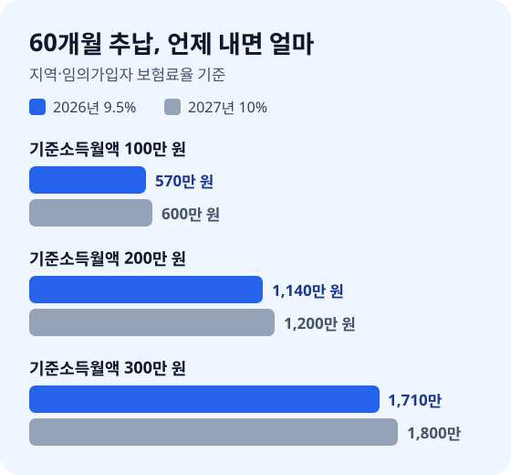
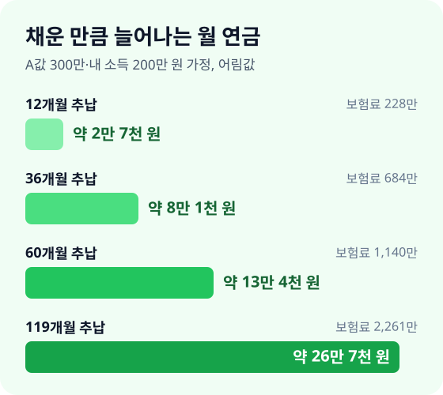

> **바쁜 분을 위한 3줄 요약**
>
> 1. 국민연금공단에서 내 가입 내역을 떼어 **보험료를 못 낸 개월 수**부터 세어 보세요.
> 2. 추납할 생각이라면 보험료율 9.5%가 적용되는 **11월 안에 신청하세요**.
> 3. 가입 기간이 10년이 안 된다면 **임의가입이나 임의계속가입**으로 120개월부터 채우세요.

국민연금 가입 내역서를 펼쳐 보니 중간중간 빈칸이 있습니다. 회사를 그만두고 쉬던 1년, 아이를 키우느라 일을 놓았던 몇 년이 그대로 비어 있습니다.

이 빈칸은 대부분 나중에 돈을 내고 다시 채울 수 있습니다. 다만 2026년부터 보험료율이 해마다 0.5%p씩 오르기 때문에, 같은 기간도 늦게 채울수록 비싸집니다. 2026년 11월 기준 국민연금법 조문으로 확인한 숫자로 정리했습니다.

## 빈 기간을 채우는 방법 세 가지부터 구분하세요

국민연금 가입 기간을 늘리는 방법은 추납, 임의가입·임의계속가입, 반납 세 가지입니다. 내 빈칸이 어떤 이유로 생겼는지에 따라 쓸 수 있는 방법이 다릅니다.

- **추후납부(추납)**: 실직·휴직·경력단절처럼 보험료를 못 낸 과거 기간을 지금 돈을 내고 채웁니다.
- **임의가입·임의계속가입**: 소득이 없어 가입 의무가 없는 사람이 스스로 가입해 앞으로의 기간을 쌓습니다.
- **반납**: 예전에 반환일시금으로 돌려받은 돈에 이자를 붙여 다시 내고, 그 기간을 되살립니다.

세 가지 모두 "가입 기간"을 늘린다는 점이 같습니다. 국민연금은 가입 기간이 길수록 연금이 늘고, **10년(120개월)을 못 채우면 연금 대신 낸 돈과 이자만 돌려받습니다**([국민연금법 제77조](<https://www.law.go.kr/법령/국민연금법/제77조>)).

## 추납할 수 있는 기간인지 확인하세요

추납은 10년 미만, 즉 최대 119개월까지 신청할 수 있습니다([국민연금법 제92조](<https://www.law.go.kr/법령/국민연금법/제92조>)). 다만 아무 기간이나 되는 것은 아니고, 법이 정한 세 종류의 기간만 채울 수 있습니다.

| 추납할 수 있는 기간 | 예시 |
|---|---|
| 첫 보험료를 낸 뒤 납부 예외였던 기간 | 실직·휴직·사업 중단·재학 |
| 첫 보험료를 낸 뒤 적용 제외였던 기간 | 소득 없는 배우자(경력단절) |
| 병역 의무를 마친 뒤 가입한 사람의 복무 기간 | 현역병·사회복무요원 등 |

핵심은 **"첫 보험료를 낸 뒤"라는 조건입니다**. 예를 들어 대학 시절 보험료를 한 번도 낸 적이 없다면 그 시절은 추납 대상이 아닙니다. 반대로 졸업 후 1년 일하다 그만두고 결혼해 쉰 기간은 대상이 됩니다.

또 하나, 추납은 **지금 가입자인 사람만** 신청할 수 있습니다. 직장인·지역가입자는 바로 신청하면 되고, 소득이 없는 전업주부라면 임의가입을 먼저 한 뒤 추납을 신청하는 순서입니다.

## 추납 보험료는 신청한 달 소득으로 계산하세요

추납 보험료는 "지금 내 기준소득월액 × 보험료율 × 채울 개월 수"입니다. 과거에 벌던 소득이 아니라 **추납을 신청한 달의 소득**을 기준으로 계산합니다(국민연금법 제92조 제3항).

보험료율은 2025년 법 개정으로 해마다 오릅니다. 지역가입자·임의가입자 기준으로 2026년 9.5%, 2027년 10%이고, 2032년 12.5%를 거쳐 13%까지 올라갑니다([국민연금법](<https://www.law.go.kr/법령/국민연금법>) 제88조와 부칙 제4조, 법률 제20903호).

| 기준소득월액 | 60개월 추납(9.5%) | 60개월 추납(10%) |
|---|---|---|
| 100만 원 | 570만 원 | 600만 원 |
| 200만 원 | 1,140만 원 | 1,200만 원 |
| 300만 원 | 1,710만 원 | 1,800만 원 |

같은 60개월이라도 2027년으로 넘어가면 기준소득월액 200만 원 기준 60만 원을 더 냅니다. 한꺼번에 내기 어렵다면 **최대 60회까지 나눠 낼 수 있고**, 이때는 1년 만기 정기예금 이자율 수준의 이자가 붙습니다([국민연금법 시행령 제62조](<https://www.law.go.kr/법령/국민연금법시행령/제62조>), 제52조 준용).

## 11월 안에 신청하면 9.5%가 확실합니다

일시납 추납 보험료는 **신청한 달의 다음 달 말일까지** 내고([국민연금법 시행령 제62조](<https://www.law.go.kr/법령/국민연금법시행령/제62조>) 제4항, 제52조 제1항 준용), 그 **납부 기한이 속한 달의 요율**로 계산합니다(국민연금법 제92조 제3항, 2025년 11월 개정). 그래서 11월에 신청하면 기한이 12월 말이라 2026년 요율 9.5%가 적용됩니다.

12월에 신청하면 납부 기한이 2027년 1월 말이 되어, 원칙대로라면 2027년 요율 10%로 계산됩니다. 예전에는 신청한 달 기준이었기 때문에 12월 신청도 그해 요율이었지만, 2025년 11월 개정으로 기준이 바뀌었습니다.

정리하면 날짜별로 이렇게 갈립니다.

- **11월에 신청**: 납부 기한이 12월 말이라 9.5%로 계산됩니다.
- **12월에 신청**: 납부 기한이 1월이라 원칙적으로 10%입니다.
- **2027년에 신청**: 10%로 계산됩니다.

12월에 신청하고 같은 달 안에 내면 그해 요율을 적용하는 부칙 특례가 있다는 설명도 있습니다. 다만 2026년 11월 현재 법령 원문과 공단 안내에서 직접 확인하지 못했으니, 12월에 신청할 계획이라면 공단에 적용 요율부터 확인하세요. 가장 확실한 방법은 **11월 안에 신청하는 것**입니다.

나눠 내기를 고르면 첫 회차가 신청한 다음 달부터라 요율 계산이 달라질 수 있습니다. 분할 납부를 생각한다면 신청 전에 국민연금공단에서 회차별 금액과 요율이 담긴 계산서를 받아 보세요.

## 늘어나는 연금을 어림 계산해 보세요

추납으로 늘어나는 연금은 한 달 채울 때마다 대략 "(A값 + 내 평균소득) × 0.0448%"입니다. 2026년 이후 가입 기간의 연금 계산 상수 1.290(소득대체율 43%)으로 20년 가입 때의 연금을 구한 뒤, 이를 240개월로 나눠 한 달 몫을 어림한 값입니다([국민연금법 제51조](<https://www.law.go.kr/법령/국민연금법/제51조>)).

추납한 기간의 연금은 **추납 보험료를 낸 달을 기준으로** 계산합니다(제92조 제5항). 그래서 2026년에 내면 예전 낮은 대체율이 아니라 2026년 기준(43%)으로 연금이 붙습니다.

예를 들어 A값(가입자 전체 평균소득)을 300만 원, 내 평균소득을 200만 원으로 가정하면 한 달 채울 때마다 연금이 월 약 2,240원 늘어납니다. 아래 금액은 지금 돈 가치 기준의 어림값이고, 실제 금액은 공단 예상연금 조회로 확인하세요.

| 추납 개월 수 | 늘어나는 월 연금(어림) | 드는 보험료(9.5%) |
|---|---|---|
| 12개월 | 약 2만 7천 원 | 228만 원 |
| 36개월 | 약 8만 1천 원 | 684만 원 |
| 60개월 | 약 13만 4천 원 | 1,140만 원 |
| 119개월 | 약 26만 7천 원 | 2,261만 원 |

60개월을 채우면 1,140만 원을 내고 월 약 13만 4천 원을 더 받습니다. **약 7년 1개월을 받으면 낸 돈을 회수**하고, 그 뒤로는 평생 더 받는 구조입니다. 국민연금은 해마다 물가만큼 오르므로 실제 회수 기간은 이보다 짧아질 수 있습니다.

## 소득이 없다면 임의가입으로 기간을 쌓으세요

18세 이상 60세 미만이고 직장·지역가입자가 아니라면 스스로 신청해 임의가입자가 될 수 있습니다([국민연금법 제10조](<https://www.law.go.kr/법령/국민연금법/제10조>)). 전업주부, 소득 없는 학생, 은퇴 준비 중인 무소득자가 대상입니다.

임의가입자의 기준소득월액은 매년 지역가입자 전체의 **중위수 소득**으로 정해지고, 해당 연도 4월부터 다음 해 3월까지 적용됩니다([국민연금법 시행령 제10조](<https://www.law.go.kr/법령/국민연금법시행령/제10조>)). 원하면 이보다 높게 정해 더 낼 수도 있습니다.

예를 들어 중위수가 100만 원이라면 2026년 보험료는 월 9만 5천 원입니다. A값 300만 원으로 같은 방식으로 계산하면 한 달 가입마다 연금이 월 약 1,790원 늘어, **약 4년 5개월을 받으면 그달 보험료를 회수**합니다. 요율이 13%까지 오르면 회수 기간은 약 6년으로 길어집니다.

임의가입자가 추납할 때는 보험료 상한이 있습니다. A값에 그해 요율을 곱한 금액을 넘지 않도록 정해 두어, 고소득 기준으로 한꺼번에 채우는 것은 막혀 있습니다(시행령 제62조 제2항, 2025년 12월 개정).

## 60세에 10년이 안 됐다면 임의계속가입을 하세요

60세가 됐는데 가입 기간이 10년에 못 미치면, **65세가 될 때까지 임의계속가입**으로 보험료를 더 내고 기간을 채울 수 있습니다([국민연금법 제13조](<https://www.law.go.kr/법령/국민연금법/제13조>)). 10년을 넘긴 사람도 연금을 늘리려고 신청할 수 있습니다.

60세에 반환일시금을 받아 버리면 임의계속가입을 할 수 없습니다(제13조 제1항 단서). 예를 들어 60세에 가입 기간이 100개월이라면, 일시금을 받기 전에 20개월만 더 채우면 평생 연금을 받을 수 있는지부터 계산하세요.

## 예전에 돌려받은 돈이 있다면 반납을 계산하세요

반환일시금을 받은 적이 있는 사람이 다시 가입자가 되면, 받은 돈에 이자를 붙여 반납하고 그 기간을 되살릴 수 있습니다([국민연금법 제78조](<https://www.law.go.kr/법령/국민연금법/제78조>)). 이자는 받은 날부터 1년 만기 정기예금 이자율로 계산합니다.

반납금도 나눠 낼 수 있습니다. 가입 기간이 1년 미만이면 3회, 1년 이상 5년 미만이면 12회, 5년 이상이면 24회까지입니다([국민연금법 시행령 제52조](<https://www.law.go.kr/법령/국민연금법시행령/제52조>)).

반납은 예전 기간을 되살리는 것이라 추납과 계산 방식이 다를 수 있습니다. 예전 가입 기간이 길수록 공단에서 반납 전후 예상 연금을 함께 받아 보고 정하세요.

## 내 상황에 맞는 방법을 고르세요

내 빈칸이 어디서 생겼는지에 따라 먼저 할 일이 다릅니다. 아래 표에서 가장 가까운 줄을 찾아보세요.

| 상황 | 쓸 방법 | 먼저 할 일 |
|---|---|---|
| 직장인, 예전 실직·휴직 기간 있음 | 추납 | 11월 안에 신청 |
| 전업주부, 결혼 전 납부 이력 있음 | 임의가입 + 추납 | 임의가입 신청 후 추납 개월 수 정하기 |
| 전업주부, 납부 이력 없음 | 임의가입 | 매달 낼 금액 정하고 자동이체 |
| 50대, 가입 기간 10년 미만 | 추납 + 임의가입 | 120개월까지 남은 개월 수 계산 |
| 60세, 가입 기간 10년 미만 | 임의계속가입 | 반환일시금 받기 전에 신청 |
| 예전에 일시금을 받음 | 반납 | 반납금과 늘어나는 연금 비교 |

## 신청은 이 순서로 하세요

신청은 국민연금공단 지사 방문이나 공단 홈페이지·모바일 앱에서 합니다. 화면 메뉴 이름은 바뀔 수 있으니 아래 순서만 기억하세요.

1. **가입 내역 조회**: 공단에서 내 가입 내역을 떼어 납부 예외·적용 제외 개월 수를 확인합니다.
2. **예상 연금 조회**: 지금 기준 예상 연금액을 메모해 둡니다.
3. **추납 금액 계산 요청**: 채울 개월 수를 정해 일시납·분할납 금액을 받아 봅니다.
4. **신청과 납부**: 11월에 신청했다면 12월 말까지 납부합니다.
5. **반영 확인**: 다음 달 가입 내역에 기간이 늘었는지, 예상 연금이 바뀌었는지 다시 봅니다.

## 자주 하는 실수를 피하세요

- **첫 납부 전 기간까지 채우려 하기**: 보험료를 한 번도 내지 않은 시절은 추납 대상이 아닙니다.
- **생활비로 쓸 돈까지 넣기**: 추납 보험료는 돌려받을 수 없습니다. 비상금을 남기고 남는 돈으로 정하세요.
- **119개월을 한 번에 채우기**: 상한까지 채울 필요는 없습니다. 10년 채우기, 회수 기간처럼 목표를 정해 개월 수를 고르세요.
- **건강보험 피부양자 기준을 잊기**: 연금이 늘면 연금소득도 늘어 은퇴 뒤 피부양자 기준에 걸릴 수 있습니다.

## 이미 신청 시기를 놓쳤다면

2027년 1월에 신청해도 추납은 할 수 있습니다. 요율이 10%로 계산될 뿐이라, 기준소득월액 200만 원·60개월이면 1,140만 원이 1,200만 원이 됩니다.

해마다 요율이 0.5%p씩 오르니 미룰수록 같은 기간이 비싸집니다. 올해를 놓쳤다면 내년 11월 안에 신청하는 것을 목표로 다시 계획하세요.

## 자주 묻는 질문

**Q. 국민연금 추납은 몇 개월까지 할 수 있나요?**
10년 미만, 즉 최대 119개월까지입니다. 첫 보험료를 낸 뒤 실직·휴직·경력단절로 못 낸 기간과 군 복무 기간이 대상입니다.

**Q. 추납 보험료는 과거 소득으로 계산하나요?**
아닙니다. 추납을 신청한 달의 기준소득월액에 보험료율을 곱해 계산합니다. 2026년 요율은 9.5%이고 2027년은 10%입니다.

**Q. 12월에 추납을 신청하면 올해 요율이 적용되나요?**
원칙적으로는 아닙니다. 12월에 신청하면 납부 기한이 1월이라 2027년 요율 10%로 계산되니, 9.5%를 적용받으려면 11월 안에 신청하세요.

**Q. 전업주부도 추납할 수 있나요?**
결혼 전에 보험료를 낸 이력이 있다면 임의가입을 먼저 한 뒤, 경력단절 기간을 추납할 수 있습니다. 납부 이력이 없다면 임의가입으로 앞으로의 기간을 쌓습니다.

## 오늘 할 일 체크리스트

| 시기 | 할 일 |
|---|---|
| 11월 둘째 주 | 가입 내역 떼서 빈 개월 수 세기 |
| 11월 셋째 주 | 예상 연금과 추납 금액 계산 받기 |
| 11월 말까지 | 추납 개월 수 정하고 신청하기 |
| 12월 말까지 | 추납 보험료 납부하기 |
| 1월 | 가입 기간과 예상 연금 반영 확인 |

빈칸을 채우는 비용은 해마다 오르고, 늘어난 연금은 평생 받습니다. 11월이 끝나기 전에 국민연금공단에서 가입 내역 한 장부터 떼어 보세요.

---

> 📅 **함께 보면 좋은 글**  
> 연금을 언제부터 받을지는 [국민연금 조기수령 vs 연기수령](/posts/2026-national-pension-claim-strategy.html)에서, 65세 이후 기초연금을 받을 수 있는지는 [기초연금 수급 조건 2026](/posts/2026-basic-pension-eligibility-guide.html)에서, 국민연금 외에 채울 연금은 [40대 노후 준비 시작하기](/posts/2026-forties-retirement-planning-guide.html)에서 보세요. 은퇴 뒤 건강보험료가 걱정된다면 [건강보험료 줄이는 법](/posts/2026-health-insurance-premium-saving-guide.html)도 함께 읽어 보세요. 개인연금으로 줄일 세금은 [연금저축·IRP 세액공제 계산기](/apps/pension-tax-calculator/)로 바로 계산할 수 있어요.
