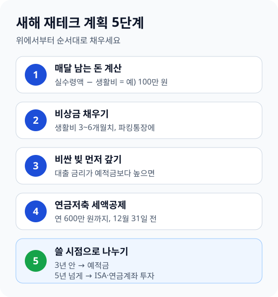
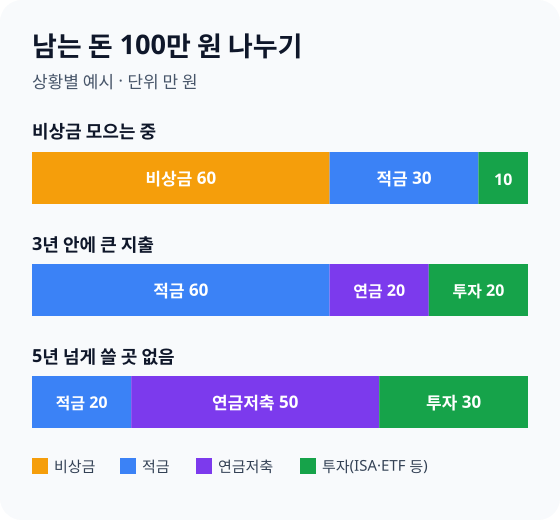

> **바쁜 분을 위한 3줄 요약**
>
> 1. 월급에서 생활비를 빼고 매달 남는 돈부터 숫자로 적으세요.
> 2. 생활비 3~6개월치 비상금을 먼저 채우고, 그다음에 투자 비율을 정하세요.
> 3. 돈마다 쓸 시점을 붙여 3년 안에 쓸 돈은 예적금, 5년 넘게 둘 돈은 연금·투자 계좌로 보내세요.

새 다이어리 첫 장에 "올해는 1,000만 원 모으기"라고 적어 둡니다. 그런데 2월이 되면 그 목표가 어디로 갔는지 잘 기억나지 않습니다.

목표가 흐려지는 이유는 의지보다 **순서가 없어서**인 경우가 많습니다. 이 글은 새해 재테크 계획을 다섯 단계로 나눠, 각 단계에서 무엇을 숫자로 정하면 되는지 보여 줍니다. 수치는 2026년 11월 기준입니다.

## 매달 남는 돈부터 숫자로 적으세요

계획의 출발점은 **실수령액에서 고정 생활비를 뺀 금액**입니다. 연봉이 아니라 통장에 실제로 들어오는 돈으로 계산하세요.

최근 3개월 카드 명세서와 계좌 출금 내역을 열어 월평균 지출을 구합니다. 경조사비·명절·자동차 보험료처럼 1년에 몇 번 나가는 돈은 연간 금액을 12로 나눠 생활비에 더하세요.

예를 들어 실수령 300만 원, 생활비 200만 원인 1인 가구라면 매달 남는 돈은 100만 원입니다. 아래 단계는 모두 이 100만 원을 어디로 보낼지 정하는 과정입니다.

실수령액을 모른다면 [연봉 실수령액 계산기](/apps/salary-net-calculator/)로 먼저 확인하세요. 4대보험과 소득세를 뺀 월 금액이 나옵니다.

## 비상금은 생활비 3~6개월치로 정하세요

비상금 목표는 **월 생활비 × 3~6개월**입니다. 생활비 200만 원이면 600만~1,200만 원입니다.

몇 개월치를 잡을지는 소득이 끊길 위험으로 정하세요. 소득이 둘이거나 회사가 안정적이면 3개월, 혼자 벌거나 소득이 들쭉날쭉하면 6개월 이상이 안전합니다.

| 상황 | 비상금 목표 | 생활비 200만 원이면 |
|---|---|---|
| 1인 직장인 | 3개월 | 600만 원 |
| 맞벌이 부부 | 3개월 | 600만 원 |
| 외벌이·자녀 있음 | 6개월 | 1,200만 원 |
| 프리랜서·자영업 | 6개월 이상 | 1,200만 원 이상 |

비상금은 언제 쓸지 모르는 돈이라 바로 꺼낼 수 있는 파킹통장에 두세요. 예적금에 묶어 두면 급할 때 중도해지로 이자를 거의 못 받습니다.

넣는 곳에 따라 1년 이자 차이도 납니다. 우리 블로그 [적금·예금 계산기](/apps/savings-calculator/)와 같은 방식(단리, 이자소득세 15.4%)으로 600만 원을 1년 두면 이렇습니다. 금리는 예시이니 실제 상품 금리로 다시 넣어 보세요.

| 넣는 곳(예시 금리) | 세전 이자 | 세후 이자 |
|---|---|---|
| 입출금통장 연 0.1% | 6,000원 | 5,076원 |
| 파킹통장 연 2% | 12만 원 | 10만 1,520원 |

같은 600만 원인데 1년에 9만 원 넘게 차이가 납니다. 파킹통장 고르는 법은 [파킹통장 vs CMA vs 정기예금](/posts/2026-parking-savings-guide.html)에서 정리했습니다.

## 비상금이 없다면 매달 남는 돈의 절반 이상을 먼저 넣으세요

비상금이 0원이라면 **남는 돈의 60% 정도를 비상금에 먼저 넣으세요.** 월 100만 원이 남으면 60만 원씩 10개월이면 600만 원이 찹니다.

이 기간에도 투자를 완전히 멈출 필요는 없습니다. 다만 비상금이 없는 상태에서 투자 비중을 크게 잡으면, 급한 일이 생겼을 때 손실 중인 투자금을 팔게 됩니다.

비상금 통장은 월급 통장과 다른 은행에 만드세요. 앱에서 잔액이 매일 보이면 쓰고 싶어집니다.

## 비싼 빚은 저축보다 먼저 갚으세요

대출 금리가 예적금 금리보다 높다면 **갚는 쪽이 확실한 수익**입니다. 예를 들어 연 6% 대출 1,000만 원을 갚으면 1년 이자 60만 원이 그대로 줄어듭니다.

같은 1,000만 원을 연 3% 정기예금에 넣으면 세후 이자는 25만 3,800원입니다. 대출 이자에는 세금이 붙지 않으니 차이는 더 벌어집니다.

카드 리볼빙·현금서비스·카드론처럼 금리가 높은 빚부터 순서대로 갚으세요. 주택담보대출처럼 금리가 낮고 기간이 긴 빚은 저축과 같이 가져가도 됩니다.

갚기 전에 중도상환수수료가 있는지 확인하세요. 금리를 낮출 수 있다면 [금리인하요구권](/posts/2026-interest-rate-cut-request-guide.html)부터 신청해 보고, 다른 은행으로 옮길지는 [대출 갈아타기 계산기](/apps/loan-refinance-calculator/)로 수수료까지 빼서 비교하세요.

한국은행 기준금리는 2026년 11월 26일 0.25%p 올라 연 3.25%입니다( [한국은행 기준금리 추이](https://www.bok.or.kr/portal/singl/baseRate/list.do?dataSeCd=01&menuNo=200643)). 변동금리 대출이 있다면 금리 결정 때마다 이자가 달라지니 [기준금리와 대출 이자](/posts/2026-base-rate-loan-deposit-guide.html) 글도 함께 보세요.

## 연금저축은 올해 몫부터 12월 31일 전에 넣으세요

노후 자금은 세액공제를 받는 **연금저축·IRP에 먼저 넣으세요.** 넣는 순간 세금을 돌려받으니 다른 어떤 상품보다 출발점이 높습니다.

연금저축은 연 600만 원, IRP를 합치면 연 900만 원까지 세액공제를 받습니다. 공제율은 총급여 5,500만 원 이하면 지방소득세를 합쳐 16.5%, 넘으면 13.2%입니다([소득세법 제59조의3](https://www.law.go.kr/법령/소득세법/제59조의3)).

| 연금저축에 넣는 돈 | 총급여 5,500만 원 이하 | 5,500만 원 초과 |
|---|---|---|
| 월 25만 원(연 300만 원) | 49만 5,000원 | 39만 6,000원 |
| 월 50만 원(연 600만 원) | 99만 원 | 79만 2,000원 |

올해 공제는 12월 31일까지 넣은 돈만 셉니다. 아직 덜 넣었다면 [연금저축·IRP 세액공제 계산기](/apps/pension-tax-calculator/)로 남은 한도와 환급액을 확인하고, 연말 전에 할 일은 [연말 절세 막판 체크리스트](/posts/2026-year-end-tax-saving-checklist.html)에서 한 번에 보세요.

다만 55세 전에 꺼내면 공제받은 돈과 수익에 16.5% 기타소득세를 냅니다. 비상금을 다 채운 뒤, 오래 묻어 둘 수 있는 금액만 넣으세요.

## 돈마다 쓸 시점을 붙여 저축과 투자를 나누세요

저축과 투자의 비율은 나이보다 **그 돈을 언제 쓸지**로 정하세요. 3년 안에 쓸 돈은 원금이 흔들리면 안 되고, 5년 넘게 둘 돈은 흔들림을 버틸 시간이 있습니다.

| 쓸 시점 | 넣을 곳 | 예시 목표 |
|---|---|---|
| 1년 안 | 파킹통장·정기예금 | 이사비, 여행, 경조사 |
| 1~3년 | 적금·정기예금 | 전세 보증금, 결혼 자금, 차 |
| 3~5년 | 예금과 투자 반반 | 내 집 계약금 |
| 5년 넘게 | ISA·연금계좌 투자 | 노후, 자녀 교육비 |

목표마다 "언제, 얼마"를 적으면 매달 넣을 금액이 나옵니다. 예를 들어 1년 뒤 600만 원이 필요하면 월 50만 원 적금입니다.

같은 적금 방식(연 3%, 12개월, 단리, 세금 15.4%)으로 계산기를 돌리면 월 납입액별 결과는 이렇습니다.

| 월 납입액 | 원금 | 세후 이자 |
|---|---|---|
| 30만 원 | 360만 원 | 4만 9,491원 |
| 50만 원 | 600만 원 | 8만 2,485원 |
| 100만 원 | 1,200만 원 | 16만 4,970원 |

적금 이자가 생각보다 적은 이유는 회차마다 이자 붙는 기간이 달라서입니다. 자세한 계산은 [적금 이자 계산법](/posts/2026-installment-savings-interest-guide.html)에 있습니다.

## 내 상황에 맞는 비율을 골라 보세요

남는 돈 100만 원을 기준으로 **세 가지 상황별 예시 비율**을 만들었습니다. 정답이 아니라 출발점이니, 목표 금액에 맞춰 10만 원 단위로 조정하세요.

| 상황 | 비상금·적금 | 연금저축·투자 |
|---|---|---|
| 비상금 모으는 중 | 비상금 60만, 적금 30만 | 투자 10만 |
| 3년 안에 큰 지출 | 적금 60만 | 연금저축 20만, 투자 20만 |
| 5년 넘게 쓸 곳 없음 | 적금 20만 | 연금저축 50만, 투자 30만 |

투자 몫은 처음이라면 여러 종목에 나눠 담는 ETF로 시작하는 편이 관리하기 쉽습니다. 고르는 순서는 [ETF 투자 시작하는 법](/posts/2026-etf-beginner-guide.html)에, 세금을 줄이는 계좌는 [ISA 계좌 가이드](/posts/2026-isa-account-guide.html)에 정리했습니다.

나이와 가구 형태별로는 이렇게 시작해 보세요.

- **20대 사회초년생**: 비상금 3개월치를 첫해 목표로 잡고, 연금저축은 월 10만 원처럼 작게 여세요. [사회초년생 월급 관리법](/posts/2026-first-salary-money-management-guide.html)도 참고하세요.
- **30대 결혼·전세 준비**: 3년 안에 쓸 목돈이 크니 적금 비중을 높이고, 투자는 남는 돈의 20% 안쪽에서 시작하세요.
- **40대 자녀 있음**: 비상금을 6개월치로 늘리고, 연금저축·IRP 공제 한도부터 채우세요.

## 계획은 자동이체로 월급날 다음 날 실행하세요

계획을 지키는 가장 쉬운 방법은 **월급 다음 날 자동이체**입니다. 쓰고 남은 돈을 모으는 대신, 모을 돈을 먼저 빼고 남은 돈으로 생활하세요.

은행 앱마다 메뉴 이름은 조금 다르지만 순서는 비슷합니다.

1. 은행 앱에서 **이체 → 자동이체 → 자동이체 등록**을 누르세요.
2. 받는 계좌에 비상금 통장, 적금, 연금저축 계좌를 하나씩 넣으세요.
3. 이체일은 월급날 다음 날로, 금액은 위에서 정한 비율대로 넣으세요.
4. 잔액 부족 때 재출금 여부를 확인하고 등록을 마치세요.

새해를 기다리지 말고 이번 달 월급날에 맞춰 등록하세요. 12월에 시작하면 1월 1일에 이미 한 달을 앞서갑니다.

## 계획을 세울 때 자주 하는 실수를 피하세요

- **비상금 없이 투자부터 시작하기**: 급한 일이 생기면 손실 중인 투자금을 팔게 됩니다. 비상금 3개월치를 먼저 채우세요.
- **목표 금액만 쓰고 날짜를 안 쓰기**: "1,000만 원 모으기"보다 "12월까지 1,000만 원"처럼 날짜를 붙여야 월 금액이 나옵니다.
- **한 은행에 전부 넣기**: 예금자보호 한도는 금융회사별로 1인당 1억 원입니다([예금자보호법 시행령 제18조](https://www.law.go.kr/법령/예금자보호법시행령/제18조)). 1억 원을 넘으면 은행을 나누세요.
- **보너스를 계획 밖에 두기**: 성과급·연말정산 환급금은 들어오는 날 비율대로 나누세요. 그대로 두면 생활비로 섞입니다.

## 이미 계획이 틀어졌다면

비상금을 써 버렸다면 **투자 몫을 잠시 줄이고 비상금부터 다시 채우세요.** 자책하기보다 비상금이 제 역할을 했다고 보고 다시 시작하면 됩니다.

적금을 깨야 할 상황이라면 만기까지 남은 기간을 먼저 보세요. 만기가 한두 달 남았다면 예적금 담보대출로 잠시 빌리고 만기에 갚는 편이 이자 손해가 적을 수 있으니 은행에 금리를 물어보세요.

## 자주 묻는 질문

**Q. 비상금은 얼마나 모아야 하나요?**
월 생활비의 3~6개월치입니다. 생활비가 200만 원이면 600만~1,200만 원이고, 혼자 벌거나 소득이 불규칙하면 6개월 이상으로 잡으세요.

**Q. 비상금은 어디에 두나요?**
바로 꺼낼 수 있는 파킹통장에 두세요. 600만 원을 연 2% 파킹통장에 1년 두면 세후 이자는 10만 1,520원으로, 연 0.1% 입출금통장의 5,076원보다 많습니다.

**Q. 저축과 투자 비율은 몇 대 몇이 좋나요?**
정해진 비율보다 돈을 쓸 시점으로 나누세요. 3년 안에 쓸 돈은 예적금, 5년 넘게 둘 돈은 연금계좌·ISA 투자로 보내는 방식입니다.

**Q. 대출이 있는데 저축부터 해야 하나요?**
대출 금리가 예적금 금리보다 높으면 갚는 쪽이 먼저입니다. 다만 비상금 3개월치는 남겨 두고 갚으세요.

## 새해 재테크 계획 체크리스트

| 할 일 | 언제 | 확인 |
|---|---|---|
| 매달 남는 돈 계산 | 이번 주 | ☐ |
| 비상금 목표 정하기 | 이번 주 | ☐ |
| 비싼 빚 목록 만들기 | 이번 주 | ☐ |
| 연금저축 올해 한도 채우기 | 12월 31일 전 | ☐ |
| 목표마다 날짜·금액 쓰기 | 12월 | ☐ |
| 월급 다음 날 자동이체 등록 | 다음 월급날 | ☐ |

매달 남는 돈이 나오면 나머지 네 단계는 이 글의 표를 따라 채우면 됩니다. 12월 월급날 다음 날로 자동이체 세 개를 걸어 두면, 1월 1일에 이미 한 달을 앞서 시작합니다.

수치는 2026년 11월 18일 기준입니다. 이자 계산 예시는 우리 적금·예금 이자 계산기와 같은 계산식으로 냈고, 상품 금리와 예시 인물은 모두 가정입니다. 세율과 한도는 국가법령정보센터의 소득세법·예금자보호법 시행령 조문, 기준금리는 한국은행 발표를 기준으로 했습니다.

---

> 📊 **직접 계산해 보세요**  
> [적금·예금 이자 계산기](/apps/savings-calculator/)로 비상금과 적금의 세후 이자를, [연금저축·IRP 세액공제 계산기](/apps/pension-tax-calculator/)로 올해 남은 공제 한도와 환급액을 확인할 수 있어요. 출발점이 되는 월 실수령액은 [연봉 실수령액 계산기](/apps/salary-net-calculator/)로 계산하세요.
