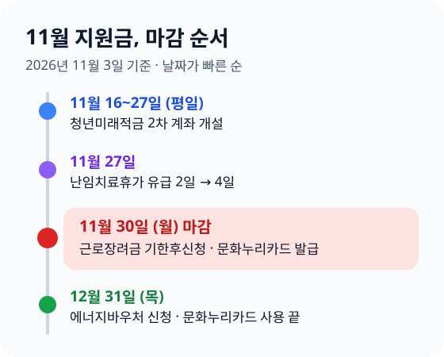
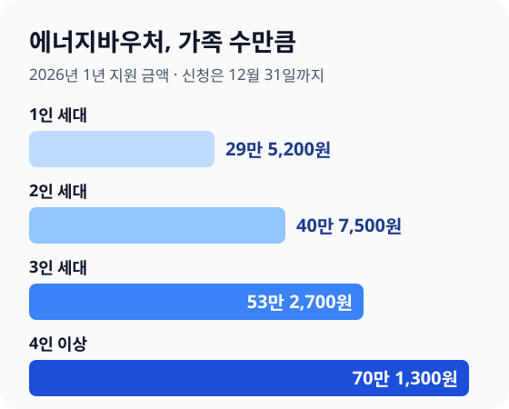

> **바쁜 분을 위한 3줄 요약**
>
> 1. 근로장려금과 문화누리카드는 **11월 30일 전에 신청하세요**.
> 2. 청년미래적금 2차 심사를 통과했다면 **11월 16~27일 평일에 계좌를 여세요**.
> 3. 에너지바우처는 **12월 31일까지 주민센터나 복지로에서 신청하세요**.

달력을 넘기니 어느새 11월입니다. 올해 받을 수 있었던 지원금 가운데 아직 신청하지 않은 것이 있다면, 이달이 사실상 마지막 기회입니다.

정부 지원금은 "몰라서 못 받는" 경우가 가장 많습니다. 이 글은 11월에 마감되거나 11월에 꼭 움직여야 하는 지원금만 골라, 날짜순으로 할 일을 정리했습니다. 날짜와 금액은 2026년 11월 3일 기준으로 정책브리핑과 법 조문에서 확인했습니다.

## 11월에 마감되는 지원금부터 챙기세요

이번 달 안에 움직여야 하는 지원금은 네 가지입니다. 마감이 가장 빠른 것부터 보세요.

| 지원금 | 이번에 할 일 | 마감 |
|---|---|---|
| 청년미래적금 2차 | 심사 통과자 계좌 개설 | 11월 16~27일(평일) |
| 근로장려금 | 기한후신청 | 11월 30일 |
| 문화누리카드 | 발급·재충전 신청 | 11월 30일 |
| 에너지바우처 | 신청 | 12월 31일 |

11월 27일부터는 난임치료휴가의 유급 기간도 늘어납니다. 신청하는 지원금은 아니지만, 해당하는 직장인이라면 휴가 계획을 세울 때 알아 두면 좋습니다.

마감이 지나면 대부분 다시 받을 방법이 없습니다. 아래에서 내게 해당하는 것만 골라 이번 주 안에 신청해 두세요.

## 근로장려금은 11월 30일까지 기한후신청하세요

5월 정기신청을 놓쳤어도 **11월 30일까지 기한후신청**을 하면 근로장려금을 받을 수 있습니다. 대신 원래 금액의 95%만 받습니다([조세특례제한법 제100조의7](<https://www.law.go.kr/법령/조세특례제한법/제100조의7>)).

대상은 2025년에 일해서 번 돈이 있는 가구입니다. 가구원 전체 재산이 2억 4천만 원 미만이어야 하고([조세특례제한법 제100조의3](<https://www.law.go.kr/법령/조세특례제한법/제100조의3>)), 부부 합산 소득은 가구 유형마다 기준이 다릅니다. 단독 가구는 2,200만 원, 홑벌이 가구는 3,200만 원, 맞벌이 가구는 4,400만 원 미만입니다.

기한후신청으로 받을 수 있는 최대 금액은 이렇게 줄어듭니다.

| 가구 유형 | 정기신청 최대 | 기한후신청 최대(95%) |
|---|---|---|
| 단독 | 165만 원 | 156만 7,500원 |
| 홑벌이 | 285만 원 | 270만 7,500원 |
| 맞벌이 | 330만 원 | 313만 5,000원 |

5%가 깎여도 단독 가구는 최대 156만 7,500원입니다. 몇 분이면 끝나는 신청이니, 받을 수 있는지부터 확인하세요.

1. 홈택스나 손택스 앱에 로그인해 "근로·자녀장려금" 메뉴를 엽니다.
2. 모의계산에 2025년 소득과 재산을 넣어 받을 수 있는지 봅니다.
3. 대상이면 기한후신청을 누르고 계좌를 적어 제출합니다.

기한후신청은 심사에 시간이 걸려 신청한 뒤 몇 달 뒤에 들어옵니다. 소득·재산 기준과 금액 계산은 [근로장려금 기한후신청 가이드](/posts/2026-earned-income-tax-credit-guide.html)에 자세히 정리했습니다.

## 문화누리카드는 11월 30일까지 발급받고 12월에 다 쓰세요

문화누리카드는 **11월 30일까지 발급받아야** 하고, 받은 지원금은 **12월 31일까지 써야** 합니다. 남은 돈은 다음 해로 넘어가지 않습니다.

2026년 지원금은 1인당 연 15만 원입니다. 청소년(13~18세)과 60~64세는 1만 원을 더해 16만 원을 받습니다([정책브리핑, 문화체육관광부](https://www.korea.kr/news/policyNewsView.do?newsId=148958946)).

대상은 6세 이상(2020년 12월 31일 이전 출생) 기초생활수급자와 법정 차상위계층입니다. 신청은 주민센터, 문화누리카드 누리집, 모바일 앱에서 할 수 있습니다.

예를 들어 4인 가족이 모두 대상이고 그중 한 명이 15세라면 15만 원 × 3명 + 16만 원 = 61만 원입니다. 영화·공연·도서·여행·체육 시설에서 쓸 수 있으니, 12월 일정을 미리 잡아 두세요.

지난해 카드를 받았던 분은 조건에 따라 자동으로 재충전되기도 합니다. 충전이 안 됐다면 누리집이나 주민센터에 직접 신청하세요.

## 청년미래적금은 11월 16~27일 평일에 계좌를 여세요

청년미래적금 2차 가입 심사를 통과했다면 **11월 16일부터 27일 사이 평일**에 신청한 은행 앱에서 계좌를 열어야 합니다. 이 기간이 지나면 계좌를 열 수 없습니다([금융위원회 보도자료](https://www.fsc.go.kr/no010101/87933)).

2차 가입 신청에는 68만 8,000명이 몰렸고, 지금은 소득과 자격 심사가 진행 중입니다. 최종 결과는 11월 중순에 개별로 안내됩니다.

청년도약계좌에서 갈아타는 분은 순서를 지키세요. 청년미래적금 계좌를 먼저 연 뒤, 같은 기간 안에 도약계좌를 "청년미래적금 가입 목적 특별중도해지"로 해지해야 새 계좌에 돈을 넣을 수 있습니다.

일반 해지를 누르면 그동안 받은 정부기여금과 비과세 혜택을 잃을 수 있습니다. 두 상품의 차이는 [청년도약계좌·청년미래적금 정리](/posts/2026-youth-leap-account-guide.html)를 보세요.

## 에너지바우처는 12월 31일까지 신청하세요

에너지바우처는 **12월 31일까지** 주민센터나 복지로에서 신청할 수 있습니다. 겨울 난방비에 쓰는 몫이 대부분이니, 아직 신청하지 않았다면 이번 달에 하세요.

대상은 생계·의료·주거·교육급여 수급자 가운데 노인, 영유아, 장애인, 임산부, 한부모가족 같은 세대원이 있는 가구입니다. 금액은 세대원 수에 따라 정해져 있습니다([정책브리핑, 에너지바우처](https://www.korea.kr/news/policyNewsView.do?newsId=148966678)).

| 세대원 수 | 1년 지원 금액 |
|---|---|
| 1인 | 29만 5,200원 |
| 2인 | 40만 7,500원 |
| 3인 | 53만 2,700원 |
| 4인 이상 | 70만 1,300원 |

동절기 몫은 2026년 10월 1일부터 2027년 5월 31일까지 씁니다. 전기·도시가스·지역난방 요금에서 깎는 방식과, 국민행복카드로 등유·LPG·연탄을 사는 방식 가운데 고를 수 있습니다.

작년에 받았고 주소나 세대원 수가 그대로라면 자동으로 신청됩니다. 이사했거나 가족 수가 바뀌었다면 다시 신청해야 하니, 에너지바우처 통합센터(1600-3190)나 주민센터에 확인하세요.

## 소상공인은 경영안정 바우처를 받았는지 확인하세요

연 매출 1억 400만 원 미만 소상공인은 공과금·4대 보험료·차량 연료비에 쓸 수 있는 바우처를 최대 25만 원 받습니다. 2025년 12월 31일 이전에 개업해 지금 영업 중인 사업체가 대상입니다([정책브리핑, 중소벤처기업부](https://www.korea.kr/news/policyNewsView.do?newsId=148958616)).

신청은 2월 9일부터 소상공인24에서 받았습니다. 아직 신청하지 않았다면 지금도 접수 중인지와 남은 예산부터 소상공인24나 콜센터(1533-0600)에서 확인하세요.

이미 받았다면 카드에 남은 바우처를 확인해 연말 전에 공과금이나 보험료로 쓰세요. 한 사람이 여러 사업체를 운영해도 1개 사업체만 받을 수 있습니다.

## 난임치료휴가는 11월 27일부터 유급 4일입니다

11월 27일부터 연간 6일인 난임치료휴가 가운데 **유급 기간이 2일에서 4일로** 늘어납니다. 우선지원대상기업 근로자는 정부가 주는 난임치료휴가 급여도 4일분으로 늘어납니다([정책브리핑, 고용노동부](https://www.korea.kr/news/policyNewsView.do?newsId=148970585)).

시술 일정이 11월 말 이후라면 휴가를 그 뒤로 잡는 것이 유리합니다. 회사 인사팀에 바뀐 규정이 반영됐는지 미리 물어보세요.

## 가구별로 먼저 챙길 것을 고르세요

모든 지원금을 다 볼 필요는 없습니다. 내 상황에 맞는 줄만 보고 그 지원금부터 신청하세요.

| 내 상황 | 먼저 볼 지원금 | 마감 |
|---|---|---|
| 작년 소득이 적은 직장인·프리랜서 | 근로장려금 | 11월 30일 |
| 기초생활수급·차상위 가구 | 문화누리카드·에너지바우처 | 11월 30일·12월 31일 |
| 2차 신청한 만 19~34세 청년 | 청년미래적금 계좌 개설 | 11월 27일 |
| 연 매출 1억 400만 원 미만 사장님 | 경영안정 바우처 | 소상공인24 확인 |
| 난임 시술 중인 직장인 | 난임치료휴가 | 11월 27일부터 4일 |

부모님이 기초연금을 받으신다면 문화누리카드와 에너지바우처 대상인지 함께 확인해 보세요. 대신 신청할 때는 주민센터에 신분증과 가족관계를 보여 줄 서류를 챙겨 가면 됩니다.

내가 받을 수 있는 지원금을 한 번에 보고 싶다면 정부24의 "보조금24"에서 본인 인증 뒤 조회하세요. 받을 수 있는 정부 지원금 목록과 신청 화면이 함께 나옵니다.

## 자주 하는 실수를 피하세요

지원금을 놓치는 이유는 대부분 날짜와 순서입니다. 아래 다섯 가지만 피하세요.

- **마감일 당일에 신청하기**: 11월 30일은 월요일입니다. 마지막 날은 접속이 몰리니 그 주 초에 끝내세요.
- **문화누리카드를 받고 안 쓰기**: 12월 31일이 지나면 남은 돈은 사라집니다. 발급받은 날 바로 쓸 곳을 정하세요.
- **청년도약계좌를 일반 해지하기**: 꼭 "청년미래적금 가입 목적 특별중도해지"를 고르세요.
- **이사 뒤 에너지바우처를 그대로 두기**: 주소가 바뀌면 자동 신청이 안 될 수 있습니다.
- **근로장려금 대상이 아니라고 단정하기**: 소득이 적은 해의 프리랜서·아르바이트 소득도 대상입니다. 모의계산부터 해 보세요.

## 이미 마감을 놓쳤다면

1. **근로장려금**: 11월 30일이 지나면 2025년 소득분은 받을 수 없습니다. 2026년 소득분은 내년 5월 정기신청을 달력에 적어 두세요.
2. **문화누리카드**: 올해 발급은 끝나지만 내년 2월쯤 다시 발급이 시작됩니다. 정책브리핑에 새해 일정이 나오면 바로 신청하세요.
3. **청년미래적금**: 2차 계좌 개설을 놓쳤다면 다음 모집 공고를 기다려야 합니다. 그사이 비과세 혜택이 있는 다른 저축은 [적금 이자 계산법](/posts/2026-installment-savings-interest-guide.html)을 참고하세요.
4. **잊고 있던 다른 돈도 찾아보세요**: 휴면예금이나 숨은 보험금이 있을 수 있습니다. 찾는 방법은 [숨은 돈 찾기](/posts/2026-hidden-money-finder-guide.html)에 정리했습니다.

## 자주 묻는 질문

**Q. 근로장려금 기한후신청은 언제까지인가요?**
11월 30일까지입니다. 기한후신청은 원래 금액의 95%를 받고, 이날이 지나면 2025년 소득분은 신청할 수 없습니다.

**Q. 문화누리카드는 언제까지 쓸 수 있나요?**
11월 30일까지 발급받고 12월 31일까지 써야 합니다. 2026년 지원금은 1인당 15만 원이고, 13~18세와 60~64세는 16만 원입니다.

**Q. 에너지바우처는 얼마를 받나요?**
세대원 수에 따라 1인 29만 5,200원, 2인 40만 7,500원, 3인 53만 2,700원, 4인 이상 70만 1,300원입니다. 신청은 12월 31일까지 할 수 있습니다.

**Q. 청년미래적금 계좌는 주말에도 열 수 있나요?**
아닙니다. 계좌 개설 기간은 11월 16일부터 27일까지이고 토요일과 일요일은 제외됩니다.

## 11월 지원금 체크리스트

| 날짜 | 할 일 |
|---|---|
| 이번 주 | 보조금24에서 받을 수 있는 지원금 조회 |
| 이번 주 | 근로장려금 모의계산, 대상이면 기한후신청 |
| 11월 16~27일 | 청년미래적금 계좌 개설, 도약계좌 특별중도해지 |
| 11월 27일 | 난임치료휴가 유급 4일 적용 시작 |
| 11월 30일 전 | 문화누리카드 발급·재충전 신청 |
| 12월 | 문화누리카드 잔액 모두 쓰기 |
| 12월 31일 전 | 에너지바우처 신청 확인 |

지원금은 기다린다고 찾아오지 않고, 신청한 사람에게만 들어옵니다. 오늘 보조금24에서 내 이름으로 받을 수 있는 지원금부터 조회해 보세요.

---

> 📅 **함께 보면 좋은 글**  
> [근로장려금 기한후신청 가이드](/posts/2026-earned-income-tax-credit-guide.html)에서 내 금액을 먼저 확인하고, 연말까지 챙길 세금 일정은 [연말 절세 막판 체크리스트](/posts/2026-year-end-tax-saving-checklist.html)를 보세요. 이번 주 경제 소식은 [생활경제 대시보드](/apps/economy-dashboard/)에서 확인할 수 있어요.
