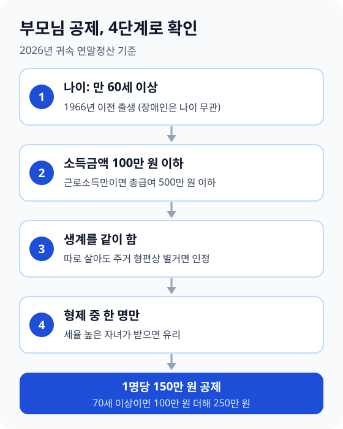
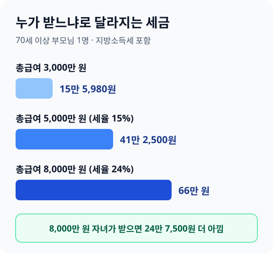

> **바쁜 분을 위한 3줄 요약**
>
> 1. 부모님 출생 연도와 올해 소득 종류부터 적어 보고, 60세·100만 원 조건에 맞는지 확인하세요.
> 2. 형제자매와 상의해 세율이 가장 높은 한 사람만 부모님을 올리세요.
> 3. 그 사람이 부모님 의료비와 카드 사용액까지 함께 공제받도록 1월 전에 자료 제공 동의를 받아 두세요.

명절에 형제들이 모여 앉았습니다. "아버지 연말정산은 올해 누가 해?" 하는 말이 나오지만, 작년에 누가 했는지 아무도 정확히 기억하지 못합니다.

부모님 부양가족 공제는 조건만 맞으면 따로 사셔도 받을 수 있습니다. 대신 형제 중 한 사람만 받을 수 있고, 누가 받느냐에 따라 같은 가족이 덜 내는 세금이 20만 원 넘게 달라집니다. 이 글은 2026년 11월 기준 소득세법 조문으로 조건을 확인하고, 우리 연말정산 계산기로 금액을 직접 계산했습니다.

## 부모님 나이부터 확인하세요

2026년 귀속 연말정산에서는 **1966년 이전에 태어난 부모님**이 기본공제 대상입니다. 법은 만 60세 이상 직계존속을 부양가족으로 정하고, 그해 중에 한 번이라도 그 나이가 되는 날이 있으면 대상으로 봅니다([소득세법 제50조](<https://www.law.go.kr/법령/소득세법/제50조>), [제53조](<https://www.law.go.kr/법령/소득세법/제53조>)).

생일이 12월 31일이어도 1966년생이면 2026년에 만 60세가 되는 날이 있으니 공제 대상입니다. 배우자의 부모님(장인·장모, 시부모님)도 같은 조건으로 올릴 수 있습니다.

| 출생 연도 | 2026년 귀속 공제 | 공제 금액 |
|---|---|---|
| 1967년 이후 | 나이 조건 미달 | 없음 (장애인은 예외) |
| 1957~1966년 | 기본공제 | 150만 원 |
| 1956년 이전 | 기본공제 + 경로우대 | 250만 원 |

70세 이상이면 경로우대 추가공제 100만 원이 더해집니다([소득세법 제51조](<https://www.law.go.kr/법령/소득세법/제51조>)). 장애인이면 나이와 상관없이 기본공제를 받고, 추가공제 200만 원도 받습니다.

장애인에는 장애인 등록을 한 분만 들어가는 것이 아닙니다. 희귀·난치 질환 등으로 계속 치료가 필요해 병원에서 장애인증명서를 받은 경우도 대상이 될 수 있으니, 부모님이 오래 치료 중이시라면 담당 병원에 증명서 발급이 되는지 물어보세요.

## 소득금액 100만 원 선을 따져 보세요

부모님의 **연간 소득금액 합계가 100만 원 이하**여야 합니다. 여기서 "소득금액"은 번 돈 전체가 아니라 필요경비나 공제를 뺀 금액이라, 수입이 100만 원을 넘어도 대상일 수 있습니다.

근로소득만 있으면 기준이 따로 있습니다. 1년 총급여가 **500만 원 이하**면 공제 대상입니다. 퇴직 후 짧게 일하신 부모님은 원천징수영수증의 총급여부터 확인하세요.

| 부모님 소득 | 판단 기준 | 따져 볼 점 |
|---|---|---|
| 근로소득만 | 총급여 500만 원 이하 | 일한 달의 급여 합계 |
| 예금 이자·배당 | 연 2,000만 원 이하 | 분리과세라 소득금액에 넣지 않음 |
| 연금저축·IRP 연금 | 연 1,500만 원 이하 | 분리과세를 고르면 제외 |
| 국민연금 | 과세 대상 연금만 | 2002년 이후 낸 보험료분 |
| 상가·사업 소득 | 수입 − 필요경비 | 100만 원 넘기 쉬움 |
| 집·땅 판 해 | 양도소득금액 포함 | 비과세 양도면 해당 없음 |

예금 이자와 배당은 합계 2,000만 원 이하면 원천징수로 끝나는 분리과세라 소득금액에 들어가지 않습니다. 연금저축·IRP에서 받는 사적연금도 1년 1,500만 원 이하면 분리과세를 고를 수 있습니다([소득세법 제14조](<https://www.law.go.kr/법령/소득세법/제14조>)).

국민연금은 **2002년 1월 1일 이후** 낸 보험료로 받는 부분만 과세 대상입니다([소득세법 제20조의3](<https://www.law.go.kr/법령/소득세법/제20조의3>)). 오래전부터 보험료를 내신 분은 받는 연금 전체보다 과세 대상 금액이 훨씬 적으니, 국민연금공단에 과세 대상 연금액을 확인해 보세요.

판단 시점은 **12월 31일 현재**입니다. 그해 중에 돌아가셨다면 돌아가신 날 전날을 기준으로 판단하므로, 올해 부모님을 여읜 분도 공제를 받을 수 있습니다.

## 따로 사셔도 공제를 받을 수 있습니다

부모님이 다른 집에 사셔도 **주거 형편상 따로 사는 것이면 생계를 같이 하는 것으로 봅니다**([소득세법 제53조](<https://www.law.go.kr/법령/소득세법/제53조>)). 형제자매나 다른 부양가족은 원칙적으로 주민등록상 같이 살아야 하지만, 직계존속인 부모님은 이 예외가 따로 있습니다.

다만 실제로 부양하고 있어야 합니다. 매달 생활비를 계좌이체로 보내 드리면 나중에 확인을 요청받았을 때 근거가 됩니다. 현금으로 드린다면 금액과 날짜를 메모로라도 남겨 두세요.

부모님이 다른 형제와 같이 사시는 경우에도, 같이 사는 형제가 아닌 다른 자녀가 공제를 받을 수 있습니다. 중요한 것은 같은 해에 **한 사람만** 받는다는 점입니다.

## 총급여별로 줄어드는 세금을 계산하세요

부모님 1명을 올리면 총급여 5,000만 원 직장인은 세금이 **24만 7,500원**, 70세 이상이면 **41만 2,500원** 줄어듭니다. 아래 표는 [연말정산 환급 계산기](/apps/year-end-tax-calculator/)로 본인 1명에 부모님만 더했을 때 결정세액(지방소득세 포함) 차이를 구한 값입니다.

| 총급여 | 60~69세 부모님 1명 | 70세 이상 부모님 1명 |
|---|---|---|
| 3,000만 원 | 11만 1,380원 | 15만 5,980원 |
| 5,000만 원 | 24만 7,500원 | 41만 2,500원 |
| 8,000만 원 | 39만 6,000원 | 66만 원 |
| 1억 원 | 39만 6,000원 | 66만 원 |

계산 원리는 단순합니다. 공제 150만 원에 내 세율과 지방소득세를 곱하면 됩니다. 세율 15% 구간이면 150만 원 × 16.5%로 24만 7,500원, 24% 구간이면 150만 원 × 26.4%로 39만 6,000원입니다.

총급여 3,000만 원은 효과가 작습니다. 낼 세금 자체가 적어서, 산출세액이 줄면 직장인이 자동으로 받는 근로소득세액공제도 함께 줄기 때문입니다. 부모님 두 분이 모두 70세 이상이면 총급여 5,000만 원 기준 **82만 5,000원**이 줄어듭니다.

예시는 4대보험을 계산기 자동값으로 넣고 다른 공제는 넣지 않은 가정입니다. 카드·의료비·연금계좌 공제가 있으면 금액이 조금 달라지니, 내 숫자로 계산기에 다시 넣어 보세요.

## 형제 중 세율이 높은 사람이 받으세요

같은 부모님은 형제 중 **한 사람만** 공제받을 수 있습니다([소득세법 제50조](<https://www.law.go.kr/법령/소득세법/제50조>)). 소득공제라서 세율이 높은 사람이 받을수록 가족 전체로 덜 내는 세금이 커집니다.

예를 들어 형은 총급여 8,000만 원(세율 24%), 동생은 5,000만 원(세율 15%)이고 아버지가 72세라고 가정하겠습니다. 형이 받으면 66만 원, 동생이 받으면 41만 2,500원이 줄어 **24만 7,500원 차이**가 납니다.

두 사람이 모두 올리면 한쪽은 나중에 공제가 취소되고 가산세를 낼 수 있습니다. 서로 신고서에 적어 낸 경우에는 **직전 해에 공제받은 사람**이 우선이고, 직전 해에 받은 사람이 없으면 종합소득금액이 가장 많은 사람이 받습니다([소득세법 시행령 제106조](<https://www.law.go.kr/법령/소득세법시행령/제106조>)).

그래서 작년에 동생이 받았다면 올해 형이 받기로 미리 정하고, 동생은 신고서에서 확실히 빼야 합니다. 형제 단체 대화방에 "2026년 귀속 아버지 공제는 형"처럼 한 줄 남겨 두면 다음 해에 헷갈리지 않습니다.

세율 차이가 없다면 부모님 의료비를 많이 낸 사람이 받는 편이 낫습니다. 의료비는 부모님을 기본공제로 올린 사람이 낸 금액만 공제되기 때문입니다.

## 의료비와 카드 사용액도 함께 옮기세요

부모님을 위해 낸 의료비는 **나이와 소득에 상관없이** 공제받을 수 있습니다([소득세법 제59조의4](<https://www.law.go.kr/법령/소득세법/제59조의4>)). 부모님 소득이 100만 원을 넘어 기본공제는 못 받아도, 자녀가 낸 병원비는 자녀의 의료비 세액공제로 넣을 수 있습니다.

의료비는 총급여의 3%를 넘는 부분에 15%를 세액공제합니다. 과세기간 종료일 현재 65세 이상인 부모님 의료비는 일반 가족의 연 700만 원 한도가 적용되지 않습니다.

예를 들어 총급여 5,000만 원인 자녀가 70세 어머니 의료비로 500만 원을 냈다고 가정하겠습니다. 3%인 150만 원을 넘는 350만 원의 15%인 52만 5,000원이 의료비 공제입니다. 이때 표준세액공제 13만 원은 빠지므로, 계산기로 구한 실제 감소액은 지방소득세를 합쳐 **43만 4,500원**입니다.

부모님의 신용카드·체크카드 사용액도 내 카드 공제에 합칠 수 있습니다. 조건은 부모님 연간 소득금액이 100만 원 이하이고 생계를 같이 하는 것이며, 나이 조건은 없습니다([조세특례제한법 제126조의2](<https://www.law.go.kr/법령/조세특례제한법/제126조의2>)).

다만 부모님을 다른 형제가 기본공제로 받았다면 그 부모님 카드 사용액은 내 공제에 넣을 수 없습니다. 기본공제와 의료비·카드 사용액은 **같은 사람에게 몰아야** 한다고 기억하세요.

## 12월 31일 전에 순서대로 준비하세요

부모님 공제는 1월 간소화 자료가 열린 뒤에 준비하면 늦을 수 있습니다. 아래 순서로 올해 안에 끝내 두세요.

1. **조건 확인**: 부모님 출생 연도, 올해 근로·사업·연금 소득을 적어 보세요.
2. **형제와 정하기**: 세율과 의료비를 비교해 공제받을 한 사람을 정하세요.
3. **생활비 기록**: 따로 사신다면 계좌이체 기록을 남겨 두세요.
4. **자료 제공 동의**: 부모님이 홈택스나 손택스에 본인 인증으로 들어가 공제받을 자녀에게 간소화 자료 제공 동의를 해 주셔야 합니다.
5. **회사 신고서 작성**: 1월에 부양가족 명세에 부모님을 넣고, 의료비·카드 자료를 함께 내려받으세요.

자료 제공 동의는 부모님이 직접 해야 해서, 휴대폰 인증이 어려우시면 시간이 걸립니다. 연말에 찾아뵐 때 함께 해 두면 1월에 서두르지 않아도 됩니다.

## 자주 하는 실수를 피하세요

**소득이 생긴 해를 놓치는 실수**가 가장 흔합니다. 부모님이 올해 상가 임대를 시작하셨거나, 퇴직 후 총급여 500만 원을 넘게 일하셨다면 올해는 대상이 아닙니다.

**형제 중복 공제**도 자주 생깁니다. 서로 "내가 하겠다"고 말만 하고 확인하지 않으면 둘 다 올리게 됩니다. 1월에 각자 회사에 내기 전 부양가족 명세를 사진으로 주고받으세요.

**집을 판 해**도 조심하세요. 1세대 1주택 비과세가 아니면 양도소득금액이 생겨 100만 원을 넘기기 쉽습니다. 부모님이 올해 부동산을 파셨다면 양도세 신고 내용부터 확인하세요.

## 이미 잘못 넣었거나 놓쳤다면 고치세요

조건이 안 되는 부모님을 올렸다면 **수정신고로 먼저 바로잡으세요**. 국세청이 나중에 찾아내면 덜 낸 세금에 가산세가 붙지만, 스스로 고치면 부담이 줄어듭니다.

반대로 지난해에 받을 수 있었는데 놓쳤다면 법정신고기한부터 5년 안에 경정청구로 돌려받을 수 있습니다. 연도별 마감과 홈택스 신청 순서는 [연말정산 경정청구 방법](/posts/2026-year-end-tax-correction-claim-guide.html)에 정리했습니다.

## 자주 묻는 질문

**Q. 부모님이 국민연금을 받으시면 부양가족 공제를 못 받나요?**
받을 수도 있습니다. 2002년 이후 낸 보험료분만 과세 대상이고 연금소득공제를 뺀 소득금액으로 따지므로, 국민연금공단에서 과세 대상 연금액을 확인한 뒤 판단하세요.

**Q. 부모님과 따로 사는데 공제받을 수 있나요?**
받을 수 있습니다. 부모님이 주거 형편상 따로 사시고 자녀가 실제로 부양하고 있다면 생계를 같이 하는 것으로 봅니다.

**Q. 형과 제가 둘 다 아버지를 올리면 어떻게 되나요?**
한 사람만 인정됩니다. 직전 해에 공제받은 사람이 우선이고, 다른 쪽은 공제가 취소되어 세금과 가산세를 낼 수 있습니다.

**Q. 부모님 소득이 100만 원을 넘으면 의료비도 공제가 안 되나요?**
의료비는 나이와 소득 조건 없이 공제됩니다. 자녀가 낸 부모님 병원비라면 기본공제를 못 받아도 의료비 세액공제에 넣을 수 있습니다.

**Q. 1966년 12월생 어머니도 올해 공제 대상인가요?**
대상입니다. 2026년 중에 만 60세가 되는 날이 있으면 그해 공제 대상으로 봅니다.

## 부모님 공제 체크리스트

| 확인할 것 | 기준 (2026년 귀속) |
|---|---|
| 나이 | 1966년 이전 출생, 1956년 이전이면 100만 원 추가 |
| 소득 | 소득금액 100만 원 이하, 근로소득만이면 총급여 500만 원 이하 |
| 동거 | 따로 살아도 주거 형편상 별거면 인정 |
| 공제받을 사람 | 형제 중 세율 높은 한 사람 |
| 함께 옮길 것 | 부모님 의료비, 카드 사용액 |
| 자료 준비 | 부모님 간소화 자료 제공 동의 |

부모님 공제는 한 번 정해 두면 해마다 같은 사람이 이어 받기 쉽습니다. 이번 주말 형제들과 연락할 때 부모님 출생 연도와 올해 소득부터 함께 확인해 보세요.

세법 수치는 2026년 11월 기준 국가법령정보센터 조문으로 확인했습니다. 연말정산 전에는 국세청 홈택스 안내로 최신 기준을 다시 확인하세요. 부부 사이에서 공제를 나누는 법은 [맞벌이 부부 연말정산 절세 전략](/posts/2026-dual-income-couple-tax-saving-guide.html), 놓치기 쉬운 다른 항목은 [연말정산 소득공제 놓치기 쉬운 항목 총정리](/posts/2026-year-end-tax-settlement-guide.html)에서 이어서 보세요.

**직접 계산해 보세요**: [연말정산 환급 계산기](/apps/year-end-tax-calculator/)에서 "부모님 등 부양가족"과 "그중 만 70세 이상" 숫자를 바꿔 보면 형제 각자의 절세액을 바로 비교할 수 있습니다.
