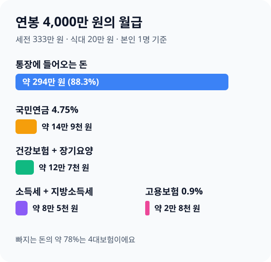
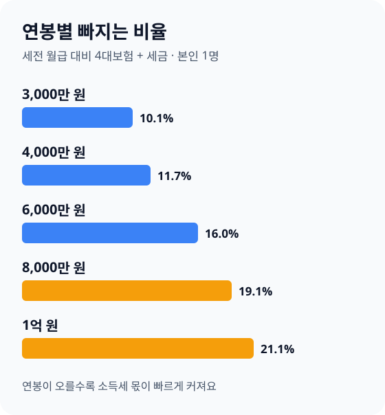

> **바쁜 분을 위한 3줄 요약**
>
> 1. 급여명세서에서 국민연금·건강보험·소득세 **세 줄부터 확인하세요**.
> 2. 부양가족과 비과세 식대가 회사에 제대로 **신고됐는지 물어보세요**.
> 3. 연봉 협상 전에 인상액의 약 75%만 남는다고 보고 **실수령액으로 계산하세요**.

월급날 아침, 은행 앱 알림에 찍힌 금액이 계약서의 연봉을 12로 나눈 숫자보다 한참 적습니다. 어디로 얼마가 빠졌는지 급여명세서를 열어 봐도 항목이 너무 많습니다.

이 글은 2026년 11월 기준 4대보험 요율과 국세청 근로소득 간이세액표로 연봉별 실수령액을 계산했습니다. 숫자는 모두 우리 [연봉 실수령액 계산기](/apps/salary-net-calculator/)와 같은 방식으로 냈습니다.

## 연봉 4,000만 원이면 한 달에 약 294만 원을 받습니다

연봉 4,000만 원의 월 실수령액은 2,944,007원입니다. 세전 월급 3,333,333원에서 4대보험과 세금 389,326원이 빠집니다.

아래 표는 비과세 식대 월 20만 원, 부양가족 본인 1명, 원천징수 100%를 가정했습니다. 소득세는 회사가 매달 떼는 추정치이고, 최종 세금은 다음 해 2월 연말정산에서 정해집니다.

| 연봉 | 세전 월급 | 월 실수령액 |
|---|---|---|
| 3,000만 원 | 2,500,000원 | 2,248,521원 |
| 3,600만 원 | 3,000,000원 | 2,680,384원 |
| 4,000만 원 | 3,333,333원 | 2,944,007원 |
| 5,000만 원 | 4,166,666원 | 3,571,533원 |
| 6,000만 원 | 5,000,000원 | 4,200,536원 |
| 7,000만 원 | 5,833,333원 | 4,832,473원 |
| 8,000만 원 | 6,666,666원 | 5,390,548원 |
| 1억 원 | 8,333,333원 | 6,574,146원 |

연봉 1억 원이어도 월 실수령액은 657만 원 정도입니다. 연봉이 두 배가 되어도 실수령액은 두 배보다 덜 늘어납니다.

## 월급에서 빠지는 6가지를 항목별로 확인하세요

월급에서는 국민연금·건강보험·장기요양보험·고용보험·소득세·지방소득세 6가지가 빠집니다. 앞의 4개는 요율이 정해진 보험료이고, 뒤의 2개는 소득이 클수록 비율이 커지는 세금입니다.

2026년 11월 13일 국가법령정보센터에서 각 요율을 직접 확인했습니다. 근로자는 아래 비율을 내고, 회사가 같은 만큼(고용보험은 그보다 많이) 더 냅니다.

| 항목 | 근로자 부담률 | 연봉 4,000만 원 월 공제 |
|---|---|---|
| 국민연금 | 4.75% | 148,833원 |
| 건강보험 | 3.595% | 112,643원 |
| 장기요양보험 | 0.4724% | 14,801원 |
| 고용보험 | 0.9% | 28,199원 |
| 소득세 | 간이세액표 | 77,140원 |
| 지방소득세 | 소득세의 10% | 7,710원 |

국민연금은 [국민연금법 부칙](https://www.law.go.kr/법령/국민연금법)에 따라 2026년 근로자 몫이 1만분의 475, 곧 4.75%입니다. 최종 요율은 [국민연금법 제88조](https://www.law.go.kr/법령/국민연금법/제88조)가 정한 본인 6.5%까지 해마다 오릅니다.

건강보험료율은 [국민건강보험법 시행령 제44조](<https://www.law.go.kr/법령/국민건강보험법 시행령/제44조>)의 7.19%를 회사와 반씩 냅니다. 장기요양보험료율은 [노인장기요양보험법 시행령 제4조](<https://www.law.go.kr/법령/노인장기요양보험법 시행령/제4조>)의 0.9448%를 반씩 내고, 실업급여 보험료율 1.8%도 [고용산재보험료징수법 시행령 제12조](<https://www.law.go.kr/법령/고용보험 및 산업재해보상보험의 보험료징수 등에 관한 법률 시행령/제12조>)대로 반씩 냅니다.

연봉 4,000만 원이라면 빠지는 돈의 약 78%가 4대보험입니다. 이 구간에서는 세금보다 보험료가 실수령액을 더 많이 줄입니다.

## 비과세 식대 20만 원이 빠졌는지 먼저 보세요

식대가 비과세로 처리되면 연봉 4,000만 원 기준으로 한 달에 48,085원을 더 받습니다. [소득세법 제12조](https://www.law.go.kr/법령/소득세법/제12조)는 식사를 따로 받지 않는 근로자의 식사대를 월 20만 원까지 비과세로 정합니다.

같은 연봉에서 비과세가 없으면 실수령액은 2,895,922원입니다. 비과세 금액에는 4대보험과 소득세가 붙지 않아서 차이가 생깁니다.

급여명세서에 "식대" 줄이 따로 있는지 확인하세요. 없거나 회사에서 밥을 제공하는데 식대도 비과세로 잡혀 있다면 인사팀에 기준을 물어보세요.

## 부양가족을 올리면 매달 떼는 소득세가 줄어듭니다

부양가족과 자녀를 회사에 신고하면 매달 떼는 소득세가 바로 줄어듭니다. 간이세액표가 가족 수와 8~20세 자녀 수에 따라 세액을 다르게 정하기 때문입니다.

예를 들어 본인과 배우자, 8세 이상 자녀 1명이 있는 3인 가구(자녀 1명 공제)라고 가정해 계산했습니다. 같은 연봉이라도 매달 떼는 소득세와 지방소득세가 아래처럼 달라집니다.

| 연봉 | 본인 1명 실수령액 | 3인 가구(자녀 1명) |
|---|---|---|
| 3,000만 원 | 2,248,521원 | 2,276,501원 |
| 4,000만 원 | 2,944,007원 | 3,019,027원 |
| 6,000만 원 | 4,200,536원 | 4,328,356원 |
| 8,000만 원 | 5,390,548원 | 5,573,818원 |

연봉 6,000만 원이면 한 달에 127,820원 차이입니다. 다만 이 돈은 연말정산 결과를 미리 당겨 받는 것이라, 실제 공제 요건을 갖추지 못한 가족을 올리면 2월에 다시 냅니다.

맞벌이 부부는 같은 자녀를 두 사람이 모두 올리면 안 됩니다. 누구에게 올릴지는 [맞벌이 부부 연말정산 절세 전략](/posts/2026-dual-income-couple-tax-saving-guide.html)을 보고 정하세요.

## 연봉이 오르면 인상분의 약 75%가 남습니다

연봉 4,000만 원에서 300만 원 오르면 1년 실수령액은 2,261,484원 늘어납니다. 인상분의 75.3%가 남는다는 뜻입니다.

연봉 6,000만 원에서 300만 원 오를 때도 76.1%가 남습니다. 인상분에 4대보험 약 10%와 늘어난 소득세가 함께 붙기 때문입니다.

"과세 구간이 올라가면 월급이 오히려 줄어든다"는 말은 사실이 아닙니다. [소득세법 제55조](https://www.law.go.kr/법령/소득세법/제55조)의 누진세율은 구간을 넘은 금액에만 높은 세율을 매깁니다.

| 연봉 변화 | 월 실수령액 증가 | 남는 비율 |
|---|---|---|
| 4,000만 → 4,300만 원 | 188,457원 | 75.3% |
| 6,000만 → 6,300만 원 | 190,457원 | 76.1% |

연봉 협상 때는 인상액에 0.75를 곱해 실수령액으로 바꿔 보세요. 이직 제안을 비교할 때도 같은 방법으로 월 실수령액을 나란히 놓으면 판단이 쉬워집니다.

## 원천징수 80%와 120%는 연말정산 결과로 고르세요

원천징수 비율을 80%로 낮추면 연봉 4,000만 원 기준 월 실수령액이 2,960,977원으로 16,970원 늘어납니다. 120%로 올리면 2,927,047원으로 16,960원 줄어듭니다.

1년 동안 내는 세금 총액은 바뀌지 않습니다. 매달 덜 떼면 2월 연말정산에서 덜 돌려받거나 더 내고, 많이 떼면 그만큼 더 돌려받습니다.

| 지난 연말정산 결과 | 고를 비율 |
|---|---|
| 해마다 수십만 원을 추가로 냄 | 120% |
| 해마다 비슷하게 맞음 | 100%(기본) |
| 해마다 크게 돌려받고 지금 현금이 빠듯함 | 80% |

비율은 회사에 신청서를 내서 바꿉니다. 지난해 연말정산 결과는 [연말정산 소득공제 놓치기 쉬운 항목](/posts/2026-year-end-tax-settlement-guide.html)을 보며 함께 점검하세요.

## 2027년 1월 월급은 국민연금만큼 줄어듭니다

2027년부터 국민연금 근로자 부담률이 4.75%에서 5.00%로 오릅니다. 국민연금법 부칙에 2027년은 1만분의 500으로 적혀 있습니다.

연봉 4,000만 원(과세 월급 3,133,333원)이라면 한 달에 약 7,833원이 더 빠집니다. 기준소득월액 400만 원이면 10,000원이 더 빠집니다.

2027년 건강보험료율 같은 다른 요율은 이 글을 쓰는 시점에 확정 조문을 확인하지 못했습니다. 1월 급여명세서가 나오면 국민연금 줄부터 비교해 보세요.

## 실수령액이 계산과 다를 때 확인할 5가지

급여명세서가 계산기와 다르면 대부분 아래 다섯 가지 가운데 하나입니다. 하나씩 지워 가면 원인을 찾을 수 있습니다.

**퇴직금 포함 연봉인지 확인하세요.** 연봉 4,000만 원에 퇴직금이 포함되면 13으로 나눠 세전 월급이 3,076,923원이 되고, 실수령액은 2,745,603원으로 내려갑니다.

**국민연금 상한을 확인하세요.** 국민연금은 기준소득월액 상한이 있어 고소득자는 보험료가 더 늘지 않습니다. 우리 계산기는 2026년 7월부터 상한을 월 659만 원으로 계산합니다.

**상여금이 나온 달인지 보세요.** 상여금이 나온 달은 그달 소득세가 크게 늘어 실수령액 비율이 달라집니다.

**2월·4월 급여를 따로 보세요.** 2월에는 연말정산 결과가, 4월에는 건강보험료 연말정산 결과가 더해지거나 빠집니다. 건강보험료 정산은 [건강보험료 줄이는 법](/posts/2026-health-insurance-premium-saving-guide.html)에서 설명했습니다.

**부양가족 신고서를 다시 보세요.** 입사 때 낸 신고서에 가족이 빠져 있으면 매달 소득세를 더 뗍니다.

## 연봉·가구별로 오늘 할 일을 정하세요

연봉 구간과 가구 형태에 따라 먼저 손볼 곳이 다릅니다. 아래 표에서 내 칸을 찾으세요.

| 상황 | 먼저 할 일 |
|---|---|
| 연봉 3,000만 원 안팎, 혼자 | 식대 비과세 확인, 남는 돈 자동이체 |
| 연봉 4,000만~6,000만 원, 혼자 | 연금저축·IRP로 세액공제 받기 |
| 자녀가 있는 외벌이 | 부양가족·자녀 신고서 확인 |
| 맞벌이 | 자녀 공제를 누구에게 올릴지 정하기 |
| 연봉 8,000만 원 이상 | 원천징수 120% 검토, 연금계좌 한도 채우기 |

사회초년생이라면 [사회초년생 월급 관리법](/posts/2026-first-salary-money-management-guide.html)에서 실수령액을 통장 4개로 나누는 법을 보세요. 세금을 줄이려면 [연말 절세 막판 체크리스트](/posts/2026-year-end-tax-saving-checklist.html)가 이어집니다.

## 자주 묻는 질문

**Q. 연봉 4,000만 원 실수령액은 얼마인가요?**
비과세 식대 20만 원, 본인 1명 기준으로 한 달 2,944,007원입니다. 1년으로는 약 3,533만 원입니다.

**Q. 연봉이 오르면 세금 때문에 실수령액이 줄어들 수도 있나요?**
줄어들지 않습니다. 높은 세율은 구간을 넘은 금액에만 붙고, 연봉 4,000만 원에서 300만 원 오르면 인상분의 75.3%가 남습니다.

**Q. 원천징수 80%를 고르면 세금을 덜 내나요?**
덜 내지 않습니다. 매달 덜 뗀 만큼 연말정산에서 덜 돌려받거나 더 내므로 1년 세금 총액은 같습니다.

**Q. 2027년에 월급에서 더 빠지는 것이 있나요?**
국민연금 근로자 부담률이 4.75%에서 5.00%로 오릅니다. 연봉 4,000만 원이면 한 달에 약 7,833원이 더 빠집니다.

## 월급날 확인 체크리스트

| 순서 | 할 일 |
|---|---|
| 1 | 급여명세서에서 6가지 공제 항목 찾기 |
| 2 | 식대 비과세 20만 원 들어갔는지 보기 |
| 3 | 부양가족·자녀 신고 내용 확인 |
| 4 | 계산기로 내 연봉 실수령액과 비교 |
| 5 | 지난 연말정산 결과로 원천징수 비율 정하기 |

실수령액은 연봉만으로 정해지지 않고, 신고서 한 장과 비과세 한 줄로도 달라집니다. 이번 달 급여명세서를 열어 식대와 부양가족 두 줄부터 확인해 보세요.

---

> 💵 **직접 계산해 보세요: [연봉 실수령액 계산기 →](/apps/salary-net-calculator/)**  
> 연봉과 비과세액, 부양가족 수만 넣으면 월 실수령액과 항목별 공제액, 연봉이 오를 때 남는 금액을 알려 드려요.

> 📚 **함께 읽으면 좋은 글**  
> 매달 뗀 세금을 돌려받으려면 [연말정산 소득공제 놓치기 쉬운 항목](/posts/2026-year-end-tax-settlement-guide.html)을, 세액공제를 더 받으려면 [IRP 세액공제 300만 원 더 받는 법](/posts/2026-irp-tax-deduction-guide.html)을 보세요.
