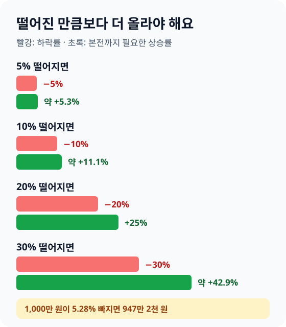
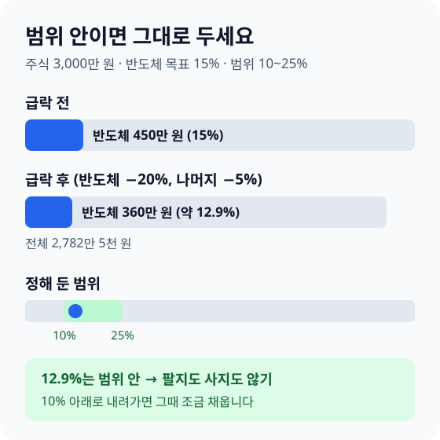

> **바쁜 분을 위한 3줄 요약**
>
> 1. 팔기 전에 그 돈을 **언제 쓸지**부터 종이에 적으세요.
> 2. 적립식 자동이체는 그대로 두고, 비중이 **정해 둔 범위를 벗어났을 때만** 조정하세요.
> 3. 레버리지 ETF·신용·미수로 산 것이 있다면 **그 계좌부터** 확인하세요.

출근길 지하철에서 증권 앱을 열자 화면이 온통 파란색입니다. 어제 하루에만 계좌가 몇십만 원 줄었고, 오늘 새벽 미국 증시는 더 크게 떨어졌다는 알림이 와 있습니다.

지금 다 팔아야 하나, 아니면 더 사야 하나 고민된다면 잠깐 앱을 닫으세요. 급락한 날 내리는 결정은 대부분 지수가 어디로 갈지가 아니라 **그 돈을 언제 쓸지**로 정해집니다.

이 글은 시장을 예측하지 않습니다. 대신 오늘 계좌 앞에서 순서대로 할 일을 정리했습니다.

## 무슨 일이 있었는지 숫자로 확인하세요

11월 5일 코스피는 5.28% 내린 5,383.80에, 미국 나스닥은 같은 날 5.52% 내린 24,315.00에 마감했습니다(언론 보도 기준, 한국 시간 11월 6일 오전 확인). 이틀 연속 반도체와 AI 관련 주식이 하락을 이끌었습니다.

| 시장 | 11월 5일 하루 변동 | 비고 |
|---|---|---|
| 코스피 | −5.28% | 5,383.80 마감 |
| 코스닥 | −5.11% | 매도 사이드카 발동 |
| 나스닥 | −5.52% | 24,315.00 마감 |
| S&P500 | 약 −4.4% | 미국 대형주 500개 |
| 다우 | 약 −3.4% | 약 1,800포인트 하락 |

국내에서는 삼성전자가 7.57%, SK하이닉스가 9.46% 떨어졌고, 외국인이 하루에 약 3조 4천억 원어치를 팔았다고 보도됐습니다. 미국에서는 필라델피아 반도체지수가 약 12% 빠졌습니다.

하락의 배경으로는 AI 데이터센터 투자가 줄어들 수 있다는 우려와, 미국 중간선거 결과 뒤 데이터센터 규제가 강화될 수 있다는 관측이 거론됐습니다. 원인이 무엇이든 지금 우리가 정할 수 있는 것은 내 계좌의 다음 행동뿐입니다.

## 팔기 전에 그 돈을 언제 쓸지 먼저 적으세요

1년 안에 쓸 돈이 주식에 들어가 있다면 그 부분은 줄이는 것을 검토하고, 5년 넘게 둘 돈이라면 오늘 팔 이유는 거의 없습니다. 같은 하락이라도 돈의 쓸 날짜에 따라 정답이 다릅니다.

| 그 돈을 쓸 시기 | 오늘 할 일 | 이유 |
|---|---|---|
| 1년 안 (전세 잔금, 결혼 자금) | 그 금액만큼 줄이기 검토 | 회복을 기다릴 시간이 없어요 |
| 1~3년 | 더 사지 말고 유지 | 반등을 기다릴 여유가 조금 있어요 |
| 5년 이상 (노후 자금) | 계획대로 유지 | 하루 하락보다 기간이 길어요 |

계좌에 든 돈을 쓸 시기별로 나눠 메모장에 적어 보세요. "전세 잔금 2,000만 원은 내년 3월"처럼 금액과 날짜를 함께 쓰면, 팔아야 할 돈과 그대로 둘 돈이 바로 갈립니다.

1년 안에 쓸 돈을 줄인다면 한꺼번에 팔지 않아도 됩니다. 몇 주에 나눠 줄이고, 판 돈은 [파킹통장이나 만기를 맞춘 예금](/posts/2026-parking-savings-guide.html)으로 옮기세요. 다음에는 처음부터 쓸 날짜가 정해진 돈을 주식에 넣지 않는 것이 가장 좋은 대비입니다.

## 떨어진 만큼보다 더 올라야 본전입니다

5% 떨어지면 약 5.3%, 20% 떨어지면 25%가 올라야 본전입니다. 하락률이 클수록 회복에 필요한 상승률이 빠르게 커집니다.

예를 들어 코스피를 따라가는 ETF에 1,000만 원을 넣었다면 11월 5일 하루에 약 947만 2천 원이 됐습니다. 다시 1,000만 원이 되려면 약 5.57%가 올라야 합니다.

이 숫자가 말하는 것은 두 가지입니다. 첫째, 하루 5% 하락은 크지만 회복이 불가능한 숫자는 아닙니다. 둘째, 하락이 20~30%로 이어지면 회복에 오랜 시간이 걸릴 수 있으니, **버틸 수 있는 금액만 주식에 두는 것**이 가장 확실한 대비입니다.

## 적립식 자동이체는 멈추지 마세요

매달 같은 금액을 사는 적립식은 가격이 떨어진 달에 더 많은 수량을 삽니다. 급락한 달에 자동이체를 멈추면 이 효과를 스스로 놓치게 됩니다.

간단한 예로 계산해 보겠습니다(가정). 매달 30만 원씩 ETF를 사는데, 이번 달 가격이 1만 원이면 30주를 삽니다. 다음 달 가격이 8,000원으로 20% 떨어지면 같은 30만 원으로 37.5주를 삽니다.

두 달 동안 60만 원으로 67.5주를 샀으니 평균 매수 가격은 약 8,889원입니다. 두 달 가격의 단순 평균인 9,000원보다 낮습니다. 떨어질 때 더 많이 산 덕분입니다.

다만 이 방법은 **오래 둘 돈**일 때만 맞습니다. 생활비가 빠듯한데 적립 금액을 지키느라 카드값이 밀린다면 금액을 줄이세요. 멈추는 것보다 줄여서 이어 가는 편이 낫습니다.

"지금이 기회"라며 생활비나 비상금까지 끌어와 한꺼번에 사는 것도 피하세요. 바닥을 맞히기는 누구에게도 어렵습니다. 더 사고 싶다면 적립 금액을 몇 달 동안 조금 늘리는 방식이 안전합니다.

## 비중이 정해 둔 범위를 벗어났을 때만 조정하세요

비중 되돌리기는 하루 하락이 아니라 **정해 둔 범위**를 기준으로 합니다. 범위 안이라면 팔지도 사지도 않는 것이 규칙입니다.

[AI·반도체 ETF 글](/posts/2026-ai-semiconductor-etf-guide.html)에서 예로 든 것처럼, 주식 투자금 3,000만 원 가운데 반도체 ETF를 15%인 450만 원 담고, 10% 아래로 내려가거나 25%를 넘으면 조정하기로 정했다고 해 보겠습니다.

이번처럼 반도체가 20% 내리고 나머지가 5% 내렸다면 반도체는 360만 원, 나머지는 2,422만 5천 원이 됩니다. 전체 2,782만 5천 원 가운데 반도체 비중은 약 12.9%입니다.

12.9%는 정해 둔 범위 안이라 아무것도 하지 않습니다. 하락이 이어져 10% 아래로 내려가면 그때 다른 자산 일부를 옮겨 15% 근처로 채웁니다. 기준을 숫자로 정해 두면 뉴스를 볼 때마다 흔들리지 않습니다.

아직 범위를 정하지 않았다면 오늘이 좋은 날입니다. "반도체는 주식의 10~20%", "주식은 전체 자산의 60%"처럼 한 줄로 적어 두세요.

## 연금계좌는 오늘 팔 이유가 가장 적습니다

연금저축·IRP는 55세 이후에 쓸 돈이라, 하루 급락에 맞춰 팔 이유가 가장 적은 계좌입니다. 계좌 안에서 사고팔아도 세금은 나중에 꺼낼 때 매겨지지만, 하락한 상품을 팔면 손실을 확정하고 회복의 기회를 놓칩니다.

특히 계좌를 해지하거나 중도인출하는 것은 피하세요. 세액공제를 받은 돈을 55세 전에 꺼내면 16.5%를 기타소득세로 냅니다. 하락한 데다 세금까지 내는 셈입니다.

위험을 줄이고 싶다면 팔아서 꺼내지 말고 **계좌 안에서** 옮기세요. 주식형 ETF 일부를 채권형·예금으로 바꾸면 세금 없이 비중을 조정할 수 있습니다. IRP는 원래 위험자산을 70%까지만 담을 수 있어 주식 비중이 정해진 범위를 넘지 않습니다.

계좌별 규칙은 [연금저축펀드 활용법](/posts/2026-pension-savings-fund-guide.html)과 [IRP 세액공제 글](/posts/2026-irp-tax-deduction-guide.html)에서 확인하세요.

## 레버리지·신용·미수 계좌부터 확인하세요

하루 수익률의 2배를 따라가는 레버리지 ETF는 나스닥이 5.5% 떨어진 날 대략 11% 떨어집니다. 오르내림이 반복되면 지수가 제자리로 돌아와도 손실이 남을 수 있어, 급락기에는 일반 ETF보다 훨씬 위험합니다.

증권사 돈을 빌려 산 **신용융자**나 결제일에 돈을 넣어야 하는 **미수거래**가 있다면 오늘 가장 먼저 확인하세요. 주가가 떨어져 증권사가 정한 담보비율 아래로 내려가면, 정한 날까지 돈을 더 넣지 않을 경우 증권사가 주식을 강제로 팝니다(반대매매).

1. 증권사 앱의 **신용·미수 잔고**와 **담보비율** 화면을 엽니다.
2. 추가로 넣어야 할 돈과 기한이 나와 있으면 그 금액부터 확인합니다.
3. 채울 여유가 없다면 증권사가 팔기 전에 스스로 일부를 정리할지 정합니다. 반대매매는 원하지 않는 가격에 팔릴 수 있습니다.

빌린 돈으로 투자하고 있지 않다면 이 부분은 건너뛰어도 됩니다. 다만 앞으로도 급락에 버티려면 빌린 돈으로 주식을 사지 않는 것이 가장 확실한 방법입니다.

## 해외주식 손실은 올해 안에 정리하면 세금이 줄 수 있어요

해외주식과 미국 상장 ETF는 1년 동안의 이익과 손실을 합쳐 세금을 계산합니다. 올해 다른 해외 종목에서 이익을 냈다면, 손실 난 종목을 올해 안에 정리해 세금을 줄일 수 있습니다.

예를 들어 올해 해외 ETF에서 500만 원을 벌었다면 (500만 − 250만) × 22% = 55만 원을 냅니다. 같은 해 다른 해외 종목에서 100만 원 손실을 확정하면 (400만 − 250만) × 22% = 33만 원으로 줄어듭니다.

연말 정리는 결제일 기준이라 12월 마지막 거래일보다 며칠 앞서 끝내야 할 수 있습니다. 쓰는 증권사의 연말 매도 마감일을 미리 확인하세요. 그리고 세금만 보고 팔지 말고, 그 종목을 계속 들고 갈 이유가 있는지 먼저 따져 보세요.

국내 상장 해외 ETF는 일반 계좌에서 손익을 합쳐 주지 않습니다. 이런 상품은 [ISA](/posts/2026-isa-account-guide.html) 안에서 손익을 합쳐 계산할 수 있습니다.

## 급락한 날 자주 하는 실수를 피하세요

- **하루 종일 앱을 들여다본다**: 가격을 볼수록 충동적으로 사고팔기 쉽습니다. 오늘은 위 순서대로 한 번만 점검하고 앱을 닫으세요.
- **한 번에 다 판다**: 쓸 시기가 먼 돈까지 팔면 반등이 와도 다시 들어가기 어렵습니다.
- **물타기를 한 번에 몰아서 한다**: 떨어진 종목에 남은 돈을 다 넣으면 하락이 이어질 때 버틸 돈이 없습니다.
- **인버스·레버리지로 만회하려 한다**: 하루 방향을 맞혀야 하는 상품으로 손실을 되찾으려 하면 손실이 더 커지기 쉽습니다.
- **소문과 단톡방 추천을 따른다**: 급락기에는 "이 종목만은 오른다"는 권유가 늘어납니다. 출처가 불분명한 리딩방 권유는 피하세요.

## 이미 많이 잃었다면

손실 금액보다 **남은 돈으로 무엇을 할지**에 집중하세요. 먼저 생활비 3~6개월치 비상금이 투자 계좌 밖에 있는지 확인하고, 없다면 앞으로 넣을 돈을 비상금부터 채우는 데 쓰세요.

다음으로 손실이 큰 종목이 왜 떨어졌는지 회사 공시나 상품 설명서를 확인하세요. 시장 전체가 함께 떨어진 것이라면 오래 둘 돈은 기다려 볼 수 있습니다. 반대로 그 회사만의 문제라면 처음 산 이유가 아직 유효한지 다시 따져 봐야 합니다.

마음이 크게 흔들려 잠을 못 잘 정도라면 그 자체가 주식 비중이 너무 높다는 신호입니다. 회복을 기다리는 동안 조금씩 비중을 낮추는 계획을 세우세요.

## 자주 묻는 질문

**Q. 주식이 급락하면 바로 팔아야 하나요?**
그 돈을 언제 쓸지로 정하세요. 1년 안에 쓸 돈이라면 줄이는 것을 검토하고, 5년 넘게 둘 돈이라면 하루 하락에 팔 이유는 적습니다.

**Q. 급락했을 때 적립식 투자를 멈춰야 하나요?**
오래 둘 돈이라면 멈추지 마세요. 같은 금액으로 가격이 떨어진 달에 더 많은 수량을 사서 평균 매수 가격이 낮아집니다.

**Q. 5% 떨어진 주식은 얼마나 올라야 본전인가요?**
약 5.3%가 올라야 합니다. 20% 떨어지면 25%, 30% 떨어지면 약 42.9%가 올라야 본전입니다.

**Q. 연금저축 계좌의 주식형 펀드도 팔아야 하나요?**
55세 이후에 쓸 돈이라 오늘 팔 이유가 가장 적습니다. 위험을 줄이고 싶다면 해지하지 말고 계좌 안에서 채권형·예금으로 일부를 옮기세요.

## 오늘부터 일주일 체크리스트

| 언제 | 할 일 |
|---|---|
| 오늘 | 계좌의 돈을 쓸 시기별로 나눠 적기 |
| 오늘 | 신용·미수·레버리지 잔고와 담보비율 확인 |
| 이번 주 | 1년 안에 쓸 돈은 나눠 줄이기 검토 |
| 이번 주 | 비중 범위(예: 반도체 10~20%)를 숫자로 적기 |
| 다음 적립일 | 자동이체 그대로 두기, 부담되면 금액만 줄이기 |
| 12월 중순 | 해외주식 손익 확인, 연말 매도 마감일 확인 |

급락한 날의 결정은 대부분 일주일 뒤에 후회하거나 안도하게 됩니다. 오늘은 앱을 닫기 전에 그 돈을 언제 쓸지, 메모장 한 줄만 적어 두세요.

※ 이 글은 일반적인 정보 제공을 위한 것이며 투자 권유가 아닙니다. 지수와 종목 숫자는 2026년 11월 6일 오전에 확인한 언론 보도 기준이며, 세금·제도는 2026년 11월 기준입니다.

---

> 📚 **함께 읽으면 좋은 글**  
> [AI·반도체 ETF 투자 방법](/posts/2026-ai-semiconductor-etf-guide.html) · [ETF 투자 시작하는 법](/posts/2026-etf-beginner-guide.html) · [달러 투자 방법](/posts/2026-dollar-investment-guide.html) · [해외주식 양도소득세](/posts/2026-overseas-stock-capital-gains-tax-guide.html)  
> 연금계좌로 굴리는 돈의 세금 혜택은 [연금저축·IRP 세액공제 계산기](/apps/pension-tax-calculator/)로 확인해 보세요.
