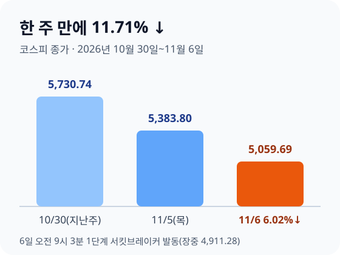
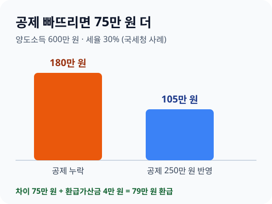

> **바쁜 분을 위한 3줄 요약**
>
> 1. 신용융자가 있다면 증권사 앱에서 담보비율과 반대매매 기준을 오늘 확인하세요.
> 2. 예금 금리가 세전 연 3.31%보다 낮다면 만기 때 더 높은 곳을 찾아 옮기세요.
> 3. 주식을 팔고 양도세를 신고했다면 홈택스 환급금 상세조회를 열어 보세요.

금요일 아침, 증권사 앱을 열자마자 "서킷브레이커 발동" 알림이 뜹니다. 지난주까지 5,700선이던 코스피가 한 주 만에 5,000선 턱걸이까지 내려왔습니다.

이번 주 뉴스 가운데 내 지갑에 바로 닿는 네 가지만 골라 할 일까지 정리했습니다. 숫자는 2026년 11월 6일(금) 마감 기준입니다.

## 이번 주 숫자를 확인하세요

이번 주에는 코스피가 크게 내리고 환율이 올랐으며, 물가 상승률은 조금 낮아졌습니다. 지난주 금요일(10월 30일)과 이번 주 금요일(11월 6일)을 나란히 놓았습니다.

| 숫자 | 지난주 | 이번 주 |
|---|---|---|
| 기준금리 | 연 3.00% | 연 3.00% |
| 원/달러 환율 | 1,334.3원 | 1,356.6원 |
| 코스피 | 5,730.74 | 5,059.69 |
| 소비자물가(전년 대비) | 2.9% (9월) | 2.8% (10월, 11월 3일 발표) |

기준금리는 11월 26일 금융통화위원회에서 올해 마지막으로 정합니다. 그때까지는 연 3.00%입니다.

## 신용융자가 있다면 담보비율부터 확인하세요

증권사 돈을 빌려 주식을 샀다면 오늘 담보비율부터 보세요. 정부가 9일부터 3개월간 담보비율 유지의무를 면제했지만, 내 계좌의 반대매매 기준은 증권사 공지로 직접 확인해야 합니다.

**무슨 일인가요**

코스피는 11월 6일 324.11포인트(6.02%) 내린 5,059.69로 마감했습니다. 오전 9시 3분에는 장중 4,924.61까지 밀려 1단계 서킷브레이커가 발동됐고, 매매가 20분간 멈췄습니다.

한 주 전체로는 지난주 금요일 5,730.74보다 671.05포인트(11.71%) 내렸습니다. 미국 중간선거(11월 3일) 뒤 AI 데이터센터 규제 우려로 미국 반도체주가 급락한 것이 원인으로 꼽혔습니다.

정부는 6일 관계기관 합동 시장상황 점검회의를 열고, 9일부터 3개월 동안 증권사의 신용융자 담보비율 140% 유지의무를 면제한다고 밝혔습니다. 주가 급락 때 과도한 반대매매가 변동성을 키우는 것을 막으려는 조치입니다.

**내 지갑엔**

예를 들어 코스피를 따라가는 상품에 1,000만 원이 들어 있었다면, 한 주 사이 평가액이 약 117만 원 줄었습니다. 빌린 돈 없이 투자했다면 손실은 평가액에 머뭅니다.

신용융자는 다릅니다. 예를 들어 내 돈 1,000만 원에 1,000만 원을 빌려 2,000만 원어치를 샀다면 담보비율은 200%입니다. 이번 주처럼 11.71% 내리면 평가액은 약 1,766만 원, 담보비율은 약 176.6%가 됩니다.

140%까지 내려가려면 평가액이 1,400만 원, 곧 처음보다 30% 떨어져야 합니다. 유지의무 면제는 증권사에 주는 여유일 뿐 빚이 줄어드는 것은 아니니, 여유가 있을 때 빌린 돈부터 줄이세요.

**할 일**

- 증권사 앱 → 신용·미수 잔고 화면에서 담보비율과 추가 납입 기한을 확인하세요.
- 9일 이후 내 증권사가 반대매매 기준을 바꿨는지 증권사 공지사항에서 확인하세요.

관련 글: [나스닥·코스피 5% 급락한 날, 내 ETF·연금계좌에서 할 일](/posts/2026-stock-market-crash-what-to-do.html), [ETF 투자 시작하는 법](/posts/2026-etf-beginner-guide.html)

출처: [증권사 신용융자 담보비율 의무 '3개월 면제'…증시 변동성 대응](https://www.korea.kr/news/policyNewsView.do?newsId=148975208), 대한민국 정책브리핑(11월 6일) · 파이낸셜뉴스 「美 데이터센터 규제 우려에 코스피 6% 급락…외국인 2.8조 순매도」(11월 6일)

## 환율이 1,350원을 넘었으니 달러 예산을 다시 잡으세요

원/달러 환율은 11월 6일 1,356.6원으로 마쳤습니다. 지난주보다 22.3원 올랐으니, 연말 여행·직구 예산은 오른 환율로 다시 계산하세요.

**무슨 일인가요**

증시가 급락한 6일 하루에만 환율이 14.5원 올랐습니다. 미국 AI 규제 우려와 국내 증시 급락이 원인으로 꼽혔습니다.

**내 지갑엔**

1,000달러를 바꾼다면 지난주에는 133만 4,300원, 이번 주에는 135만 6,600원이 듭니다. 일주일 사이 2만 2,300원이 늘었습니다.

**할 일**

- 쓸 날이 정해진 달러는 남은 기간으로 나눠 바꾸세요. 한 번에 바꾸면 그날 환율에 모두 걸립니다.
- 환전 전에 은행 앱에서 환율 우대율을 확인하세요.

관련 글: [환율 급등할 때 달러 살까 말까](/posts/2026-exchange-rate-surge-dollar-buy-guide.html), [환전 수수료 계산기](/apps/exchange-fee-calculator/)

출처: SBS Biz 「'AI 규제 우려·증시 급락'에 환율 급등…14.5원 오른 1356.6원」(11월 6일)

## 물가 2.8%를 이기는 예금인지 세후로 계산하세요

10월 소비자물가는 1년 전보다 2.8% 올랐습니다. 세금 15.4%를 떼고도 이 물가를 이기려면 예금 금리가 세전 연 3.31% 이상이어야 합니다.

**무슨 일인가요**

국가데이터처는 11월 3일 10월 소비자물가지수가 120.73으로 1년 전보다 2.8%, 한 달 전보다 0.2% 올랐다고 발표했습니다. 9월 2.9%보다 0.1%p 낮습니다.

식료품과 에너지를 뺀 근원물가도 2.8% 올랐고, 자주 사는 품목으로 만든 생활물가는 2.6% 올랐습니다. 농축수산물은 1년 전보다 1.7% 내렸습니다.

**내 지갑엔**

우리 [적금·예금 계산기](/apps/savings-calculator/) 방식(단리, 이자소득세 15.4%)으로 1,000만 원을 1년 예금에 넣어 보겠습니다. 물가만큼 돈의 값어치를 지키려면 1년 뒤 1,028만 원이 있어야 합니다.

| 예금 금리(세전) | 1년 뒤 세후 수령액 | 1,028만 원과 비교 |
|---|---|---|
| 연 3.0% | 1,025만 3,800원 | 2만 6,200원 모자람 |
| 연 3.5% | 1,029만 6,100원 | 1만 6,100원 남음 |

**할 일**

- 은행 앱에서 내 예금의 약정 금리와 만기일을 확인하세요.
- 만기가 다가온 예금은 세전 연 3.31%를 기준으로 갈아탈 곳을 비교하세요.

관련 글: [물가 오를 때 내 돈 지키는 법](/posts/2026-inflation-money-protection-guide.html), [파킹통장 고르는 법](/posts/2026-parking-savings-guide.html)

출처: [2026년 10월 소비자물가동향](https://www.korea.kr/briefing/policyBriefingView.do?newsId=156787698), 국가데이터처(11월 3일)

## 주식 양도세를 신고했다면 환급금 상세조회를 열어 보세요

국세청이 주식 양도소득 기본공제 250만 원을 빠뜨리고 세금을 더 낸 4,687명에게 21억 원을 11월 3일 돌려줬습니다. 신청하지 않아도 되니 홈택스에서 대상인지만 확인하세요.

**무슨 일인가요**

국세청은 2021~2025년 귀속 주식 양도소득세 신고를 다시 살펴, 기본공제를 누락한 납세자에게 직권으로 환급했습니다. 1인당 최대 79만 원입니다.

기본공제는 [소득세법 제103조](https://www.law.go.kr/법령/소득세법/제103조)에 따라 양도소득금액에서 연 250만 원을 빼 주는 항목입니다. 국내주식과 해외주식은 합쳐서 연 250만 원이고, 부동산은 따로 250만 원을 받습니다.

**내 지갑엔**

국세청 사례를 보면, 양도소득 600만 원을 세율 30%로 신고하며 공제를 빠뜨린 사람은 180만 원을 냈습니다. 공제를 반영하면 세금은 105만 원이라 75만 원에 환급가산금 4만 원을 더한 79만 원을 받았습니다.

공제 250만 원을 그대로 돌려받는 것은 아닙니다. 국세청 설명대로 세율 20%라면 본세 50만 원을 돌려받습니다. 개인지방소득세 10%는 다음 달에 따로 자동 환급됩니다.

**할 일**

- 홈택스 → 납부·고지·환급금 → 환급금 상세조회에서 세목이 양도소득세이고 환급결정일이 2026년 10월인 내역을 찾으세요.
- 환급계좌가 없다면 같은 화면의 [지급신청]에서 본인 명의 계좌를 넣으세요. 국세청은 환급을 이유로 계좌 비밀번호를 묻지 않습니다.

관련 글: [해외주식 양도소득세, 12월 전에 손을 쓰면 줄일 수 있습니다](/posts/2026-overseas-stock-capital-gains-tax-guide.html)

출처: [주식 양도소득 기본공제 누락분, 국세청이 먼저 찾아 돌려드립니다](https://www.korea.kr/briefing/pressReleaseView.do?newsId=156787734), 국세청 보도참고자료(11월 3일)

## 다음 주 일정을 달력에 넣으세요

다음 주에는 신용융자 담보비율 면제 시작과 미국 물가 발표가 가장 큰 일정입니다. 11월 말까지 이어지는 날짜를 함께 적어 두었습니다.

- **11월 9일(월)**: 신용융자 담보비율 140% 유지의무 면제 시작(3개월)
- **11월 10일(화) 밤**: 미국 10월 소비자물가 발표(미국 노동통계국)
- **11월 11일(수)**: 국가데이터처 10월 고용동향 발표
- **11월 16~27일**: 청년미래적금 2차 계좌 개설(주말 제외)
- **11월 26일(목)**: 한국은행 금통위 기준금리 결정, 올해 마지막
- **11월 30일(월)**: 문화누리카드 신청 마감, 유류세 인하 종료 예정일

유류세 인하를 12월 이후에도 이어 갈지는 아직 확인하지 못했습니다. 11월 말 정부 발표를 확인하세요.

## 자주 묻는 질문

**Q. 신용융자 담보비율 유지의무가 면제되면 반대매매가 없어지나요?**
증권사가 담보비율 140%를 반드시 지킬 의무가 9일부터 3개월간 면제되는 것입니다. 실제 반대매매 기준은 증권사마다 다를 수 있으니 내 증권사 공지를 확인하세요.

**Q. 국세청 양도세 환급은 따로 신청해야 하나요?**
신청하지 않아도 됩니다. 환급계좌가 있으면 자동으로 들어오고, 없으면 홈택스 환급금 상세조회에서 계좌를 넣으면 됩니다.

**Q. 물가 2.8%를 이기려면 예금 금리가 얼마여야 하나요?**
이자소득세 15.4%를 떼고도 이기려면 세전 연 3.31% 이상이어야 합니다. 연 3.0% 예금은 1,000만 원 기준으로 1년에 2만 6,200원 모자랍니다.

## 이번 주 할 일 세 가지만 하세요

이번 주 뉴스는 주가가 크게 흔들렸지만, 할 일은 세 가지입니다. 신용융자 담보비율 확인, 예금 금리와 물가 비교, 양도세 환급 조회입니다.

오늘 하나만 한다면, 빌린 돈으로 산 주식이 있는지부터 확인하세요. 다음 주 일요일에는 미국 물가 결과와 금통위를 앞둔 숫자를 정리해 다시 전해 드리겠습니다.

> **직접 계산해 보세요**: [적금·예금 계산기](/apps/savings-calculator/) · [환전 수수료 계산기](/apps/exchange-fee-calculator/) · [오늘의 생활경제 대시보드](/apps/economy-dashboard/)
