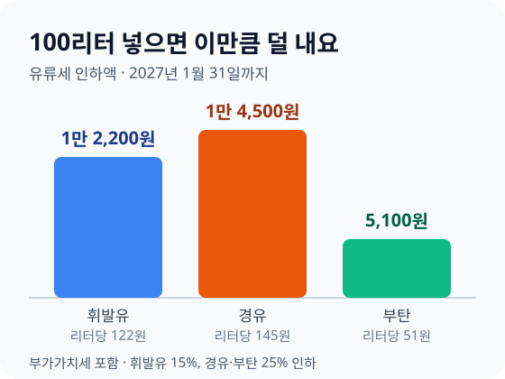
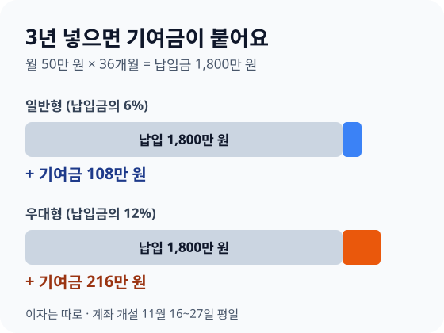

> **바쁜 분을 위한 3줄 요약**
>
> 1. 청년미래적금 2차 심사를 통과했다면 11월 27일 전에 계좌를 여세요.
> 2. 카드 포인트가 얼마인지 어카운트인포에서 미리 조회해 두세요.
> 3. 연말에 대출을 받을 계획이라면 은행 앱에서 한도부터 미리 조회하세요.

일요일 아침, 주유소 가격판을 보며 "12월부터 기름값이 오르나" 싶었던 분이 많을 겁니다. 이번 주 정부는 유류세 인하를 두 달 더 늘리기로 했습니다.

이번 주 뉴스 가운데 내 지갑에 바로 닿는 네 가지만 골라 할 일까지 정리했습니다. 숫자는 2026년 11월 13일(금) 마감 기준입니다.

## 이번 주 숫자를 확인하세요

이번 주에는 코스피가 4.56% 올랐고 환율은 19.9원 내렸습니다. 지난주 금요일(11월 6일)과 이번 주 금요일(11월 13일)을 나란히 놓았습니다.

| 숫자 | 지난주 | 이번 주 |
|---|---|---|
| 기준금리 | 연 3.00% | 연 3.00% |
| 원/달러 환율 | 1,356.6원 | 1,336.7원 |
| 코스피 | 5,059.69 | 5,290.53 |
| 소비자물가(전년 대비) | 2.8% (10월) | 2.8% (10월) |

코스피는 13일 하루에는 0.98% 내렸지만, 지난주 급락 뒤 한 주 전체로는 230.84포인트 올랐습니다. 환율은 13일 오후 3시 30분 기준이고, 1,000달러를 바꾸는 데 지난주보다 1만 9,900원이 덜 듭니다.

## 유류세 인하가 1월까지니 2월 기름값을 미리 계산하세요

유류세 인하는 2027년 1월 31일까지 이어집니다. 휘발유는 리터당 122원, 경유는 145원 싼 값이 두 달 더 유지됩니다.

**무슨 일인가요**

정부는 11월 11일 12월 이후 유류세 운용방안을 확정했습니다. 12월 1일부터 2027년 1월 31일까지 휘발유는 15%, 경유와 부탄은 25% 인하율을 지금처럼 적용합니다.

부가가치세를 포함한 리터당 인하액은 휘발유 122원, 경유 145원, 부탄 51원입니다. 정부는 고유가가 이어지는 가운데 유류세를 되돌리면 기름값과 물가가 함께 뛸 수 있다는 점을 이유로 들었습니다.

**내 지갑엔**

예를 들어 출퇴근에 한 달 휘발유 100리터를 넣는다면, 인하 덕분에 한 달 1만 2,200원을 덜 냅니다. 연장된 두 달(12월~1월)로 치면 2만 4,400원입니다.

경유차로 한 달 100리터를 넣는다면 한 달 1만 4,500원, 두 달 2만 9,000원입니다. 거꾸로 2월에 인하가 끝나면 같은 양을 넣어도 이만큼 더 내야 합니다.

**할 일**

- 한 달에 넣는 기름 양(리터)을 카드 명세서에서 확인하고, 인하액을 곱해 2월 예산에 미리 더해 두세요.
- 1월 말에 정부가 다시 연장하는지 확인하세요. 지금 발표는 1월 31일까지입니다.

관련 글: [자동차보험료 아끼는 법](/posts/2026-car-insurance-saving-guide.html), [물가 오를 때 내 돈 지키는 법](/posts/2026-inflation-money-protection-guide.html)

출처: [유류세 인하 2개월 연장…휘발유 15%·경유 25% 인하 유지](https://www.korea.kr/news/policyNewsView.do?newsId=148975482), 대한민국 정책브리핑(11월 11일)

## 쌓아 둔 카드 포인트를 지금 조회하세요

2027년 5월부터 신용카드 포인트를 지역화폐로 바꿔 동네 가게에서 쓸 수 있게 됩니다. 쓰지 않고 쌓인 카드 포인트는 모두 2.1조 원입니다.

**무슨 일인가요**

정부는 11월 13일 국가정책조정회의에서 미사용 포인트를 지역화폐로 바꾸는 방안을 보고했습니다. 금융결제원 어카운트인포나 지역화폐 앱에서 카드 포인트를 조회하고, 원하는 만큼 전환을 신청하면 다음 날부터 씁니다.

1단계는 카드 포인트이고, 2027년 5월 개통이 목표입니다. 그다음에는 KTX 마일리지, 탄소중립포인트 같은 공공기관 포인트도 바꿀 수 있도록 협의할 계획입니다.

**내 지갑엔**

카드 포인트는 지금도 어카운트인포에서 조회하고 조건에 맞으면 내 계좌로 옮길 수 있습니다. 지역화폐 전환은 쓸 곳이 하나 더 생기는 것이지, 포인트가 늘어나는 것은 아닙니다.

전환 수수료와 전환 비율은 이번 발표에 나오지 않았습니다. 카드 포인트는 보통 쌓은 지 5년이 지나면 사라지니, 내년 5월까지 기다리지 말고 지금 얼마나 있는지부터 보세요.

**할 일**

- 어카운트인포에서 카드사별로 쌓인 포인트를 조회하세요.
- "포인트 전환" 문자에 있는 링크는 누르지 마세요. 아직 전환 서비스는 열리지 않았습니다.

관련 글: [휴면예금·숨은 보험금 찾기](/posts/2026-hidden-money-finder-guide.html), [신용카드 혜택 가이드](/posts/2026-credit-card-benefits-guide.html)

출처: [잠자고 있는 포인트, 지역화폐로 바꿔 골목상권에서 쓴다](https://www.fsc.go.kr/no010101/88142), 금융위원회 보도자료(11월 13일)

## 연말에 대출이 필요하면 한도부터 조회하세요

10월 가계대출은 전 금융권에서 6조 4,000억 원 늘었습니다. 연말에는 은행이 대출 총량을 맞추느라 문턱을 높이기도 하니, 대출 계획이 있다면 한도를 먼저 확인하세요.

**무슨 일인가요**

금융위원회는 11월 12일 10월 가계대출이 6조 4,000억 원 늘어 9월 감소(2조 2,000억 원)에서 증가로 돌아섰다고 밝혔습니다. 주택담보대출이 4조 원, 신용대출이 1조 2,000억 원 늘었고, 1~10월 누적 증가액은 42조 4,000억 원입니다.

금융당국은 대출이 총량 목표 안에서 관리되고 있다며, 특정 시기에 일률적인 "대출 절벽"이 생기지 않게 해 달라고 금융권에 당부했습니다. 사업자대출을 집 사는 데 쓰는 것 같은 용도 외 사용은 계속 점검합니다.

**내 지갑엔**

예를 들어 신용대출 1,000만 원을 연 5%로 빌리면 이자는 1년에 50만 원, 한 달 약 4만 1,700원입니다. 금리가 연 1%p만 낮아도 1년에 10만 원이 줄어듭니다.

주식을 사려고 신용대출을 늘렸다면 지난주처럼 주가가 크게 흔들릴 때 손실과 이자가 함께 커집니다. 대출이 이미 있다면 지금 금리가 더 낮은 곳이 있는지 비교해 보세요.

**할 일**

- 대출 계획이 있다면 은행 앱의 대출 한도·금리 조회를 먼저 해 두세요. 조회만으로는 신용점수가 내려가지 않습니다.
- 이미 대출이 있다면 [대출 갈아타기 이자 비교 계산기](/apps/loan-refinance-calculator/)로 중도상환수수료를 빼고도 이득인지 계산하세요.

관련 글: [대환대출 갈아타기, 수수료 빼고도 이득인지 계산하는 법](/posts/2026-loan-refinancing-guide.html), [신용점수 올리는 법](/posts/2026-credit-score-guide.html)

출처: [2026년 10월 가계대출 동향(잠정)](https://www.fsc.go.kr/no010101/88124), 금융위원회 보도자료(11월 12일)

## 청년미래적금 심사를 통과했다면 27일 전에 계좌를 여세요

청년미래적금 2차 계좌 개설은 11월 16일(월)부터 27일(금)까지 평일에만 할 수 있습니다. 이 기간이 지나면 심사를 통과했어도 계좌를 열 수 없습니다.

**무슨 일인가요**

국가데이터처가 11월 11일 발표한 10월 고용동향에서 청년층(15~29세) 고용률은 42.9%로 1년 전보다 1.7%p 내렸습니다. 전체 취업자는 2,917만 9,000명으로 13만 9,000명 늘었고, 실업률은 2.0%입니다.

청년 일자리가 줄어든 만큼 정부가 돈을 얹어 주는 청년미래적금은 놓치지 않는 것이 좋습니다. 2차 가입 심사는 11월 13일 끝났고, 통과자는 신청한 금융회사 앱에서 계좌를 열면 됩니다.

**내 지갑엔**

청년미래적금은 3년 만기이고 한 달에 최대 50만 원을 넣습니다. 정부기여금은 납입금의 6%(일반형) 또는 12%(우대형)입니다.

예를 들어 월 50만 원씩 3년 넣으면 납입금은 1,800만 원입니다. 이자를 빼고도 정부기여금이 일반형 108만 원, 우대형 216만 원 붙습니다.

**할 일**

- 심사 통과 안내 문자를 확인하고, 신청한 금융회사 앱에서 11월 27일 전 평일에 계좌를 여세요.
- 청년도약계좌에서 갈아탄다면 미래적금 계좌를 먼저 연 뒤, 같은 기간에 도약계좌를 특별중도해지로 신청하세요.

관련 글: [청년도약계좌·청년미래적금 정리](/posts/2026-youth-leap-account-guide.html), [11월 정부 지원금 마감 정리](/posts/2026-november-government-support-deadlines.html)

출처: [2026년 10월 고용동향](https://www.korea.kr/briefing/policyBriefingView.do?newsId=156788701), 국가데이터처(11월 11일) · ['청년미래적금' 2차 가입 신청 안내](https://www.korea.kr/news/policyNewsView.do?newsId=148973168), 대한민국 정책브리핑

## 다음 주 일정을 달력에 넣으세요

다음 주에는 청년미래적금 계좌 개설이 시작되고, 11월 말에는 기준금리 결정과 지원금 마감이 몰립니다. 내년 일정까지 함께 적어 두었습니다.

- **11월 16일(월)~27일(금)**: 청년미래적금 2차 계좌 개설(평일만)
- **11월 26일(목)**: 한국은행 금통위 기준금리 결정, 올해 마지막
- **11월 30일(월)**: 근로장려금 기한후신청·문화누리카드 신청 마감
- **12월 1일(화)**: 유류세 인하 연장분 적용 시작
- **2027년 1월 31일(일)**: 유류세 인하 종료 예정일
- **2027년 5월**: 카드 포인트 지역화폐 전환 개통 예정

## 자주 묻는 질문

**Q. 유류세 인하는 언제까지인가요?**
2027년 1월 31일까지입니다. 그때까지 휘발유는 리터당 122원, 경유는 145원, 부탄은 51원 인하된 값이 유지됩니다.

**Q. 카드 포인트를 지역화폐로 바꾸는 건 언제부터 되나요?**
2027년 5월 개통이 목표입니다. 어카운트인포나 지역화폐 앱에서 신청하면 다음 날부터 쓸 수 있고, 수수료와 전환 비율은 아직 발표되지 않았습니다.

**Q. 청년미래적금 2차 계좌는 언제까지 열어야 하나요?**
심사를 통과했다면 11월 16일부터 27일까지 평일에 열어야 합니다. 기간이 지나면 계좌를 열 수 없습니다.

## 이번 주 할 일 세 가지만 하세요

이번 주 뉴스에서 할 일은 세 가지입니다. 청년미래적금 계좌 개설, 카드 포인트 조회, 대출 한도 확인입니다.

오늘 하나만 한다면, 어카운트인포를 열어 카드 포인트가 얼마나 쌓였는지 보세요. 1분이면 충분하고, 사라질 포인트가 있다면 지금 쓰는 편이 낫습니다.

> **직접 계산해 보세요**: [대출 갈아타기 이자 비교 계산기](/apps/loan-refinance-calculator/) · [적금·예금 계산기](/apps/savings-calculator/) · [오늘의 생활경제 대시보드](/apps/economy-dashboard/)
