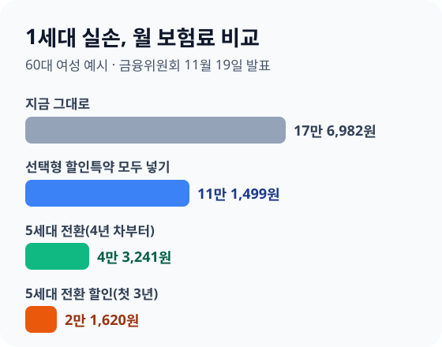
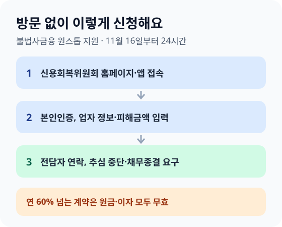

> **바쁜 분을 위한 3줄 요약**
>
> 1. 1·2세대 실손이라면 최근 3년 비급여 진료비부터 더해 보고 전환 할인을 판단하세요.
> 2. 신용융자나 레버리지 상품이 있다면 증권사 앱에서 담보비율을 오늘 확인하세요.
> 3. 불법 대출 추심에 시달리는 가족이 있다면 신용회복위원회 앱에서 원스톱 지원을 신청하게 도와주세요.

부모님 실손보험료가 한 달 10만 원을 훌쩍 넘었다는 이야기를 들어 보셨나요? 다음 주 월요일부터 오래된 실손을 바꾸거나 줄이는 길이 두 가지 열립니다.

이번 주 뉴스 가운데 내 지갑에 바로 닿는 세 가지만 골라 할 일까지 정리했습니다. 숫자는 2026년 11월 20일(금) 마감 기준입니다.

## 이번 주 숫자를 확인하세요

이번 주 코스피는 7.95% 내렸고, 환율은 지난주와 거의 같았습니다. 지난주 금요일(11월 13일)과 이번 주 금요일(11월 20일)을 나란히 놓았습니다.

| 숫자 | 지난주 | 이번 주 |
|---|---|---|
| 기준금리 | 연 3.00% | 연 3.00% |
| 원/달러 환율 | 1,336.7원 | 1,336.2원 |
| 코스피 | 5,290.53 | 4,869.96 |
| 소비자물가(전년 대비) | 2.8% (10월) | 2.8% (10월) |

코스피는 한 주 동안 420.57포인트 빠졌고, 그 대부분이 20일 하루에 나왔습니다. 환율은 20일 오후 3시 30분 주간 거래 마감 기준이며, 20일 하루로는 6.2원 올랐습니다.

## 1·2세대 실손이라면 전환 할인부터 계산해 보세요

11월 23일(월)부터 2027년 5월 22일까지, 2013년 3월 이전에 가입한 1·2세대 실손을 5세대로 바꾸면 3년간 보험료의 50%를 할인받습니다. 바꾸지 않고 일부 보장만 빼서 보험료를 낮추는 선택형 할인특약도 같은 날 시작합니다.

**무슨 일인가요**

금융위원회는 11월 19일 실손보험 점검회의에서 두 제도의 시행 준비 상황을 밝혔습니다. 대상은 2013년 3월 이전에 가입했고 재가입 주기(약관 변경) 조건이 없는 실손입니다. 5세대 전환은 따로 심사하지 않지만, 보장 종목을 늘리면 심사를 거칠 수 있습니다.

선택형 할인특약은 도수치료 같은 근골격계 물리치료, 체외충격파, 비급여 주사제, 비급여 MRI 가운데 원하는 항목을 빼는 방식입니다. 자기부담률 20%를 고르면 추가로 할인받고, 할인율은 해마다 위아래 25% 안에서 조정됩니다.

같은 회의에서 "미청구 실손보험금 찾기" 서비스도 2027년 1분기에 내놓기로 했습니다. 카드 결제 기록으로 지난 3년 진료일을 찾아 청구하지 않은 보험금을 알려 주는 서비스입니다.

**내 지갑엔**

금융위원회 예시로 60대 여성의 1세대 실손은 월 17만 6,982원입니다. 5세대로 바꾸면 첫 3년은 월 2만 1,620원, 4년 차부터는 월 4만 3,241원입니다. 할인 3년 동안 한 달 15만 5,362원, 3년이면 약 559만 원을 덜 냅니다.

대신 5세대는 비중증 비급여의 자기부담이 50%로 커지고, 도수치료 같은 항목은 보장이 빠지거나 크게 줄어듭니다. 그래서 보험료만 보고 바꾸면 안 되고, 병원을 얼마나 다니는지와 함께 따져야 합니다.

예를 들어 2세대 실손(월 12만 6,773원)을 비급여 자기부담 20%로 가정해 보겠습니다. 전환 할인 기간에는 1년에 약 126만 원을 아끼고, 자기부담이 30%p 늘어나니 1년 비중증 비급여 진료비가 약 420만 원보다 적으면 보험료로 아끼는 돈이 더 큽니다. 보험료는 보험사와 나이마다 다르니 내 계약의 실제 금액으로 다시 계산하세요.

**할 일**

- "내보험찾아줌"(생명보험협회·손해보험협회 운영)에서 실손 가입일과 보험기간을 조회해 2013년 3월 이전인지 확인하세요.
- 최근 3년 보험금 지급 내역에서 비급여만 따로 더해 보고, 전환과 특약 가운데 무엇이 나은지 정하세요.
- 바꾼 뒤 보험금을 받지 않았다면 6개월 안에 되돌릴 수 있으니, 그 기간에 진료 계획을 다시 보세요.
- 전환을 권하는 전화가 먼저 오면 바로 결정하지 마세요. 이번 제도는 설계사가 먼저 전화해 권하는 영업을 막아 두었습니다.

관련 글: [내 실손보험 몇 세대일까](/posts/2026-health-insurance-generation-guide.html), [실손보험 청구 방법, 실손24로 서류 없이](/posts/2026-medical-insurance-claim-guide.html)

출처: [깜빡 잊고 지나가버린 지난 3년간 실손보험금, '실손24'를 통해 한방에 청구하고 받을 수 있습니다](https://www.fsc.go.kr/no010101/88173), 금융위원회 보도자료(11월 19일)

## 주가가 크게 흔들릴 때는 빚부터 점검하세요

코스피는 11월 20일 하루 5.21% 내려 4,869.96에 마감했습니다. 한 주 전체로는 7.95% 빠졌습니다.

**무슨 일인가요**

20일 오전 코스피 시장에, 오후에는 코스닥 시장에도 매도 사이드카가 발동됐습니다. 사이드카는 선물 가격이 크게 떨어질 때 프로그램 매도 주문을 5분 동안 멈추는 장치입니다. 코스닥은 5.71% 내려 645.68에 마감했습니다.

언론 보도에 따르면 미국 반도체주가 크게 내린 영향이 컸습니다. 원/달러 환율도 위험을 피하려는 심리에 하루 6.2원 올랐습니다.

**내 지갑엔**

예를 들어 코스피를 따라가는 ETF에 1,000만 원을 넣어 두었다면, 한 주 동안 약 79만 5,000원이 줄었습니다. 이 손실은 팔지 않으면 확정되지 않습니다.

문제는 빚으로 산 주식입니다. 신용융자나 미수로 샀다면 주가가 더 내릴 때 담보가 모자라 증권사가 내 주식을 강제로 팔 수 있습니다. 레버리지 ETF는 하루 하락폭의 두 배 안팎으로 움직여 손실이 더 빨리 커집니다.

**할 일**

- 신용융자가 있다면 증권사 앱에서 담보비율과 반대매매 기준을 확인하고, 필요하면 일부를 갚으세요.
- 매달 정해 둔 적립식 투자는 원칙대로 이어 가되, 생활비와 비상금은 주식에 넣지 마세요.

관련 글: [나스닥·코스피 5% 급락한 날, 내 ETF·연금은?](/posts/2026-stock-market-crash-what-to-do.html), [ETF 투자 시작하는 법](/posts/2026-etf-beginner-guide.html)

출처: 파이낸셜뉴스 「코스피 4900선 붕괴…10거래일 만에 매도 사이드카 발동」(11월 20일) 보도

## 불법 대출 피해는 이제 앱으로 바로 신청하세요

11월 16일(월)부터 불법사금융 원스톱 지원을 신용회복위원회 홈페이지나 앱에서 24시간 신청할 수 있습니다. 센터를 찾아가지 않아도 방문 신청과 같은 전담자가 배정됩니다.

**무슨 일인가요**

금융위원회는 11월 16일 온라인 신청 창구를 열었다고 밝혔습니다. 본인인증을 하고 업자 정보와 피해금액만 넣으면, 전담자가 전화나 문자로 연락해 신고서 작성을 돕습니다. 상담부터 지원까지 모두 무료입니다.

전담자는 불법 업자에게 추심 중단 경고와 채무종결을 요구하고, 무료 채무자대리인 선임과 계좌 지급정지, 경찰 수사의뢰까지 이어 줍니다. 신고 방법을 모르면 신용회복위원회 콜센터(1375)에 물어보면 됩니다.

**내 지갑엔**

2025년 7월 22일부터 연 60%를 넘는 대부계약은 원금과 이자 모두 무효입니다. 연 60% 이하라도 불법 업자와 맺은 계약의 이자는 무효여서, 갚지 않아도 되고 이미 낸 돈은 돌려 달라고 할 수 있습니다.

금융위원회가 소개한 사례에서는 180만 원을 빌려 310만 원을 갚았는데, 이자율로 따지면 연 약 867%였습니다. 전담자가 채무종결을 요구해 남은 135만 원 빚이 정리됐습니다.

**할 일**

- 불법 추심 문자·통화 기록과 송금 내역을 지우지 말고 캡처해 두세요. 신고와 무효 확인에 쓰입니다.
- 급전이 필요하다면 불법 업자에게 가기 전에 서민금융진흥원(1397)의 정책서민금융 상담부터 받으세요.

관련 글: [신용점수 올리는 법](/posts/2026-credit-score-guide.html), [대환대출 갈아타기, 수수료 빼고도 이득인지 계산하는 법](/posts/2026-loan-refinancing-guide.html)

출처: [불법사금융 원스톱 지원, 이제 센터 방문 없이도 신청 가능합니다](https://www.fsc.go.kr/no010101/88150), 금융위원회 보도자료(11월 16일)

## 다음 주 일정을 달력에 넣으세요

다음 주에는 실손 전환 할인이 시작되고, 주 후반에는 기준금리 결정과 신청 마감이 몰립니다. 내년 일정까지 함께 적어 두었습니다.

- **11월 23일(월)**: 1·2세대 실손 전환 할인·선택형 할인특약 시작(2027년 5월 22일까지)
- **11월 26일(목)**: 한국은행 금통위 기준금리 결정, 올해 마지막
- **11월 27일(금)**: 청년미래적금 2차 계좌 개설 마감
- **11월 30일(월)**: 근로장려금 기한후신청·문화누리카드 신청 마감
- **12월 1일(화)**: 유류세 인하 연장분 적용 시작
- **2027년 1분기**: 미청구 실손보험금 찾기 서비스 출시 예정

## 자주 묻는 질문

**Q. 실손 전환 할인은 누가 받을 수 있나요?**
2013년 3월 이전에 가입했고 재가입 주기 조건이 없는 1·2세대 실손 가입자입니다. 11월 23일부터 2027년 5월 22일까지 5세대로 바꾸면 3년간 5세대 보험료의 50%를 할인받습니다.

**Q. 5세대로 바꿨다가 되돌릴 수 있나요?**
바꾼 뒤 보험금을 받은 적이 없다면 6개월 안에, 받았더라도 3개월 안에는 되돌릴 수 있습니다. 전환 뒤 2영업일은 숙려기간이라, 이 기간에 철회하면 불이익이 없습니다.

**Q. 불법사금융 원스톱 지원은 어디서 신청하나요?**
11월 16일부터 신용회복위원회 홈페이지나 앱에서 24시간 신청합니다. 상담부터 지원까지 모두 무료입니다.

## 이번 주 할 일 세 가지만 하세요

이번 주 뉴스에서 할 일은 세 가지입니다. 실손 가입일 확인, 빚으로 산 주식 점검, 불법 추심 피해 신청입니다.

오늘 하나만 한다면, 부모님 실손 가입일부터 확인해 드리세요. 2013년 3월 이전 계약이라면 비급여 진료비를 함께 더해 보고 전환과 특약 가운데 무엇이 나은지 정하면 됩니다.

> **직접 계산해 보세요**: [대출 갈아타기 이자 비교 계산기](/apps/loan-refinance-calculator/) · [적금·예금 계산기](/apps/savings-calculator/) · [오늘의 생활경제 대시보드](/apps/economy-dashboard/)
