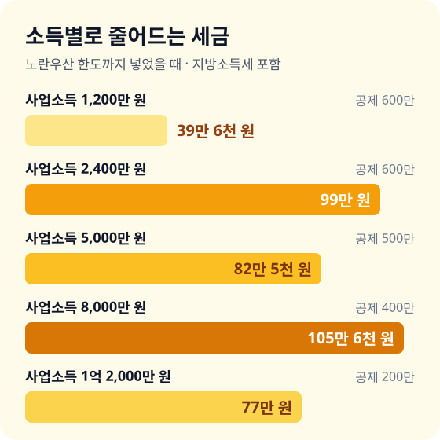
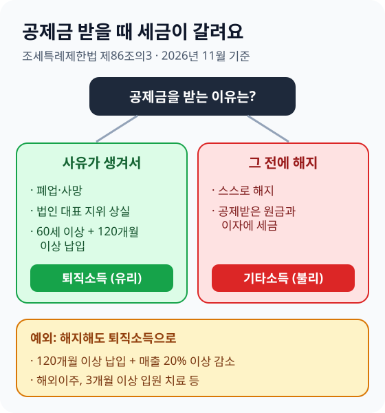

> **바쁜 분을 위한 3줄 요약**
>
> 1. 작년 종합소득세 신고서에서 **사업소득금액**부터 찾아 내 공제 한도를 확인하세요.
> 2. 올해 공제를 받으려면 **12월 31일까지 넣은 금액**으로 한도를 채우세요.
> 3. 폐업 전에 해지하면 세금을 토해 내니 **10년 이상 넣을 수 있는 금액**만 정하세요.

가게 문을 닫고 계산대 앞에 앉아 올해 장부를 넘겨 봅니다. 매출은 작년과 비슷한데, 내년 5월에 낼 종합소득세는 벌써 걱정입니다.

직장인에게 연금저축이 있다면 개인사업자에게는 노란우산공제가 있습니다. 같은 돈을 넣어도 소득에 따라 줄어드는 세금이 다르고, 넣는 시기와 해지 조건을 모르면 오히려 손해를 봅니다. 2026년 11월 기준 법 조문으로 확인한 숫자로 정리했습니다.

## 노란우산공제가 무엇인지 먼저 정리하세요

노란우산공제는 중소기업중앙회가 운영하는 소기업·소상공인 공제로, 넣는 돈을 사업소득에서 빼 주는 제도입니다. 폐업이나 노령에 대비해 목돈을 모으는 일종의 **사장님 퇴직금 통장**입니다.

근거 법은 [중소기업협동조합법 제115조](<https://www.law.go.kr/법령/중소기업협동조합법/제115조>)와 [조세특례제한법 제86조의3](<https://www.law.go.kr/법령/조세특례제한법/제86조의3>)입니다. 법이 정한 목적은 폐업·노령 같은 생계 위협에서 생활을 지키고 다시 사업할 기회를 주는 것입니다.

세 가지 특징을 기억하세요.

- **소득공제**: 넣은 돈을 사업소득금액에서 빼 주니, 세율이 높을수록 줄어드는 세금이 큽니다.
- **압류 금지**: 공제금을 받을 권리는 양도·압류하거나 담보로 잡힐 수 없습니다([같은 법 제119조](<https://www.law.go.kr/법령/중소기업협동조합법/제119조>)).
- **연 1,800만 원까지 납입**: 공제 대상이 되는 납입 규모는 연 1,800만 원 이하입니다([조세특례제한법 시행령 제80조의3](<https://www.law.go.kr/법령/조세특례제한법시행령/제80조의3>), 2026년 2월 개정).

가입 대상은 업종별 매출 기준을 넘지 않는 소기업·소상공인 개인사업자와 법인 대표입니다. 내 업종이 기준 안인지는 중소기업중앙회 노란우산 안내에서 확인하세요.

## 내 사업소득금액으로 공제 한도를 확인하세요

공제 한도는 사업소득금액 4,000만 원 이하면 600만 원, 1억 원을 넘으면 200만 원입니다. 넣은 금액과 아래 한도 가운데 **적은 쪽**만 공제됩니다.

| 사업소득금액 | 연 공제 한도 |
|---|---|
| 4,000만 원 이하 | 600만 원 |
| 4,000만 원 초과 ~ 6,000만 원 이하 | 500만 원 |
| 6,000만 원 초과 ~ 1억 원 이하 | 400만 원 |
| 1억 원 초과 | 200만 원 |

여기서 사업소득금액은 매출이 아닙니다. **매출(총수입금액)에서 필요경비를 뺀 금액**입니다. 매출 8,000만 원에 경비 5,000만 원이면 사업소득금액은 3,000만 원이고, 한도는 600만 원입니다.

부동산 임대 소득이 섞여 있다면 그 몫은 빼고 계산합니다. 임대업 소득금액에서는 공제를 받을 수 없고, 공제액도 임대 소득을 뺀 사업소득금액을 넘지 못합니다.

작년 숫자는 홈택스에서 확인할 수 있습니다. 순서는 아래와 같습니다.

1. 홈택스에 로그인하고 **세금신고 → 종합소득세 신고** 메뉴로 들어갑니다.
2. **신고서 조회·삭제** 또는 **신고내역 조회**에서 작년 신고서를 엽니다.
3. 소득금액 명세에서 **사업소득금액** 칸의 숫자를 적어 둡니다.

올해 매출이 작년과 크게 다르다면 올해 장부로 대략 다시 계산하세요. 한도는 올해 사업소득금액 기준으로 정해집니다.

## 줄어드는 세금을 소득별로 계산해 보세요

같은 노란우산공제라도 소득에 따라 줄어드는 세금은 연 39만 6천 원에서 105만 6천 원까지 달라집니다. 아래는 한도까지 넣었다고 가정하고, 본인 기본공제 150만 원만 뺀 단순한 예시입니다.

세율은 [소득세법 제55조](<https://www.law.go.kr/법령/소득세법/제55조>)의 구간(과세표준 1,400만 원 이하 6%, 5,000만 원 이하 15%, 8,800만 원 이하 24%, 1억 5,000만 원 이하 35%)을 쓰고, 지방소득세 10%를 더했습니다.

| 사업소득금액 (공제액) | 소득세 변화 | 줄어드는 세금 (지방세 포함) |
|---|---|---|
| 1,200만 원 (600만 원) | 63만 → 27만 원 | 39만 6천 원 |
| 2,400만 원 (600만 원) | 211만 5천 → 121만 5천 원 | 99만 원 |
| 5,000만 원 (500만 원) | 601만 5천 → 526만 5천 원 | 82만 5천 원 |
| 8,000만 원 (400만 원) | 1,308만 → 1,212만 원 | 105만 6천 원 |
| 1억 2,000만 원 (200만 원) | 2,603만 5천 → 2,533만 5천 원 | 77만 원 |

표에서 두 가지를 읽을 수 있습니다. 첫째, 소득이 낮으면 한도 600만 원을 다 채워도 세금이 크게 줄지 않습니다. 사업소득금액 1,200만 원이면 줄어드는 세금이 39만 6천 원뿐입니다.

둘째, 한도가 줄어도 세율이 오르면 절세액이 커질 수 있습니다. 8,000만 원 구간은 한도가 400만 원이지만 24% 세율이 적용돼 105만 6천 원이 줄어듭니다.

실제 금액은 부양가족, 다른 공제, 기납부세액에 따라 달라집니다. 정확한 금액은 5월 신고 때 홈택스 신고서에 공제액을 넣어 보면서 확인하세요.

## 직장인 부업자와 법인 대표는 조건을 따로 보세요

직장인 부업자는 **부업 사업소득금액만큼만** 공제받고, 월급(근로소득)에서는 뺄 수 없습니다. 법인 대표는 총급여 8,000만 원 이하일 때만 근로소득금액에서 공제됩니다.

예를 들어 직장인이 3.3%를 떼는 외주로 부업 사업소득금액 300만 원을 냈다면, 600만 원을 넣어도 공제는 300만 원까지입니다. 근로소득과 합친 세율 구간이 24%라면 줄어드는 세금은 약 79만 2천 원(300만 원 × 26.4%)입니다.

| 상황 | 공제받는 소득 | 공제 신청 시기 |
|---|---|---|
| 개인사업자 | 사업소득금액 | 다음 해 5월 종합소득세 신고 |
| 직장인 부업자 | 부업 사업소득금액만 | 다음 해 5월 종합소득세 신고 |
| 법인 대표(총급여 8,000만 원 이하) | 근로소득금액 | 다음 해 1~2월 연말정산 |
| 법인 대표(총급여 8,000만 원 초과) | 공제 대상 아님 | 해당 없음 |

부업 소득이 작다면 노란우산보다 연금저축·IRP가 먼저입니다. 연금계좌 세액공제는 근로소득만 있어도 받을 수 있기 때문입니다.

## 12월 31일 전에 이 순서로 넣으세요

올해 공제는 **올해 12월 31일까지 실제로 납부한 금액**만 받습니다. 가입이 12월 말이면 넣을 수 있는 달이 적어 한도를 채우기 어려우니, 11월 안에 금액을 정하세요.

1. **한도 계산**: 올해 사업소득금액을 어림해 위 표에서 한도를 찾습니다.
2. **월 납입액 정하기**: 폐업이나 은퇴 때까지 계속 낼 수 있는 금액으로 정합니다. 한도를 채우는 것보다 해지하지 않는 것이 먼저입니다.
3. **가입**: 중소기업중앙회 노란우산 누리집이나 가입 업무를 맡은 은행 창구에서 사업자등록증으로 가입합니다.
4. **연말 납입 확인**: 12월 납입분이 연내에 빠져나가는지 자동이체 날짜를 확인합니다.
5. **증명서 챙기기**: 다음 해 신고 때 공제부금 납입증명서를 냅니다. 국세청 간소화 자료로 납입 내역이 나오면 그 서류로 대신할 수 있습니다.

밀린 달이 있다면 마지막 납입일이 속한 달 말일부터 1년 6개월이 지나기 전에 그 기간 분을 내면 원래 분기에 낸 것으로 봅니다. 해당 연도 분 가운데 6개월분을 미리 내는 선납도 인정됩니다(시행령 제80조의3 제2항).

## 중간에 해지하면 공제받은 세금을 돌려줍니다

폐업·사망·60세 이상 10년 납입 같은 사유 없이 해지하면, 돌려받는 돈 가운데 **공제받은 원금과 이자에 기타소득세가 붙습니다**. 그동안 아낀 세금보다 해지 때 내는 세금이 더 클 수도 있습니다.

법은 공제금을 받는 경우를 둘로 나눕니다([조세특례제한법 제86조의3](<https://www.law.go.kr/법령/조세특례제한법/제86조의3>) 제3항·제4항).

- **퇴직소득으로 과세(유리)**: 폐업, 사망, 법인 대표 지위 상실, 60세 이상이면서 120개월 이상 납입 후 청구할 때입니다. 퇴직소득은 납입 기간을 근속연수처럼 계산해 세금이 낮아집니다.
- **기타소득으로 과세(불리)**: 위 사유 전에 스스로 해지할 때입니다. 받는 돈에서 공제받지 않은 납입 누계만 빼고 나머지에 세금을 매깁니다.

예외도 있습니다. 120개월 이상 넣은 사람이 매출이 직전 3년 평균보다 20% 이상 줄어 해지하는 경영악화는 퇴직소득처럼 과세합니다. 해외이주, 3개월 이상 입원 치료 같은 사유는 납입 기간과 상관없이, 해지 전 6개월 안에 생겼다면 같은 대우를 받습니다(시행령 제80조의3 제5항·제6항).

그래서 처음 정하는 월 납입액이 가장 중요합니다. 운영 자금이 빠듯한 달에도 낼 수 있는 금액으로 시작하고, 여유가 생기면 늘리는 편이 안전합니다.

## 연금저축·IRP와 넣는 순서를 정하세요

사업소득이 있다면 노란우산과 연금계좌를 함께 쓰되, 소득 구간에 따라 먼저 채울 곳이 달라집니다. 연금저축·IRP는 세액공제라 세율과 상관없이 13.2~16.5%를 돌려받고, 노란우산은 소득공제라 세율이 높을수록 유리합니다.

| 내 상황 | 먼저 할 일 | 이유 |
|---|---|---|
| 사업소득금액 1,400만 원 이하 | 연금저축·IRP 먼저 | 6% 구간이라 소득공제 효과가 작습니다 |
| 사업소득금액 1,400만~8,800만 원 | 노란우산 한도 + 연금계좌 | 15~24% 구간이라 둘 다 효과가 큽니다 |
| 사업소득금액 8,800만 원 초과 | 노란우산 한도 먼저 채우기 | 35% 이상 구간에서는 소득공제가 더 유리합니다 |
| 1~2년 안에 폐업·업종 전환 예정 | 작은 금액만 또는 보류 | 짧게 넣고 해지하면 혜택이 거의 없습니다 |
| 운영 자금이 들쭉날쭉함 | 최소 금액으로 시작 | 해지하지 않는 것이 절세의 전제입니다 |

연금계좌 세액공제 한도와 비율은 [연금저축펀드 세액공제 글](/posts/2026-pension-savings-fund-guide.html)에서, 남은 한도 채우는 법은 [IRP 세액공제 글](/posts/2026-irp-tax-deduction-guide.html)에서 확인하세요.

## 자주 하는 실수를 피하세요

- **매출로 한도를 계산함**: 한도는 매출이 아니라 경비를 뺀 사업소득금액으로 정합니다. 매출이 1억 원이어도 사업소득금액이 4,000만 원 이하면 한도는 600만 원입니다.
- **직장인이 월급에서 빠질 줄 앎**: 근로소득만 있는 직장인은 공제를 받을 수 없습니다. 부업 사업소득이 있어야 합니다.
- **12월 31일을 넘김**: 1월에 넣은 돈은 올해가 아니라 다음 해 공제로 들어갑니다.
- **한도 넘게 넣고 공제를 기대함**: 1,800만 원까지 넣을 수 있어도 공제는 200만~600만 원까지입니다. 초과분은 저축 효과만 있습니다.
- **급할 때 해지함**: 운영 자금이 급하면 해지보다 공제 계약을 담보로 한 대출 제도가 있는지 먼저 중소기업중앙회에 확인하세요.

## 이미 문제가 생겼다면

**작년 신고 때 공제를 빼먹었다면** 경정청구로 돌려받을 수 있습니다. 법정신고기한부터 5년 안에 홈택스에서 신청하고, 방법은 [경정청구 글](/posts/2026-year-end-tax-correction-claim-guide.html)에 정리했습니다.

**폐업했다면** 해지하지 말고 폐업 사유로 공제금을 청구하세요. 퇴직소득으로 과세돼 세금이 낮고, 받을 권리는 압류도 금지돼 있습니다.

**당장 돈이 필요하다면** 해지 전에 기타소득세를 얼마 내야 하는지 먼저 물어보세요. 해지 환급금에서 세금을 빼고 실제로 손에 쥐는 금액을 확인한 뒤 결정해도 늦지 않습니다.

## 자주 묻는 질문

**Q. 노란우산공제 소득공제 한도는 얼마인가요?**
사업소득금액 4,000만 원 이하 600만 원, 6,000만 원 이하 500만 원, 1억 원 이하 400만 원, 1억 원 초과 200만 원입니다. 넣은 금액과 한도 중 적은 금액이 공제됩니다.

**Q. 직장인도 노란우산공제로 소득공제를 받을 수 있나요?**
근로소득만 있으면 받을 수 없습니다. 3.3%를 떼는 부업처럼 사업소득이 있으면 그 사업소득금액만큼만 공제됩니다.

**Q. 12월에 가입해도 올해 공제를 받나요?**
받습니다. 다만 12월 31일까지 실제로 낸 금액만 올해 공제되므로, 늦게 가입할수록 채울 수 있는 금액이 적어집니다.

**Q. 중간에 해지하면 어떻게 되나요?**
폐업·사망·60세 이상 120개월 납입 같은 사유 없이 해지하면, 공제받은 원금과 이자에 기타소득세가 붙습니다. 그동안 아낀 세금을 상당 부분 돌려주게 됩니다.

**Q. 노란우산공제와 연금저축 중 무엇이 먼저인가요?**
사업소득금액 1,400만 원 이하라면 연금저축·IRP가 먼저이고, 세율 구간이 높을수록 노란우산 한도를 먼저 채우는 편이 유리합니다.

## 12월 31일까지 이 순서로 확인하세요

| 시기 | 할 일 |
|---|---|
| 11월 둘째 주 | 작년 사업소득금액 확인, 올해 소득 어림하기 |
| 11월 셋째 주 | 공제 한도와 해지 없이 낼 월 납입액 정하기 |
| 11월 말 | 노란우산 가입 또는 납입액 조정 |
| 12월 중순 | 연금저축·IRP 남은 한도 함께 점검 |
| 12월 31일 전 | 12월 납입분 출금 확인 |
| 다음 해 5월 | 종합소득세 신고서에 공제부금 넣기 |

노란우산공제는 넣는 해보다 해지하지 않고 버티는 10년이 혜택을 만듭니다. 오늘 작년 신고서의 사업소득금액 한 칸부터 확인해 보세요.

---

> 📅 **함께 보면 좋은 글**  
> 5월 신고 전체 흐름은 [프리랜서·부업 종합소득세 신고 가이드](/posts/2026-freelancer-side-income-tax-guide.html)에서, 연말까지 챙길 다른 절세 항목은 [연말 절세 막판 체크리스트](/posts/2026-year-end-tax-saving-checklist.html)에서 보세요. 연금계좌로 함께 줄일 세금은 [연금저축·IRP 세액공제 계산기](/apps/pension-tax-calculator/)로 바로 계산할 수 있어요.
